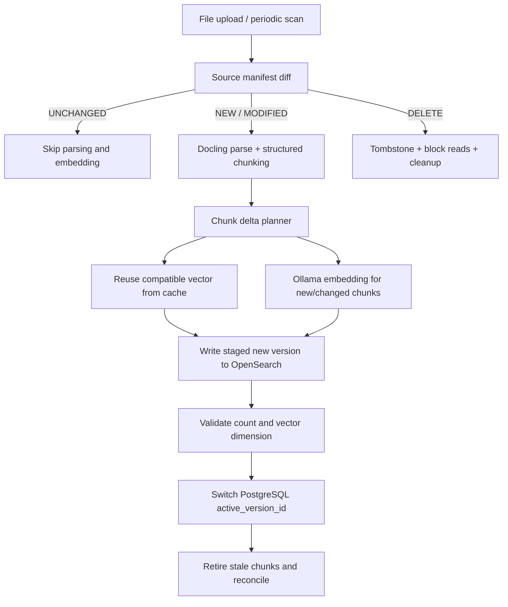

# RAG Platform — MVP Planning Reference

**Created:** 2026-11-19  
**Updated:** 2026-11-24  
**Status:** Progress-audited MVP reference; active runtime is defined by the canonical contract, not by the archived historical proposal.  
**Current contract:** [Canonical RAG runtime contract](../architecture/rag-runtime-contract.md).  
**Roadmap:** [Index/Retrieval/Enterprise implementation plan](../../../tasks/RAG_INDEX_RETRIEVAL_ENTERPRISE_IMPLEMENTATION_PLAN_2026-11-23.md).  
**Progress review source:** repository commit `fe171f5273b2dfa3db536c8bc8ffeae8f3aa582e` (static evidence review; newly listed tasks are not automatically implemented).

## Current decisions and precedence — refreshed 2026-11-23

The canonical contract owns execution profiles, API v1, model/runtime qualification, authoritative storage and authorization boundaries. **The original architecture below is historical**: it proposed OpenSearch plus Ollama, with a temporary BM25 slice. The implemented system instead uses PostgreSQL 17 + pgvector, native full-text search via GIN/tsvector/`ts_rank_cd`, and a real Haystack/FastAPI Live profile. Do not revive an in-memory Live BM25 store or OpenSearch indexes because they remain in the archive.

| Concern | Verified active direction | Not yet qualified or superseded |
| --- | --- | --- |
| Durable document store | [PostgreSQL migrations 0001/0002](../../../apps/workbench/postgres/migrations/0001_initial.up.sql), [storage adapter](../../../apps/workbench/postgres/postgres.py), source/version/Chunk, durable jobs, FORCE RLS | OpenSearch (historical), independent document store, production multi-tenant auth |
| Lexical retrieval | [Haystack lexical service](../../../apps/workbench/retrieval/lexical.py), `postgres-fts-baseline` / `postgres-fts-baseline-r1`, measured PostgreSQL `ts_rank_cd` | Real BM25 extension not deployed. [BM25 benchmark](../../../tasks/quality/TASK-RAG-BM25-001-bm25-extension-feasibility-and-quality-gate.md) decides GO/NO-GO before conditional implementation |
| Workbench UI | Explicit Preview/Live, typed API, real approved keyword graph, distinct constructor validator | Preview fixture BM25/hybrid canvas is not a real BM25/hybrid execution profile |
| Ingestion | [TXT/Markdown durable upload](../architecture/durable-text-ingestion.md), [Python AST ingestion](../../../tasks/completed/TASK-RAG-CHUNK-002-python-code-ast-ingestion.md), deterministic format registry, revisioned processing profiles | Full Office, scanned OCR, Mermaid and visual assets not complete; [PDF task](../../../tasks/TASK-RAG-CHUNK-003-pdf-layout-and-table-aware-ingestion.md) is IN PROGRESS |
| Chunking | [Chunk policy](../architecture/content-aware-chunking-strategy.md) and [operator YAML](../../../apps/workbench/document_processing.yaml) use `split_unit: token`, length 500, overlap 50 with `tiktoken:o200k_base`, plus a separately pinned native Qwen admission guard | **500 tiktoken tokens are not necessarily 500 Qwen tokens**; native guard protects max model input, not a claim of equivalent chunk units. Cross-project chunk reuse and quality cohorts remain research/optimization |
| Embedding runtime | [Qualified internal local TEI/Qwen3-Embedding-4B provider](../architecture/local-embedding-provider.md), observed full 2560 dims, pinned assets and explicit bounded query/document smoke | No qualified durable embedding ingestion, Live Dense/RRF or ANN; production sustainable TPM remains unqualified |
| Delta | Same-source unchanged upload and processing-profile fingerprints, atomic active-version swap are implemented | Per-chunk vector reuse, source rename/tombstone, production delta planner and restart/copy semantics require [DELTA-001](../../../tasks/TASK-RAG-DELTA-001-incremental-reindexing-and-embedding-vector-reuse.md) |
| TPM | Current token counters and configured input admission; one exclusive finite qualification owner shared by queries/documents; real OpenAI provider usage distinguished from native diagnostic proxy | A production **shared** 92% desired TPM scheduler / **95% hard rolling-60s reservation ceiling** is **NOT** implemented; [TPM-001](../../../tasks/TASK-RAG-TPM-001-adaptive-embedding-capacity-and-cross-project-reuse.md) remains open |
| Index generation | Existing `corpus_revision` fingerprint and active sources are served | [INDEX-001](../../../tasks/completed/TASK-RAG-INDEX-001-persisted-revision-and-consistent-search-snapshots.md) must eliminate query-time all-chunk hashing at scale |
| Original evidence | Limited guarded **local-source reveal** exists for registered local files | Universal original byte/diagram assets, multimodal representations and authorized evidence resolver are proposed [CONTENT-001..005](../../../tasks/TASK-RAG-CONTENT-001-structured-elements-representations-and-original-evidence.md) |
| Enterprise | Local exact workspace with PostgreSQL RLS and safe log correlation | Production OIDC/auth, durable async workers, ANN tenant-filter tests, backup/restore/observability and multiworkspace quotas remain separate tasks |

## MVP implementation progress checklist — reviewed 2026-11-23

**How to interpret boxes:** `[x]` = delivered in checked repository source with a completed task/evidence record; `[ ]` = not delivered or only partially qualified. This is **not** a fresh execution of all runtime tests on 2026-11-23. The links to existing task and test evidence substantiate historical completion claims. A checked storage primitive does **not** imply that real model inference or the production tenant interface is ready.

### Foundation, runtime and baseline retrieval

- [x] **ARCH — canonical contracts and superseded-stack reconciliation.** [Completed architecture task](../../../tasks/completed/TASK-ARCH-001-reconcile-rag-runtime-contract.md); [runtime contract](../architecture/rag-runtime-contract.md). PostgreSQL + pgvector authoritative; no unsupported OpenSearch Live route.
- [x] **API — FastAPI liveness/readiness/capability routes, structured errors.** [Completed API task](../../../tasks/completed/TASK-API-001-bootstrap-workbench-api.md); [application.py](../../../apps/workbench/api/application.py), [schemas.py](../../../apps/workbench/contracts/schemas.py).
- [x] **DB — PostgreSQL + pgvector, schema/migrations, active document versions and forced RLS.** [Completed DB task](../../../tasks/completed/TASK-DB-001-postgresql-pgvector-foundation.md); [migrations](../../../apps/workbench/postgres/migrations/0001_initial.up.sql); [historic SQL tests](../../../tasks/evidence/postgresql-tests-2026-11-21.xml). This is a development database, not fully authenticated multiworkspace access.
- [x] **Lexical — real PostgreSQL GIN/tsvector retrieval over persisted chunks via Haystack.** [Completed lexical task](../../../tasks/completed/TASK-RAG-001-postgres-lexical-readonly-slice.md); [lexical.py](../../../apps/workbench/retrieval/lexical.py), [postgres.py](../../../apps/workbench/postgres/postgres.py).
- [x] **UI transport — typed API discovery and explicit Preview/Live mode.** [Completed UI-001](../../../tasks/completed/TASK-UI-001-typed-api-and-execution-mode.md); [web app](../../../apps/workbench/web/src/App.tsx).
- [x] **UI execution — approved lexical graph posts real queries; no fixture fallback.** [Completed UI-002](../../../tasks/completed/TASK-UI-002-execute-live-lexical-pipeline.md); [lexical browser acceptance](RAG_Live_Lexical_Acceptance_2026-11-22.md).
- [x] **Evaluation — browser → API → Haystack → PostgreSQL lexical gate.** [Completed EVAL-001](../../../tasks/completed/TASK-EVAL-001-prove-vertical-slice.md). Evidence reports 10/10 exact-source matches and separately 0/3 paraphrase diagnostic matches; **do not present lexical-only paraphrase quality as solved**.
- [x] **Constructor validation is separate from execution.** [Completed validator](../../../tasks/completed/TASK-VAL-001-haystack-backed-pipeline-validation.md); a constructor verdict is not retrieval readiness.

### Source processing and durable ingestion

- [x] **Parser classification, TXT/Markdown and qualified Python AST.** [Completed parser](../../../tasks/completed/TASK-RAG-PARSE-001-format-detection-and-parser-registry.md), [Python task](../../../tasks/completed/TASK-RAG-CHUNK-002-python-code-ast-ingestion.md); [parser_registry.py](../../../apps/workbench/parsing/parser_registry.py).
- [x] **Chunking — deterministic text/section policies, Unicode EN/RU/UK, model input admission.** [Completed CHUNK-001](../../../tasks/completed/TASK-RAG-CHUNK-001-strategy-routing-and-profile-contract.md); [chunking.py](../../../apps/workbench/chunking/chunking.py), [model_token_counter.py](../../../apps/workbench/embedding/model_token_counter.py).
- [x] **Operator-specified split policy / 500+50 tokens.** [Completed CONFIG-001](../../../tasks/completed/TASK-CONFIG-001-document-splitting-and-default-language.md), [YAML](../../../apps/workbench/document_processing.yaml). Token unit currently means tiktoken's `o200k_base`; Qwen native admission is a separate safety counter.
- [x] **Durable bounded TXT/Markdown upload, idempotency, completed jobs and atomic source-version publication.** [Completed RAG-002](../../../tasks/completed/TASK-RAG-002-ingest-text-and-markdown.md); [ingestion.py](../../../apps/workbench/ingestion/ingestion.py), [postgres_ingestion.py](../../../apps/workbench/postgres/postgres_ingestion.py). The original bytes of all uploads are not yet a general object-storage evidence asset.
- [ ] **PDF text/layout/table end-to-end public qualification — PARTIAL.** [PDF parser models/worker](../../../apps/workbench/parsing/pdf/pdf_worker.py) and [chunk adapter](../../../apps/workbench/chunking/pdf/pdf_chunking_adapter.py) are present, but [PDF task](../../../tasks/TASK-RAG-CHUNK-003-pdf-layout-and-table-aware-ingestion.md) still identifies itself as IN PROGRESS. Do not equate installed Docling code with OCR, full PDF visual preservation or a publicly qualified handler.
- [ ] **Content-aware quality benchmarks and advanced semantic/parent expansion.** [CHUNK-004](../../../tasks/TASK-RAG-CHUNK-004-policy-benchmark-and-tiered-enrichment.md); reuse source tested code only after relevant format/quality gate.
- [ ] **Structured original assets / OCR / vision diagrams / Mermaid graph / evidence resolver.** [CONTENT-001](../../../tasks/TASK-RAG-CONTENT-001-structured-elements-representations-and-original-evidence.md), [CONTENT-002](../../../tasks/TASK-RAG-CONTENT-002-scanned-pdf-ocr-and-layout.md), [CONTENT-003](../../../tasks/TASK-RAG-CONTENT-003-visual-diagrams-charts-and-graph-extraction.md), [CONTENT-004](../../../tasks/TASK-RAG-CONTENT-004-mermaid-typed-graph-ingestion.md), [CONTENT-005](../../../tasks/TASK-RAG-CONTENT-005-original-evidence-resolution-and-grounding.md).

### Embedding, ranking, source delta and production indexing

- [x] **Real model qualification — bounded local scope.** [EMBED-001](../../../tasks/completed/TASK-RAG-EMBED-001-qualify-local-qwen-embedding-provider.md) and its [final evidence](../../../tasks/evidence/embedding-2026-11-23/report.md) prove pinned assets, container/endpoint attestation, 30-text query/document smoke, actual 2560 normalized finite output and distinct provider/proxy usage. Production capacity and durable vector ingestion remain separate.
- [ ] **TPM/RPM capacity admission at desired 0.92 and hard 0.95 — not yet.** [TPM-001](../../../tasks/TASK-RAG-TPM-001-adaptive-embedding-capacity-and-cross-project-reuse.md) must reuse the audited dispatch policy **by contract** and add independent hard rolling-60s ceiling, explicit quota ownership and real saturation measurements.
- [ ] **Durable semantic embedding jobs, backfill and coverage — not yet.** [EMBED-002](../../../tasks/completed/TASK-RAG-EMBED-002-durable-embedding-ingestion-and-backfill.md); same PostgreSQL owner and source/version identity.
- [ ] **Exact Live Dense Retrieval and real embedding query path — not yet.** [DENSE-001](../../../tasks/completed/TASK-RAG-DENSE-001-live-dense-retrieval-and-exact-cosine-baseline.md).
- [ ] **Production ANN/HNSW on compatible 2560-dimension representation — not yet.** [ANN-001](../../../tasks/TASK-RAG-ANN-001-hnsw-halfvec-index-and-tenant-recall-gates.md); current vector column and exact query are not ANN.
- [ ] **Hybrid Lexical + Dense + explicit RRF — not yet.** [HYBRID-001](../../../tasks/quality/TASK-RAG-HYBRID-001-dense-lexical-rrf-fusion-and-profile-execution.md).
- [ ] **Genuine BM25 benchmark/conditional deployment — not yet.** [BM25-001](../../../tasks/quality/TASK-RAG-BM25-001-bm25-extension-feasibility-and-quality-gate.md) is a GO/NO-GO experiment; [BM25-002](../../../tasks/quality/TASK-RAG-BM25-002-conditional-postgresql-bm25-search-profile.md) must stay blocked until benchmark/license acceptance.
- [ ] **Chunk-level Delta Detector and compatible embedding reuse — not yet.** Whole-upload `unchanged` detection is implemented, but [DELTA-001](../../../tasks/TASK-RAG-DELTA-001-incremental-reindexing-and-embedding-vector-reuse.md) must prove per-occurrence source/version/provenance matching and actual saved model calls.
- [ ] **Persisted corpus/index generation — not yet.** [INDEX-001](../../../tasks/completed/TASK-RAG-INDEX-001-persisted-revision-and-consistent-search-snapshots.md) must move digest computation from query-time `_corpus_snapshot` to transactional publication.
- [ ] **Versioned multiple approved profiles — not yet.** [PROFILE-001](../../../tasks/completed/TASK-RAG-PROFILE-001-versioned-retrieval-and-processing-profile-registry.md).

### Enterprise hardening and product completion

- [ ] **Authenticated multiworkspace/roles/quotas**: [SCALE-001](../../../tasks/TASK-RAG-SCALE-001-multiworkspace-identity-authorization-and-tenanted-retrieval.md); existing RLS + development scope are not production auth.
- [ ] **Durable async bulk workers, connector queue, per-tenant backpressure**: [SCALE-002](../../../tasks/TASK-RAG-SCALE-002-durable-asynchronous-ingestion-and-tenant-backpressure.md).
- [ ] **Trace/eval/cost/TPM windows, alert and crash-grade recovery**: [OPS-001](../../../tasks/TASK-RAG-OPS-001-tracing-evaluation-and-search-quality-gates.md), [OPS-002](../../../tasks/TASK-RAG-OPS-002-index-promotion-backup-and-disaster-recovery.md).
- [ ] **Live original PDF/image/Mermaid source viewer**: [EVIDENCE-001](../../../tasks/TASK-RAG-EVIDENCE-001-live-original-evidence-and-diagram-viewer.md).
- [ ] **Optional Microsoft MarkItDown vs Docling/native converter decision**: [CONVERT-001](../../../tasks/TASK-RAG-CONVERT-001-microsoft-markitdown-evaluation-and-safe-conversion-adapter.md). Markdown is a derived representation, not storage replacement.
- [ ] **Grounded answer generation and end-user answer completeness**: not proven by this retrieval-only MVP. Create a separate A–O generator/answer-quality task when retrieval/evidence acceptance is stable.

**Overall milestone:** source parsing, durable lexical indexing, local Preview/Live UI and basic quality checks are implemented. The enterprise-grade semantic/multimodal/TPM/delta/index-generation path is still under specification. We must not collapse these into a single "RAG complete" percentage.

## Cross-project reuse: exact donor code and adaptation decisions

**Donor reference pinned:** [Enterprise AI Development Pipeline at `955fd049949d3fc462d555be14774e4b255aa15c`](https://github.com/VibeInAMajor/enterprise-ai-development-pipeline/tree/955fd049949d3fc462d555be14774e4b255aa15c). The code is **not already integrated** in the Workbench.

| Capability | Exact inspected donor implementation (pinned commit) | Required recipient change |
| --- | --- | --- |
| TPM admission | [EmbeddingDispatchController](https://github.com/VibeInAMajor/enterprise-ai-development-pipeline/blob/955fd049949d3fc462d555be14774e4b255aa15c/src/enterprise_ai_pipeline/rag/embedding_dispatch.py) `reserve`, `finish`, `_wait_needed`, `_pacing_rates`; [capacity policy](https://github.com/VibeInAMajor/enterprise-ai-development-pipeline/blob/955fd049949d3fc462d555be14774e4b255aa15c/src/enterprise_ai_pipeline/rag/embedding_capacity.py) and [window tracker](https://github.com/VibeInAMajor/enterprise-ai-development-pipeline/blob/955fd049949d3fc462d555be14774e4b255aa15c/src/enterprise_ai_pipeline/rag/embedding_capacity_windows.py) | [TPM-001](../../../tasks/TASK-RAG-TPM-001-adaptive-embedding-capacity-and-cross-project-reuse.md) with independently configured **0.92 desired** and **0.95 hard**; donor default target is **0.85**, and its rolling hard guard uses full safe `tpm`, NOT 0.95 ceiling |
| Transport + bounded batching | [Local TEI provider](https://github.com/VibeInAMajor/enterprise-ai-development-pipeline/blob/955fd049949d3fc462d555be14774e4b255aa15c/src/enterprise_ai_pipeline/providers/tei_embeddings.py), [embedding_execution.py](https://github.com/VibeInAMajor/enterprise-ai-development-pipeline/blob/955fd049949d3fc462d555be14774e4b255aa15c/src/enterprise_ai_pipeline/rag/embedding_execution.py) and [port contract](https://github.com/VibeInAMajor/enterprise-ai-development-pipeline/blob/955fd049949d3fc462d555be14774e4b255aa15c/src/enterprise_ai_pipeline/rag/embeddings.py) | [EMBED-001](../../../tasks/completed/TASK-RAG-EMBED-001-qualify-local-qwen-embedding-provider.md)/[EMBED-002](../../../tasks/completed/TASK-RAG-EMBED-002-durable-embedding-ingestion-and-backfill.md); adapt to current TEI model/profile and async Hatch/FastAPI, no copy of donor Qdrant/SQLite runtime |
| Delta detector | [`plan_chunk_delta`](https://github.com/VibeInAMajor/enterprise-ai-development-pipeline/blob/955fd049949d3fc462d555be14774e4b255aa15c/src/enterprise_ai_pipeline/rag/chunk_delta.py), [`DocumentDeltaLookup`](https://github.com/VibeInAMajor/enterprise-ai-development-pipeline/blob/955fd049949d3fc462d555be14774e4b255aa15c/src/rag_reference/cache/document_delta_lookup.py), [`physical_delta`](https://github.com/VibeInAMajor/enterprise-ai-development-pipeline/blob/955fd049949d3fc462d555be14774e4b255aa15c/src/rag_reference/indexing/physical_delta.py) | [DELTA-001](../../../tasks/TASK-RAG-DELTA-001-incremental-reindexing-and-embedding-vector-reuse.md): reuse multiset occurrence matching, source-version/profile and verified vector availability; translate Qdrant identity to workspace+PostgreSQL records |
| Chunking | [`StructuralChunker`](https://github.com/VibeInAMajor/enterprise-ai-development-pipeline/blob/955fd049949d3fc462d555be14774e4b255aa15c/src/enterprise_ai_pipeline/rag/chunking.py), [`json_structural_chunking`](https://github.com/VibeInAMajor/enterprise-ai-development-pipeline/blob/955fd049949d3fc462d555be14774e4b255aa15c/src/enterprise_ai_pipeline/rag/json_structural_chunking.py) | Existing [CHUNK-001](../../../tasks/completed/TASK-RAG-CHUNK-001-strategy-routing-and-profile-contract.md) already implements typed policy and Haystack splitter; [CHUNK-004](../../../tasks/TASK-RAG-CHUNK-004-policy-benchmark-and-tiered-enrichment.md) must **compare and selectively adapt structural boundary / parent-child / JSON rules**, not replace current chunker |
| Audit/test patterns | [TPM smoothing audit](https://github.com/VibeInAMajor/enterprise-ai-development-pipeline/blob/955fd049949d3fc462d555be14774e4b255aa15c/tasks/TASK-M39-030-embedding-TPM-smoothing-audit.md), [delta tests](https://github.com/VibeInAMajor/enterprise-ai-development-pipeline/blob/955fd049949d3fc462d555be14774e4b255aa15c/tests/pipeline/test_rag_chunk_delta_runtime.py), [TEI tests](https://github.com/VibeInAMajor/enterprise-ai-development-pipeline/blob/955fd049949d3fc462d555be14774e4b255aa15c/tests/pipeline/test_tei_embedding_provider.py) | Port **scenarios and measurable gates**, not external tests that depend on donor-only runtime. Treat observed donor performance as donor-local, not a benchmark of current Workbench. |

**Important TPM qualification details:** the donor's `EmbeddingCapacityPolicy.target_utilization_ratio` defaults to **0.85**, while `TEIProfile.target_utilization_ratio` defaults to **0.9**. Neither is our required `0.92` desired with separate `0.95` hard ceiling. Its local TEI provider reports `usage_tokens` based on **its own tokenizer count** when provider does not report billed/completed tokens; distinguish `provider_reported` from `tokenizer_counted_proxy` and never label the latter a native measured usage value. For local TEI, `Q_TPM` is an **operator-benchmarked sustainable rate**, not an external cloud quota. The 90–95% (or specifically 92%) throughput goal is a **conditional, saturated-backlog** performance target subject to RPM, batch size, latency, GPU/VRAM and disk limits. An impossible target reports `CAPACITY_NOT_FEASIBLE`, not fake PASS.

**License boundary:** [donor LICENSE.md](https://github.com/VibeInAMajor/enterprise-ai-development-pipeline/blob/955fd049949d3fc462d555be14774e4b255aa15c/LICENSE.md) is PolyForm Strict 1.0.0 / Authorized Evaluation and explicitly **not an open-source blanket reuse grant**. Obtain/record the owner's written permission for cross-product code copying or independently implement interoperable ideas with original code and test cases. The repositories sharing an account does not automatically resolve third-party rights. Do not copy Qdrant/SQLite, vendor SDK or licensed donor files blindly.

## Updated delivery sequence and shared evidence gates

1. **First:** [INDEX-001](../../../tasks/completed/TASK-RAG-INDEX-001-persisted-revision-and-consistent-search-snapshots.md), [PROFILE-001](../../../tasks/completed/TASK-RAG-PROFILE-001-versioned-retrieval-and-processing-profile-registry.md) and [TPM-001](../../../tasks/TASK-RAG-TPM-001-adaptive-embedding-capacity-and-cross-project-reuse.md) contracts can develop in parallel; all must preserve current lexical/source publication.
2. **Second:** [EMBED-001](../../../tasks/completed/TASK-RAG-EMBED-001-qualify-local-qwen-embedding-provider.md) must prove current TEI profile, tokenizer, dimension and usage provenance; [EMBED-002](../../../tasks/completed/TASK-RAG-EMBED-002-durable-embedding-ingestion-and-backfill.md) integrates one **shared** quota governor for query/document/worker inference and durable jobs. Record actual model/Q_TPM compatibility.
3. **Third (quality-first, 2026-11-24):** [DENSE-001](../../../tasks/completed/TASK-RAG-DENSE-001-live-dense-retrieval-and-exact-cosine-baseline.md) is complete locally. Follow [quality implementation order](../../../tasks/quality/IMPLEMENTATION_ORDER.md): reviewed independent dataset, current-stack baseline and optimization, [HYBRID-001](../../../tasks/quality/TASK-RAG-HYBRID-001-dense-lexical-rrf-fusion-and-profile-execution.md), conditional BM25/reranking, context selection, answerability and independent retrieval GO. ANN and large-file ingestion are deferred until retrieval quality is proven.
4. **In parallel:** [DELTA-001](../../../tasks/TASK-RAG-DELTA-001-incremental-reindexing-and-embedding-vector-reuse.md) consumes the donor multiset reuse algorithm only after compatible source/vector profiles exist; [CHUNK-004](../../../tasks/TASK-RAG-CHUNK-004-policy-benchmark-and-tiered-enrichment.md) compares donor structural chunking to current Haystack policy.
5. **Enterprise:** [SCALE-001](../../../tasks/TASK-RAG-SCALE-001-multiworkspace-identity-authorization-and-tenanted-retrieval.md), [SCALE-002](../../../tasks/TASK-RAG-SCALE-002-durable-asynchronous-ingestion-and-tenant-backpressure.md), [OPS-001](../../../tasks/TASK-RAG-OPS-001-tracing-evaluation-and-search-quality-gates.md), [OPS-002](../../../tasks/TASK-RAG-OPS-002-index-promotion-backup-and-disaster-recovery.md) and original asset/evidence tasks each have independent measurable gates.
6. Every task remains `PROPOSED` until code, tests, user-visible functionality and evidence are actually delivered. Record source snapshots, gate results and upgrade/rollback details in the task, not only in this roadmap.

---

## Historical architecture and audit record — superseded

The original 2026-11-19 version 1.1 is retained below for its parsing research, delta/TPM audit scenarios and source references. **Every architecture selection, present-tense requirement, sample configuration, API path, milestone and performance figure inside this archive is historical, not an active implementation instruction.** OpenSearch indexes/aliases, Ollama embedding transport and cross-database publication procedures must not be copied into new work merely because they appear here. Follow the current canonical contract for any subsequent implementation.

<details>
<summary>Archived version 1.1 — superseded OpenSearch / Ollama proposal and audit</summary>

# Archived: RAG Platform — MVP Architecture and Implementation Plan

*RAG / Product Engineering*

Documents → extraction → index → retrieval → ranking → workspace

> **Focus of the first release**
>
> Correctly process new and changed documents; provide fast hybrid search and reranking; enforce strict workspace isolation. We are not building a platform for millions of documents yet, nor are we complicating the system with agents or GraphRAG.

| **DECISION** | **CONFIGURATION** |
|---|---|
| RAG framework | Haystack 3.5.0 (pin the version in dependencies) |
| Document parsing | Docling through the Haystack integration; fallback converters based on file type |
| Search index | OpenSearch: BM25 + vector search, with a separate index per workspace |
| Embedding model | Qwen3-Embedding-4B, running locally through Ollama |
| GPU | NVIDIA GeForce RTX 4090, 24 GB VRAM |
| Utilization target | 90–95% of the configured allowable TPM quota when the work queue is sufficiently populated |
| Metadata and API | PostgreSQL + FastAPI; no mandatory distributed queue for the MVP |

**Document version: 1.1 (extended with the audit and reuse plan for Delta/TPM)**

Date: November 19, 2026 | Status: agreed priorities + audit of existing components + design decisions pending validation

# Executive Summary and Document Structure

This document consolidates all decisions made during the discussions and converts them into a verifiable technical specification. It is intended to support the incremental delivery of an MVP, not to design a heavyweight enterprise platform prematurely. **Version 1.1 adds the findings from reviewing the `codex/qdrant-langfuse-local-stack` branch of `VibeInAMajor/enterprise-ai-development-pipeline`: how to reuse the existing source/chunk delta algorithms and TPM controller, how to adapt them to Ollama/OpenSearch, and which limitations have been verified.**

> **MVP outcome**
>
> The API accepts documents, accurately extracts their text and structure, stores chunks and embeddings in OpenSearch, processes only changes, retrieves relevant passages, and returns them in the correct order. No workspace can see another workspace's data or results. Under sustained load, the embedding scheduler keeps actual TPM in the target range while respecting hardware limitations.

## What Is Agreed and What Still Needs Measurement

| **Status** | **Statement** |
|---|---|
| CONFIRMED | Qwen3-Embedding-4B + Ollama + RTX 4090 24 GB; embeddings are generated locally without the cloud OpenAI API. |
| CONFIRMED | MVP priorities: parsing, indexing new/changed files, retrieval, ranking, multi-workspace support, and speed. |
| DESIGN DECISION | Haystack + Docling + OpenSearch + FastAPI + PostgreSQL. Use one search index per workspace. |
| MEASUREMENT REQUIRED | Sustainable completed TPM on the RTX 4090 with the selected GGUF/quantization; batch/concurrency settings; p95 latency. |
| CORPUS VALIDATION REQUIRED | Docling quality on real PDFs/tables and the improvement provided by hybrid retrieval and a reranker. |
| VERIFIED IN SOURCE CODE | The related project has source/chunk delta planners, document versions, and a process-local TPM admission controller. Reuse selectively; TEI/Qdrant integrations are **not** considered ready-made Ollama/OpenSearch integrations. |

## Section Guide

01 Priorities and scope · 02 Architecture · 03 Parsing · 04 Chunking · 05 Qwen/Ollama · 06 TPM · 07 OpenSearch · 08 Delta indexing · 09 Retrieval/reranking · 10 Multi-workspace · 11 Diagnostics · 12 Benchmark · 13 API/data · 14 Implementation stages · 15 Risks · **16 Delta/TPM reuse** · 17 After MVP · 18 Definition of Done · 19 Sources and open parameters.

# 01. MVP Goals, Priorities, and Scope

The primary goal is a reliable cycle: **new document → processing → index → accurate retrieval**. Scaling to millions of files, GraphRAG, live connectors to corporate systems, and complex agent pipelines are unnecessary in the first iteration.

## Required Outcomes

- Accept PDF, DOCX, TXT, and Markdown; after the initial cycle, add PPTX/HTML/XLSX based on the test corpus.
- Extract text without silently losing sections; preserve tables, headings, page references, and source links wherever possible.
- Split content into manageable chunks with reproducible identifiers and provenance.
- Generate embeddings locally with Qwen3-Embedding-4B; write text and vectors to an existing index.
- Retrieve both exact terms and semantic paraphrases; measure BM25, dense, hybrid, and reranked results.
- Reindex only new and changed files; do not invoke embeddings for unchanged content.
- Create at least three workspaces and demonstrate that data cannot cross workspace boundaries in the API, search, or CRUD operations.
- Expose timings for parsing, embedding, indexing, and search, together with understandable error causes.

## Outside the Scope of the First MVP

Full LLM answer generation, millions of documents, arbitrary external data sources, complex role hierarchies, federated search, GraphRAG, multi-region HA, and commercial billing infrastructure. The architecture should leave room for these capabilities, but implementation is deferred.

# 02. Selected Components and Responsibility Boundaries

| **Component** | **Purpose** | **Responsibility boundary** |
|---|---|---|
| FastAPI | HTTP API for workspaces, upload, status, search, deletion | Authentication, authorization, request validation, orchestration |
| PostgreSQL | Registry for files, versions, chunks, workspaces, and jobs | Source of truth for versions, permissions, deltas, and status |
| Haystack | Assembly of parsing, indexing, and retrieval pipelines | Not a change-monitoring system or tenant authorization service |
| Docling | Extraction of PDF/Office document structure | May require OCR and special handling of unusual files |
| Ollama | Local embedding inference | Does not impose a cloud TPM quota; throughput is hardware-bound |
| Qwen3-Embedding-4B | Vectors for documents and queries | Same model/profile for documents and queries; full vector size is 2560 by default |
| OpenSearch | BM25 text index + vector fields | Storage and retrieval, not the authority for a document's business version |
| Search/Rerank | Hybrid retrieval + RRF + reranker | Ranking quality is evaluated separately from extraction quality |

## Logical Architecture

```text
[Client / CLI]
      |
      | upload / search / workspace
      v
[FastAPI: authentication + workspace resolver]
      |                                   |
      | upload/update                     | search(query)
      v                                   v
[PostgreSQL registry]          [Search policy + index router]
      |                                   |
      v                                   v
[Docling / Haystack]           [OpenSearch BM25 + dense]
      |                                   |
[Chunks + metadata]            [RRF -> reranker -> top chunks]
      |
[Token scheduler -> Ollama -> Qwen3-Embedding-4B]
      |
[OpenSearch index for the workspace]
```

PostgreSQL holds metadata and active versions; OpenSearch stores searchable chunks. Consistency between the databases must be checked using `document_id` and `version_id`.

## Two Independent Pipelines

| **Indexing pipeline** | **Query pipeline** |
|---|---|
| File → detect change → parse → validate structure → chunk → embed with Qwen → write to OpenSearch → register version | Query → resolve workspace → embed query with Qwen → BM25 + dense → RRF → rerank → validate active version/ACL → return chunks |
| Run background jobs; retry only failed work; use the same logical workspace index for writes and reads. | Interactive queries receive higher priority in the embedding scheduler than background indexing. |

# 03. Parsing: Accurate Document Extraction

## Supported Document Classes

| **Document class** | **MVP processing** | **Validation** |
|---|---|---|
| Text-based PDF | Docling as primary; PyPDF/PDFMiner fallback on explicit failure | Pages, columns, paragraph order, tables, links |
| Scanned PDF | OCR when no text layer is detected; separate status | Explicitly report OCR confidence and pages without extracted text |
| DOCX | Docling or native converter | Headings, lists, tables, references/descriptions for images |
| TXT / MD | Direct converter + structure-aware splitter | UTF-8 encoding, line breaks, Markdown headings |
| HTML / PPTX / XLSX | Basic support after the initial test batch | Tables, slide/sheet order, visible links |

## Processing Steps for One File

> **1.** Validate the workspace, file type, size, extension/MIME; store the original file and `source_id`.
>
> **2.** Calculate the raw file's SHA-256 checksum; consult the registry and classify the file as new/unchanged/changed.
>
> **3.** Select a parser based on MIME/content. Use Docling for complex PDFs; fall back only for a documented reason.
>
> **4.** Produce normalized text and structural blocks (heading, paragraph, table, list, page) while preserving provenance.
>
> **5.** Run extraction checks: empty pages, unusually little text, corrupt characters, missing tables.
>
> **6.** Save a parse report with parser/configuration versions; never index an empty result as a successful parse.
>
> **7.** Send structural elements to the chunker and then the embedding scheduler.

## Two Docling Modes

`MARKDOWN` mode is useful for producing a reproducible text artifact for inspection. `DOC_CHUNKS` can export structured passages directly via `HybridChunker`. For the first PoC, compare both modes on the same documents, then select one consistent path. Do not combine Docling `DOC_CHUNKS` with uncontrolled secondary splitting in Haystack: that may destroy structural relationships. [S2]

> **Required parsing diagnostics**
>
> `parse_status`, `parser_name`, `parser_version`, `file_pages`, `extracted_pages`, `input_bytes`, `extracted_chars`, `tables_detected`, `tables_exported`, `empty_page_count`, `parse_ms`, `warnings[]`, `fallback_reason`. If the file has no extractable text, the job must be `OCR_REQUIRED` or `PARSE_FAILED`, not `INDEXED`.

# 04. Chunking, Provenance, and Metadata

## Initial Parameters to Benchmark

| **Parameter** | **Initial hypothesis** | **Why this is not a universal default** |
|---|---|---|
| Chunk size | ≈500 tokens | Optimal size can vary across document types and languages |
| Overlap | ≈50 tokens | Duplication reduces throughput and produces near-identical candidates |
| Tables | Avoid splitting without a reason; include header context | Tabular data readily loses meaning when split linearly |
| Structure | Section headings in metadata and, when needed, inside the chunk | Improves retrieval and makes results explainable |
| Tokenizer | Qwen-compatible tokenizer for token estimates | Token counts differ from character and word counts |
| Re-embedding | Only when the content/chunk profile changes | Changing parser/chunker/model requires a new processing version |

## Minimum Fields in a Search Document

```text
chunk_id source_id workspace_id
source_version_id chunk_order content_hash
content embedding[2560] embedding_model_id
document_title page_start/page_end section_path
parser_version chunker_version indexed_at
visibility / acl_label source_uri index_schema_version
```

Make `chunk_id`, the primary key of a **logical occurrence**, deterministic: `hash(workspace_id, source_id, source_version_id, chunk_order, chunk_hash)`. Re-running the same job will then not duplicate chunks. **This ID is not the embedding reuse key.** Create a separate `embedding_cache_key = hash(workspace_id, model_profile_digest, representation_profile_digest, exact_embedding_input)` for caching/reuse. A vector may remain compatible when a page number or position changes, even though `chunk_id` is different. Recalculate the vector when the actual embedding input changes. Store source files separately (a local directory or object storage); do not put large binary attachments into OpenSearch. Section 16 describes the reuse mechanism in detail.

> **Configuration changes also count as deltas**
>
> A change to `modified_at` alone, with identical content, does not trigger embeddings. However, changes to `parser_version`, `chunker_version`, extraction configuration, or `embedding_model_digest` may require reprocessing even if the raw file's SHA-256 is unchanged.

# 05. Embeddings: Qwen3-Embedding-4B, Ollama, RTX 4090

## Agreed Model and Format

| **Item** | **Decision** |
|---|---|
| Model | `qwen3-embedding:4b` in Ollama; pin the actual digest at startup [S4, S5] |
| Hardware | NVIDIA RTX 4090, 24 GB VRAM |
| Inference | Ollama HTTP API, `POST /api/embed` [S3] |
| Embedding dimensions | 2560 for the full Qwen3-Embedding-4B vector; do not change without migrating the index mapping [S4] |
| Query embedding | Same model/digest as was used to index the documents |
| API inputs | A string or a list of strings; the ingestion/scheduler layer builds batches |
| Input length | `truncate=false`: exceeding the limit must produce an error, not silently truncate the chunk [S3] |
| GPU residency | Tune `keep_alive`; monitor VRAM and model loading time |
| Guaranteed TPM | **UNKNOWN**: must be measured for this GPU, Ollama release, and selected quantization |

## Integration with Haystack

Haystack has `OllamaDocumentEmbedder` and `OllamaTextEmbedder` components in the `ollama-haystack` package, which connect to a local Ollama instance. For TPM enforcement, use a thin custom Haystack component/adapter. It receives documents, reserves tokens through the **reused `EmbeddingDispatchController`**, makes batched calls to `/api/embed`, validates vector dimensions, and returns `Document` objects carrying embeddings. Reuse the controller from the reviewed project, but implement the Ollama transport separately. [S6]

Qwen3-Embedding-4B supports task-oriented instructions. Pin a query instruction template, for example: `Instruct: Retrieve relevant passages from the indexed documents that answer the query.\nQuery: <question>`. A separate instruction for document text is generally unnecessary. A/B-test the query formulation on our RU/UA/EN corpus. [S4]

> **Do not confuse an Ollama limit with a provider quota**
>
> A local model has no external TPM quota. For our MVP, the “allowable quota” is **our own configurable limit**, selected after stress-testing sustainable throughput on the RTX 4090. Recalculate it if the quantization or Ollama version changes.

# 06. TPM 90–95%: Measurement and Adaptive Scheduling

## Terminology and Exact Target

`Q_TPM` is the maximum permitted number of input embedding tokens in a rolling 60-second window. Set it after benchmarking; it must not exceed the inference server's sustainable throughput at acceptable latency. The target rate is `0.90–0.95 × Q_TPM`, with an operating setpoint of `0.92 × Q_TPM`.

```text
TPM_completed = (sum(prompt_eval_count in window) * 60) / window_seconds

TPM_target = 0.92 * Q_TPM

TPM_hard_cap = 0.95 * Q_TPM

Example ONLY: if Q_TPM = 60,000 => target = 55,200 TPM,
allowed band = 54,000 ... 57,000 TPM.
```

60,000 TPM is a mathematical example, **not** an estimate of Qwen3-Embedding-4B throughput on the RTX 4090.

Do not develop a controller from scratch. Use `EmbeddingDispatchController`, `EmbeddingCapacityPolicy`, and `EmbeddingCapacityWindows` from the reviewed branch. Its scope is **process-local**: the MVP will have one shared admission owner for all workspaces that use the same Ollama endpoint. Direct calls to Ollama that bypass the controller are forbidden. The local Qwen adapter must not supply fictitious cloud rate-limit headers; use measured `Q_TPM` as a `local-benchmark-limit`. See Section 16. [S17–S20]

## Scheduler Algorithm

> **1.** Before a request, estimate tokens using a Qwen-compatible tokenizer and account for already reserved tokens in the rolling window.
>
> **2.** Pack short chunks into micro-batches within configured `max_batch_tokens` and `max_batch_items`; handle large chunks separately.
>
> **3.** Maintain two queues: `interactive_query` (high priority, reserved capacity) and `background_ingest` (background work).
>
> **4.** Enforce both a token budget and an in-flight batch limit. Concurrency is not TPM, and excessive parallelism increases p95.
>
> **5.** After receiving the Ollama response, reconcile estimates with actual `prompt_eval_count`; record `total_duration` and `load_duration`.
>
> **6.** Reduce concurrency/batch size on OOM, timeout, increasing p95, or throttling; cautiously increase them when headroom and sustained backlog are available.
>
> **7.** If backlog is insufficient, report actual TPM below target; never generate artificial traffic merely to hit 90%.
>
> **8.** Handle failed/cancelled requests with correct reservation-release rules; all retries pass through the same limiter.

## Measuring Quota for the Specific GPU

| **Benchmark stage** | **Workload** | **Output** |
|---|---|---|
| 1. Warm-up | One embedding, followed by repeated calls with `keep_alive` | Model load time, cold/warm latency, actual model/VRAM |
| 2. Input lengths | Passages of approximately 128/256/512/1024 tokens | TPM and latency versus length |
| 3. Batches | 1/4/8/16 items with a fixed token budget | Best `batch_items`/`batch_tokens` combination |
| 4. Concurrency | 1/2/4 in-flight requests (expand only if stable) | Sustainable completed TPM, p50/p95, OOM/error rate |
| 5. Mixed workload | Search queries plus deltas from 20–50 files | Query p95 and stability during background ingestion |
| 6. Sustained run | Continuous submission with persistent backlog | `Q_TPM` = safe reproducible capacity; 90–95% target band |

> **TPM acceptance condition**
>
> With a saturated queue in steady state, completed TPM is 90–95% of `Q_TPM`, the hard cap is not exceeded, OOM errors do not occur, and interactive search does not degrade. If GPU load makes the band unattainable without latency/error growth, lower `Q_TPM` and rerun the benchmark. The limiter must not conceal instability.

# 07. OpenSearch: Index Connection and Usage

## Core Principle

`OpenSearchDocumentStore` is Haystack's adapter to an existing OpenSearch index. It writes Haystack `Document` instances through `DocumentWriter` and retrieves chunks through retrievers. Text/BM25 and dense-vector fields coexist in OpenSearch. Connecting to the backend does not magically define a suitable index: **we explicitly control the schema and mapping**. [S7]

## Structure for One Workspace

```text
workspace_id = <opaque-uuid>

physical_index = rag_ws_<id>_v1

read_alias = rag_ws_<id>_read

write_alias = rag_ws_<id>_write (one target)

Mapping (conceptual):

content: text => BM25 / lexical search

embedding: knn_vector => dimension 2560, cosine-compatible

meta.workspace_id: keyword => tenant/workspace sanity check

meta.source_id: keyword => delta / delete selection

meta.version_id: keyword => version validation

meta.page_start: integer => source citation
```

The names/settings of the k-NN engine, `space_type`, and distance metric depend on the OpenSearch release and selected ANN engine. Do **not** assume cosine similarity is configured automatically by Haystack: verify the actual k-NN field/engine mapping. [S7]

## When to Create a New Index and When to Update an Existing One

| **Event** | **Action** | **Required verification** |
|---|---|---|
| Workspace creation | Create index + mapping + alias; register them in PostgreSQL | Dimension=2560; index belongs to exactly one workspace |
| New file | Add chunks to the existing index | Counts, fields, consistent source identity, searchable after refresh |
| File modification | Replace the chunk set for the relevant `source_id` | New chunks are available; stale chunks do not appear in results |
| File deletion | Delete associated chunk IDs and record a tombstone | Deleted chunks are absent from results after completion |
| Change to `embedding_dim`/schema | Create index v2, reindex, then switch the alias | Never mix different vector dimensions in one index |

## Important OpenSearch Details

- Writing with the same ID using `DuplicatePolicy.OVERWRITE` updates one chunk, but does not delete chunks that disappeared from an earlier document version.
- Use `refresh=wait_for` for operations that require confirmed visibility of changes. Bulk batches can temporarily use `refresh=false` with an explicit final synchronization step.
- Aliases switch an entire physical index when the schema/model changes; they are **not** a transactional mechanism for replacing one file.
- On startup, check that the index and mapping exist and that embedding dimensions, model digest, and permissions match. Never silently create an index with the wrong schema.
- A separate index per workspace simplifies MVP isolation. The overhead of shards becomes a concern if workspace counts grow substantially; solve that in the next phase.

# 08. Delta Indexing: New, Modified, and Deleted Files

## What Haystack Provides and What We Build

`DocumentWriter` supports `DuplicatePolicy.SKIP / OVERWRITE / FAIL`, while `DocumentStore` supports deletion by ID. However, open-source Haystack does not automatically monitor folders, S3, SharePoint, or other sources and does not determine which file versions have changed. **Instead of building a Delta Detector from scratch**, adapt the reviewed project's `diff_source_manifests()` and `plan_chunk_delta()` functions, adding a Docling/Haystack adapter and PostgreSQL registry. A new or changed file can be fully reparsed when necessary, but embeddings are generated only for genuinely new/changed chunks. Unchanged chunks reuse compatible vectors after verifying workspace ownership and embedding profile compatibility. [S9, S14–S16]

## Delta Classification Rules

| **Event** | **Condition** | **Outcome** |
|---|---|---|
| NEW | `source_id` does not exist | PARSE → CHUNK → EMBED → INDEX → ACTIVE |
| UNCHANGED | `source_id` exists; raw SHA-256 and processing profile match | SKIP: zero new embeddings and index writes |
| CHANGED | SHA-256 or parsing/chunking profile changed | Process only that file; create a new `source_version_id` |
| METADATA / ACL | Same text, changed title/permissions | Update metadata/permissions without recomputing embeddings |
| DELETED | Source disappeared or was deleted through the API | TOMBSTONE → delete chunk IDs → verify absence from search |
| MODEL PROFILE CHANGE | Model digest/dimensions changed | Schedule re-embedding and index migration; never mix vectors |

## Exact Workflow for Updating One File

> **1.** Receive an upload/change event or an entry from a simple polling scanner; normalize `source_id`.
>
> **2.** Acquire a logical lock on `(workspace_id, source_id)` so identical events cannot run concurrently.
>
> **3.** Compare `content_hash` and `processing_fingerprint` (parser/chunker/embedding profile). If they match, set status `SKIPPED`.
>
> **4.** Create `source_version_id` and `job_id`; save the raw file and status `PROCESSING`. Do not change the active version before successful preparation.
>
> **5.** Run parsing, chunking, embedding, and count/dimension validation; produce a manifest of new chunk IDs.
>
> **6.** Write the new chunk version to OpenSearch with an explicit version, make it visible with refresh, and verify write completeness.
>
> **7.** Switch `active_version_id` in PostgreSQL. From that point on, queries must validate the returned document version.
>
> **8.** Remove old chunks; reconcile any partially completed cleanup; finalize the job as `INDEXED`.

> **Update consistency is an explicit MVP trade-off**
>
> OpenSearch and PostgreSQL do not share an atomic transaction. Therefore, the authoritative source version is kept in PostgreSQL and query results are additionally checked against `active_version_id` (and candidate lists are topped up when necessary). Publish a new version only after successful indexing; delete old chunks after the switch. This prevents stale content from being shown, even though new-version visibility may be briefly delayed.

## Minimum File and Job Registry

```text
sources:

workspace_id, source_id, origin_uri, mime_type, raw_sha256,
active_version_id, status, created_at, last_seen_at, deleted_at

source_versions:

version_id, source_id, content_hash, parser_profile,
chunker_profile, embedding_model_digest, created_at, activated_at

source_chunks:

version_id, chunk_id, chunk_order, chunk_hash, page_start, page_end

jobs:

job_id, workspace_id, source_id, operation, attempt, status,
started_at, finished_at, error_code, error_message, metrics_json
```

In the MVP, source events come from the upload API or periodic checksum scanning of a local folder. Later, the `SourceAdapter` interface can support Google Drive, SharePoint, S3, and webhook connectors without changing the RAG pipeline itself.

# 09. Retrieval: BM25 + Qwen Dense + RRF + Reranking

## Why Hybrid Retrieval Is Required

BM25 is especially useful for exact strings: filenames, part numbers, tickets, error codes, and versions. Qwen-based dense retrieval is better suited to paraphrases and semantic similarity. Reciprocal Rank Fusion (RRF) combines the two result lists without improperly adding incomparable raw scores. Haystack provides `OpenSearchHybridRetriever` and `DocumentJoiner`. [S7]

## Initial Search Profile

| **Parameter** | **Initial configuration** | **What we measure** |
|---|---|---|
| BM25 | `top_k = 20` | Recall for exact identifiers and terms |
| Qwen dense | `top_k = 20` | Recall for semantic questions and RU/UA/EN |
| Fusion | RRF | Recall@10, MRR, nDCG@10 after fusion |
| Reranker | Top 20–30 candidates; local model, configured separately | MRR/nDCG before vs. after; latency/VRAM |
| Output | Top 5–8 chunks + source/page/score | Relevance, explainability, absence of duplicates |
| Filters | Workspace determined server-side; source ACL enforced before search | Zero cross-workspace leaks |

## Reranker Rollout Order

> **1.** First retain a BM25, dense, and RRF baseline on the same set of questions and expected chunks.
>
> **2.** Add reranking only to the combined top 20–30; log candidate order/scores before and after reranking.
>
> **3.** Measure quality and impact on the RTX 4090: a concurrent reranker can compete with Qwen embedding for VRAM.
>
> **4.** If quality does not improve meaningfully or p95 becomes excessive, keep RRF as an acceptable temporary mode.

Reranker options include FastEmbed/SentenceTransformers on CPU, or a dedicated local reranking model after benchmarking. Do not treat Qwen3-Embedding-4B as an off-the-shelf cross-encoder reranker: embedding and reranking models solve different tasks. [S4]

# 10. Multi-Workspace: Isolation as an Invariant

## MVP Rules

- Every workspace has an opaque `workspace_id`, its own files and version registry, and a dedicated physical OpenSearch index.
- Users can access a workspace only after explicit server-side authorization; a `workspace_id` supplied in the request body is **not** authorization.
- The API resolves the index/alias from a trusted server-side registry, not from arbitrary names supplied by clients.
- Every upload/search/list/delete request checks membership and permissions; `document_id` is verified against `workspace_id`.
- Searching across all indexes is forbidden without a separate administrator permission.
- Search results are validated against `source_version_id` and ACL. Failed checks return denial/empty results, never a fallback to another workspace's index.
- Verify isolation through direct API calls and concurrent upload/delete operations, not only through the UI.

## Dangerous Haystack Default

> **WARNING: `FilterPolicy.REPLACE`**
>
> Some Haystack retrievers use `FilterPolicy.REPLACE` by default: runtime filters can replace previously initialized filters. This is valid API behavior but **NOT a security mechanism**. Even `MERGE` does not replace tenant ACL. In our implementation, only the backend determines workspace routing and mandatory restrictions. [S10]

## Negative Security Scenarios

| **Scenario** | **Expected result** |
|---|---|
| User A requests workspace B | 403 or no data, without querying B's index |
| User A submits a `document_id` from workspace B | 404/403; no access to metadata or source file |
| Search in A for text unique to B | Zero B chunks returned |
| User changes a query filter to `workspace=B` | Backend ignores or rejects the attempt |
| Concurrent update in A and search in B | No cross-workspace results |
| Delete in A using an ID belonging to B | No changes in B |

# 11. Logging, Diagnostics, and Bottleneck Monitoring

The MVP does not need a heavyweight observability platform, but it does need structured JSON logs, `trace_id`, diagnostic counters, and at least a simple dashboard or CLI summary. Haystack provides logging/tracing facilities; our responsibility is to propagate consistent fields through every stage. [S1]

## Required Events

| **Event** | **Minimum fields** |
|---|---|
| `source_detected` | trace_id, workspace_id, source_id, delta_type, content_hash |
| `parse_completed` | parser, pages, chars, tables, parse_ms, warning_count, status |
| `chunks_created` | source_version_id, chunk_count, min/avg/max tokens, overlap |
| `embedding_completed` | model_digest, batch_id, input_tokens, completed_tpm, duration_ms, queue_wait_ms |
| `index_updated` | index_name, version_id, documents_written/deleted, refresh_ms |
| `retrieval_completed` | workspace_id, bm25_top_ids, dense_top_ids, fusion_ids, search_ms |
| `rerank_completed` | candidate_ids, before/after_rank, rerank_ms |
| `job_failed` | job_id, stage, error_code, attempt, retryable, elapsed_ms |

## Metrics That Identify the Faulty Stage

| **Area** | **Metrics** |
|---|---|
| Parsing | docs_ok/docs_failed, parse_ms p50/p95, extracted_chars/page, missing_pages, OCR_rate |
| Chunking | chunks/doc, tokens/chunk p50/p95, duplicate_chunk_rate, oversized_chunk_rate |
| Embedding | prompt_eval_count, completed_tpm, admitted_tpm, max_window_tokens, batch_size, queue_wait_ms, OOM/errors |
| Index | indexed_chunks, deleted_chunks, write_errors, index_refresh_ms, stale_version_hits |
| Search | Recall@K, MRR, nDCG@K, lexical/dense hits, rerank_gain, search_ms p50/p95 |
| Workspace | forbidden_requests, denied_doc_ids, cross_workspace_leaks = 0 |

Do not send full confidential documents, raw embeddings, or user secrets to ordinary logs. Trace IDs, identifiers, and short sanitized diagnostic details are sufficient for routine debugging. Detailed examples must be enabled separately and access-controlled.

# 12. Quality Benchmark and Verifiable Acceptance Criteria

## Test Corpus

The first corpus contains 20–50 diverse documents: a conventional text PDF, a complex PDF with tables, DOCX, Markdown/TXT, bilingual/multilingual RU/UA/EN content, several files with similar names, one intentionally corrupted document, and identical content placed in two different workspaces.

Manually prepare 30–50 reference questions with answer evidence: expected `source_id`, page/section, expected passages, and required facts. Include exact-key lookup, semantic paraphrases, cross-document questions, and questions that cannot be answered from the corpus.

## Metrics and Initial Acceptance Targets

| **Metric** | **Initial target** | **How it is verified** |
|---|---|---|
| Parsing completeness | No unexplained losses in reference files | Manually compare pages, sections, tables, and contents |
| Silent truncation | Zero incidents | `truncate=false`; oversized input → explicit error |
| Delta SKIP | 100% of unchanged files bypass embedding | Repeat upload has `input_tokens=0` in logs |
| Delta UPDATE/DELETE | Zero stale chunks in final results after job completion | Active-version check and repeated search |
| Retrieval Recall@10 | Target ≥0.90; aim for ≥0.95 | Golden set; retain a baseline before optimizations |
| Reranking | MRR/nDCG no worse than baseline; improvement measured | A/B test on the same questions and corpus |
| Isolation | Zero cross-workspace results in API/search | Negative security tests |
| TPM | 90–95% of `Q_TPM` under sustained backlog | Rolling completed tokens/60s and no OOM |
| Latency | Record p50/p95 for parse/search/embed | Set numerical limits after hardware baseline |

Recall@10 thresholds are **design targets**, not measured Haystack results or a promise of universally complete answers. Acceptance requires real logs and a reproducible benchmark.

## Diagnosing Poor Answer Quality

- **Parsing failure:** the source fact was never extracted.
- **Chunking failure:** the fact was extracted but broken apart or lost its heading/table context.
- **Indexing failure:** the chunk was created but is missing from the index or has the wrong model/version.
- **Retrieval failure:** the required chunk exists but did not appear in top-K.
- **Reranking failure:** the required chunk was retrieved but dropped below the final output cutoff.
- **Workspace/ACL failure:** the chunk was intentionally excluded due to access rules; log this separately.
- **Generation failure (future phase):** the evidence reached the context, but the LLM omitted it from the answer.

# 13. Minimum API and Data State

## External API Contract

| **Method** | **Endpoint** | **Result** |
|---|---|---|
| POST | `/workspaces` | Create workspace, bind index/alias, return `workspace_id` |
| GET | `/workspaces` | List workspaces accessible to the current user |
| POST | `/workspaces/{id}/documents` | Upload a file; return `source_id`/`job_id` |
| GET | `/workspaces/{id}/documents` | List documents and their current versions/statuses |
| GET | `/workspaces/{id}/jobs/{job_id}` | Return status, stage, duration, and error reason |
| POST | `/workspaces/{id}/search` | Hybrid + optional reranking; return chunks, pages, titles, scores, versions |
| DELETE | `/workspaces/{id}/documents/{source_id}` | Delete a source and all of its active indexed chunks |
| POST | `/workspaces/{id}/sync` | Check the source for new/changed files (local scanner) |

## Job State Machine

```text
DISCOVERED -> PENDING -> PARSING -> CHUNKING -> EMBEDDING
           -> INDEXING -> VALIDATING -> INDEXED

If there is no delta: SKIPPED

On failure: FAILED (including stage/error/retryable)

On deletion: DELETING -> DELETED
```

In the first release, background jobs may run inside the API process or in one separate worker, provided state is persisted, operations are idempotent, and restart recovery works. Do not introduce a distributed queue just for its own sake.

## Configuration as a Versioned Artifact

```yaml
rag:
  framework: haystack

opensearch:
  index_per_workspace: true
  embedding_dim: 2560
  refresh_on_publish: wait_for

parsing:
  primary: docling
  report_warnings: true

chunking:
  target_tokens: 500
  overlap_tokens: 50

embedding:
  provider: ollama
  model: qwen3-embedding:4b
  dimensions: 2560
  truncate: false
  quota_tpm: "SET_AFTER_BENCHMARK"
  target_utilization: 0.92
  max_utilization: 0.95
  query_priority: high

retrieval:
  bm25_top_k: 20
  dense_top_k: 20
  fusion: reciprocal_rank_fusion
  rerank_candidates: 25
  final_top_k: 8
```

This is an **application-level design configuration**, not a ready-to-use Haystack API schema. It describes parameters for our application/adapters; field names and SDK signatures will be finalized during implementation.

# 14. Step-by-Step Plan: Atomic Tasks and Exit Criteria

Every stage has an independent deliverable, automated checks, and metrics. Open the next stage only after the previous acceptance gate passes; benchmark and documentation work can continue separately.

## P0.0 Local Environment and Smoke Test

**Implementation.** Create Docker Compose or an equivalent environment with FastAPI, PostgreSQL, OpenSearch, and access to local Ollama. Verify `qwen3-embedding:4b`, its digest, vector dimensions, and GPU access.

**Acceptance.** One string → `/api/embed` → a 2560-dimensional vector; one Haystack `Document` can be written to and retrieved from OpenSearch. The environment is reproducible.

Logs/artifacts: `environment.json`, dependency lockfile, GPU/runtime snapshot, smoke test.

## P0.1 Parsing and Extraction

**Implementation.** Implement upload, parser routing, Docling, original-file storage, and parse reports. Test 20–50 documents. Handle empty, scanned, and corrupted PDFs separately.

**Acceptance.** Every file produces a clear status and extracted artifact; no silent “successful empty” results. Produce a breakdown of failures by file type.

Logs/artifacts: `parse_results.csv`, extracted Markdown/JSON, `parse_ms`.

## P0.2 Chunking and Model-Aware Embeddings

**Implementation.** Add a structure-aware splitter, source metadata, Ollama adapter, and storage of 2560-dimensional embeddings. Test stable IDs and dimension mismatch rejection.

**Acceptance.** Repeated identical processing preserves chunks; 100% of embeddings have the expected dimensions; oversized inputs are explicitly rejected.

Logs/artifacts: chunk manifest, `tokens_per_chunk`, `embedding_ms`.

## P0.3 Indexes and Delta Detector

**Implementation.** Add a PostgreSQL registry, per-workspace index creation, index mapping, an idempotent writer, and a version reconciler. **Adapt existing** `diff_source_manifests()` and `plan_chunk_delta()`; implement a Docling source adapter, workspace-scoped embedding cache, and safe publication. Do not port Qdrant MVCC wholesale.

**Acceptance.** NEW indexes only its file; UNCHANGED does not invoke embedding; CHANGED does not touch other sources and reuses vectors for matching chunks; DELETE removes results upon completion. Rename/position-shift/duplicate-occurrence and crash-before-activation have separate tests.

Logs/artifacts: delta case matrix, version records, skipped/updated/deleted counters.

## P0.4 Baseline and Hybrid Retrieval

**Implementation.** Implement `/search`, BM25 top 20, dense top 20, RRF, and results with source/page/version metadata. Prepare 30–50 gold-standard questions.

**Acceptance.** Exact terms and paraphrases are found; Recall@5/10, MRR, and nDCG are measured; failed queries can be reproduced.

Logs/artifacts: `retrieval_baseline.json`, ranking report, `search_ms`.

## P0.5 Reranking and Quality Comparison

**Implementation.** Add a local reranker to the fused top 20–30 candidates, return the top 5–8 chunks, and measure the added latency.

**Acceptance.** Quantitative improvement is shown (or its absence demonstrated); Qwen's GPU stability is not degraded.

Logs/artifacts: `before_after_rerank.csv`, `rerank_ms`, `query_latency_p95`.

## P0.6 Multi-Workspace and Negative Tests

**Implementation.** Create three workspaces; add membership checks, index routing, mandatory server-side filters, and active-version post-validation.

**Acceptance.** Direct cross-workspace API read/search/upload/delete requests cannot gain access; zero leaks in concurrent tests.

Logs/artifacts: security test report, workspace trace IDs.

## P0.7 TPM 90–95% and Resilience

**Implementation.** Benchmark Qwen with **Ollama** on the RTX 4090 and determine `Q_TPM`. **Port** `EmbeddingDispatchController`, `EmbeddingCapacityPolicy`, and `EmbeddingCapacityWindows`; add `OllamaEmbeddingProvider` and a local `capacity_supplier`. Configure token-aware admission, batching, query priority, and adaptive concurrency. Do not present TEI/Azure adapters or TEI measurements as Ollama results.

**Acceptance.** With a sustained inventory of ready work, the median completed utilization across **full eligible minute windows** is 90–95% of `Q_TPM`. Also report the fraction and minimum of in-band windows, rolling-60-second dips/peaks, query p95, and OOM/errors. If strict band compliance is not achieved, do not declare PASS merely because the median is good.

Logs/artifacts: `tpm_benchmark.csv`, rolling TPM, GPU VRAM, batch histograms.

## P0.8 Final End-to-End Regression

**Implementation.** Run ingestion, update, delete, retrieval, reranking, and isolation within one scenario; pin versions of the entire stack.

**Acceptance.** Every scenario remains reproducible after restart, errors can be traced by trace/job IDs, and the dashboard/README explains how to run and test the service.

Logs/artifacts: acceptance report, pinned configuration, known limitations.

# 15. Risks, Trade-offs, and Decisions

| **Risk** | **Why it is real** | **Mitigation** |
|---|---|---|
| PDF/tables lose meaning | Parser can flatten columns, rows, and headings incorrectly | Keep originals and Markdown/JSON artifacts; manually inspect a test set; fallback |
| Silent Ollama truncation | `/api/embed` defaults to `truncate=true` [S3] | Explicitly set `false`, guard chunk size, test oversized inputs |
| Incorrect vector dimensions | Qwen 4B supports up to 2560; model/profile mismatch possible | Validate dimension and model digest on startup and before indexing |
| Stale chunks after updates | OVERWRITE does not remove chunks absent from a newer version | Versions, manifests, authoritative active version, reconciler |
| “95% TPM” with empty backlog | There is insufficient work to reach the target | Assess target utilization only with a saturated backlog |
| RTX 4090 overload | Docling OCR and reranker may share GPU capacity with Qwen | Begin with CPU parsing, monitor VRAM, limit reranker independently |
| Cross-tenant leakage | Routing, filter-policy, or alias mistakes | One index per workspace + authorization + server ACL + negative tests |
| A release update changes retrieval behavior | Defaults, methods, or parameters can change | Version pinning + rerun retrieval benchmark before upgrades |

## Workspace Count Limitation

One index per workspace is a deliberate compromise: appropriate for the MVP and a small number of workspaces, but costly in shard/cluster-state overhead for thousands of workspaces. When scaling, consider a shared index with rigorously enforced filters or a mixed tenant-tier strategy. Do not complicate the data model prematurely.

## Prevent Unsafe Pipeline Deserialization

Do not allow users to upload arbitrary Haystack pipeline YAML/JSON into a shared process without a strict allowlist. Do not set `HAYSTACK_UNSAFE_DESERIALIZATION=1`. This is a baseline security configuration requirement, not a separate security product.

# 16. Reusing the Delta Detector and TPM Controller from the Existing Project

## 16.1 Audit Scope and Architectural Decision

The [`codex/qdrant-langfuse-local-stack`](https://github.com/VibeInAMajor/enterprise-ai-development-pipeline/tree/codex/qdrant-langfuse-local-stack) branch of `VibeInAMajor/enterprise-ai-development-pipeline` was reviewed as of November 19, 2026. The audit covered source/chunk delta code, version models, indexing, the admission controller, the local TEI adapter, configuration, and related unit/integration tests. **This was a static review of source code and documented test results; the branch's tests have not been executed in our new project.** Before porting, pin a specific source commit SHA and rerun the applicable tests against that snapshot.

**Decision:** reuse the existing Delta Detection **algorithms** and the TPM Controller **core**, without importing the entire independent RAG runtime. Keep the selected stack unchanged: **Haystack + Docling + OpenSearch + PostgreSQL + Ollama + Qwen3-Embedding-4B (RTX 4090)**. The reviewed project uses Qdrant and local TEI, which have different storage backends and inference APIs. [S14–S23]

| **Capability in the source project** | **Source file/function** | **MVP decision** | **Portability constraint** |
|---|---|---|---|
| Source document diff | `rag/repository_index.py` → `diff_source_manifests` | **Port the algorithm** | Original `RepositorySourceManifest` targets Git/repository identities; replace with tenant/workspace/source identities |
| Chunk comparison | `rag/chunk_delta.py` → `plan_chunk_delta` | **Adapt and reuse** | `ContextChunk` and `physical_vector_identity` rely on custom chunking/representation; Haystack adapter required |
| Document versioning | `rag/document_manifest.py` → `DocumentVersion`, `ChunkRef` | **Simplify the contract** | PostgreSQL is the source of truth; do not port the SQLite implementation |
| Physical delta planning | `rag/mutable_index.py`, `rag_reference/indexing/physical_delta.py` | **Borrow ideas and tests** | The existing Root/Qdrant pool/CAS publication mechanism is too heavyweight for the MVP |
| TPM/RPM admission and pacing | `rag/embedding_dispatch.py` → `EmbeddingDispatchController` | **Port the core** | Process-local by default; one quota owner per endpoint |
| Capacity configuration | `rag/embedding_capacity.py` → `EmbeddingCapacityPolicy`, `AssignedEmbeddingCapacity` | **Port** | Calibrate local limits for Ollama, not Azure/TEI |
| Usage windows | `rag/embedding_capacity_windows.py` | **Port** | Track admitted/estimated and completed tokens, plus eligible windows, separately |
| Local calibration | `providers/tei_capacity.py` → `measured_dispatch_controller` | **Reimplement the pattern** | Do not port `TEIProfile`; create `OllamaProfile` and measured local capacity |
| Embedding transport | `providers/tei_embeddings.py` → `TEIEmbeddingProvider` | **Implement Ollama adapter against the contract** | TEI exposes `/embed` and `/info`; Ollama exposes `/api/embed` and a different response |
| Physical vector database | `vector_stores/qdrant.py` | **Do not port** | Indexing and search remain in the Haystack OpenSearch integration |
| Source parser | `rag/parsing.py` | **Do not port** | Source parser primarily supports code, Markdown, and configuration; use Docling for PDF/DOCX |

### What Has Been Demonstrated—and What Has Not

The source code confirms separate source/chunk delta contracts and capacity pacing. Unit/integration tests cover renames, identical chunks, vector reuse, restarts/recovery, and index versioning. The source project's documentation includes its own live-test results; **those results do not prove that the new Haystack/OpenSearch/Ollama stack works** and cannot replace our acceptance tests. [S21–S23]

## 16.2 Delta Detector: Adaptation for Documents and Workspaces

### File/Source Deltas: What We Port

`diff_source_manifests(previous, current)` classifies `unchanged`, `added`, `modified`, `deleted`, and `renamed`. Its comparison includes more than raw bytes: parsing/chunking profiles, access/source-selection rules, and repository identity. A rename with unchanged content is detected using a content hash and compatible attributes. [S14]

In our project, define a **`SourceObservation`** object passed to the Delta Planner with the following fields:

```text
workspace_id, source_id, source_uri, mime_type,
raw_sha256, byte_size, last_seen_at, source_revision,
parser_profile_digest, chunker_profile_digest,
embedding_profile_digest, acl_policy_digest
```

Provide a separate **`SourceAdapter`**: upload through the API produces a new observation, while filesystem polling compares the current directory/manifest with the last successful snapshot. `mtime` is a fast reason to recheck a file, **not the sole change criterion**. The real content-change criterion is the byte checksum plus processing profile. A rename accompanied by changed content can safely be classified as DELETE+NEW; fuzzy rename detection is unnecessary in the MVP.

If **only ACL/metadata** changes, embeddings do not need rebuilding, but read permissions and current-version references must be updated immediately. Haystack `REPLACE`/`MERGE` filters do not constitute an authorization boundary.

### Chunk Deltas: What We Port

`plan_chunk_delta()` matches a **multiset of old and new chunk occurrences**, not merely `set(content_hash)`. It checks exact text, structural semantics, physical vector existence, and representation compatibility. Repeated text within one document must not disappear due to deduplication. If a chunk shifts line/page position, its embedding may be reused, but its provenance must be bound to the **new** document/page/ACL. [S15]

Define **three distinct identities** in our data model:

| **Identifier** | **What it identifies** | **Use** |
|---|---|---|
| `source_version_id` | A specific version of an entire file inside a workspace | Include/exclude document versions during retrieval |
| `chunk_id` | One occurrence of a passage in one document version | Citations, pages, order, lifecycle, OpenSearch record ID |
| `embedding_cache_key` | Exact bytes of the **embedding input** + model/revision/settings/tokenization/representation + workspace | Reuse a computed vector even if `chunk_id` changes |

For the MVP, we **do not need one physical OpenSearch vector point shared by multiple documents**. Store separate chunk records in OpenSearch but reuse their numeric embedding values from the cache. This is substantially simpler than porting the source project's Qdrant physical-point pool and preserves each chunk's own ACL and provenance. Include the workspace in the cache key; **no cross-workspace reuse in the first phase**.

Strict invariant: identical text may produce a different embedding if the model, tokenizer, document instructions, normalization, or representation prefix changes. Therefore, the `embedding_cache_key` must be tied to the complete fingerprint. `content_hash` alone or `source_id` alone is insufficient.

### Updating a Modified Document



For a CHANGED file, **reparsing the entire modified file is acceptable** because a structural parser may change chunk boundaries. The primary optimization is to avoid repeating inference for unchanged chunks—not to force partial-paragraph parsing at all costs. If Docling creates different boundaries and the actual embedding input changes, recomputation is required.

Publication must remain safe: index the new version **before** switching `active_version_id`; validate current versions/ACL on the server when returning search results. If writing or validation fails, continue serving the previously certified version. After switching, delete or exclude old chunks from search; a reconciliation job repairs incomplete cleanup. This is **not** a distributed PostgreSQL+OpenSearch transaction and does not port Qdrant MVCC “as is.” [S16]

### Source-Code Dependencies Not to Copy Blindly

- `ContextChunk`, `physical_vector_identity`, `VectorIndexConfig`, `GenerationTree`, `Root`, SQLite document storage, and Qdrant pools are internal types/infrastructure from the other project. Isolate the algorithms behind simple dataclasses/Protocols and implement a `HaystackDocument <-> CanonicalChunk` adapter.
- `diff_source_manifests` compares repository-specific fields (`project`, `repository`, `branch`). Replace them with `workspace_id` and `source_namespace`, while preserving this rule: **an incompatible profile requires reindexing the relevant scope, not risky reuse of old embeddings**.
- Manifest comparison does not discover files unless an observer supplies new observations. Upload handlers and pollers must create them; PDF/DOCX/HTML content will not magically enter a Git-only scanner.
- Renaming a source does not grant permission to inherit another source's rights: always derive new metadata/ACL from the current source.

## 16.3 TPM Controller: Reusing the Core and Implementing an Ollama Provider

### Existing Source-Code Capabilities

`EmbeddingDispatchController` uses `reserve(estimated_tokens, scope)` before inference and `finish(reservation, usage_tokens, success, ambiguous)` afterward. It implements rolling-60-second token/request reservations, pacing, maximum in-flight concurrency, deadline-aware waiting, responses to throttling/failures, ramp recovery, and a journal of capacity windows. `EmbeddingCapacityPolicy` sets the target utilization ratio. `AssignedEmbeddingCapacity` supplies an **operator-validated, measured** capacity limit for the local server. [S17–S20]

This is **not a ready-made interactive/background priority queue** and **not a distributed limiter**. Add a thin priority layer between retrieval queries and ingestion, making both categories pass through **one** admission controller. Separate controllers in multiple independent processes do not enforce a single shared TPM quota.

### Minimum Contract for the New Adapter

```text
Haystack DocumentEmbedder / QueryEmbedder
    -> OllamaEmbeddingProvider
       -> tokenizer-estimate(input + purpose-specific instruction)
       -> EmbeddingDispatchController.reserve(tokens)
       -> POST /api/embed (model, input[], truncate=false, keep_alive)
       -> validate result count, finite values, dimension=2560, model digest
       -> EmbeddingDispatchController.finish(...)
       -> 2560-dimensional vectors / Haystack Documents
    -> OpenSearch index for the authorized workspace
```

Before sending a request, count tokens with a tokenizer matching the **specific** Qwen/Ollama version (including the query instruction), prohibit silent truncation, and validate the actual response. When Ollama provides `prompt_eval_count`, use it for **completed-token metrics**. If a particular Ollama release/runtime does not provide that metric, explicitly report `actual_usage_unknown`; do not substitute a convenient estimate and label it as actual usage. For safe admission, reserve a conservative token estimate **before** the call; receiving a completed usage figure must not retroactively authorize oversubscription for requests already sent.

**Configuration for the first measurements** (this is **our application's configuration**, not an Ollama API schema):

```yaml
embedding_capacity:
  provider: ollama
  model: qwen3-embedding:4b
  output_dimensions: 2560
  capacity_source: local-benchmark-limit
  measured_tpm: null             # populate after a sustained Ollama benchmark
  target_utilization_ratio: 0.92
  max_utilization_ratio: 0.95
  max_in_flight: 1                # compare against 2 only after measuring
  max_batch_items: 8             # hypothesis: compare 1/4/8/16
  max_batch_tokens: null         # establish from tokenizer/runtime
  query_priority: high
  common_capacity_owner: single-process
```

`target_utilization_ratio = 0.92` is a **configured send-rate setpoint**, not a measured promise of actually attaining 92%. `max_utilization_ratio = 0.95` is our conservative internal **admission ceiling** relative to `Q_TPM`. Reduce quota when overloaded, p95 is unstable, OOM occurs, or a reranker shares the GPU. Operational tuning alone does not require reindexing, but changing the model/dimensions/representation does.

> **Critical implementation detail from the source controller:** `EmbeddingDispatchController._pacing_rates()` multiplies `tpm` by `target_utilization_ratio`, but `_wait_needed()` uses the **full** `tpm` as its hard rolling reservation budget, not `0.95 * tpm`. In other words, setting 0.92 regulates the average send cadence but **does not guarantee** that every rolling 60-second window remains below 95%. For the MVP, add an independent hard guard: `reserved_tokens_rolling60 <= 0.95 * Q_TPM`, while keeping the desired rate at `0.92 * Q_TPM`. Do not simply assign `assigned_tpm = 0.95 * Q_TPM` while leaving the 0.92 ratio unchanged: that would lower the desired rate to 0.874 of the original quota. Test 60-second boundary conditions and concurrent requests.

### What Not to Port

- Azure-specific `embedding_rate_headers.py`. Ollama is not an Azure/OpenAI deployment; it has no validated external cloud TPM/RPM quota. Never fabricate `x-ratelimit-*` headers merely to force `CAPACITY_CONFIRMED`.
- `TEIEmbeddingProvider` and its HTTP `/embed`/`/info` behavior. Implement the adapter for Ollama `/api/embed`; borrow only the strict model/tokenizer/dimension verification approach from TEI.
- A `TEIProfile` that projects **2560 → 1536**. The current MVP uses **2560** and a separate OpenSearch mapping. Do not import old TEI 1536-dimensional vectors into the Ollama 2560-dimensional index.
- Unnecessary Azure/Factory infrastructure and Qdrant publication machinery; they are not needed for correct single-owner admission in the MVP.

### Benchmarks from the Source Project: Useful Reference, Not Our Throughput

The source document `docs/local-tei-embedding-service.md` describes running Qwen3-Embedding-4B on a 24 GB RTX 4090, **but with Hugging Face TEI, not Ollama**. [S21]

| **Metric from the related project** | **Value** | **Interpretation** |
|---|---:|---|
| Maximum sweep TPM (13,220 tokens/s × 60) | **≈793,200 TPM** | Measured with TEI under a specific workload profile |
| Batch / parallel setting achieving 13,126 tokens/s | **16 / 2** | TEI profile only |
| P95 of one TEI request | **238 ms** | Does not imply the same Ollama p95 |
| Peak GPU memory in the sweep | **11,848 MiB** | Not a guarantee of Ollama VRAM usage |
| TEI admission configured to 90% of peak | **≈713,880 TPM** | Configured target, not guaranteed completed TPM |
| Governed 40-request TEI run: 11,194 tokens/s | **≈671,640 TPM** | Actually observed in one run, including overhead |
| **Actual sustainable Ollama `Q_TPM` for our MVP** | **NOT MEASURED** | Must be established in P0.7 |

For illustration, if `Q_TPM` were hypothetically ≈793,200, the 92% operating point would be ≈729,744 TPM. **This is not a planned SLA** and must not be inserted into `measured_tpm` without testing the current Ollama build, quantization, and real corpus.

A separate long-running `TASK-M39-030` audit in the source project concerns **Azure embeddings**. Its completed three-preparation-window experiment reported approximately **88.67% mean utilization** in selected full STEADY windows (median **88.47%**), while **strict compliance with the target band failed**. This is a useful warning: *a limiter can be correct, yet empty ready batches, slow index writes, or ACK delays can leave completion windows below target*. Do not present the Azure result as an Ollama benchmark. [S22]

### Metrics and Honest PASS Criteria

Measure **separately**: `estimated/admitted_tpm`, `completed_tpm`, `eligible_window_utilization`, `ready_queue_depth`, `tokens_per_batch`, `batch_fill_ratio`, `inflight`, `queue_wait_ms`, `model_inference_ms`, `opensearch_write_ms`, `gpu_vram_mib`, `gpu_utilization_pct`, `search_p95_ms`, and `failed_requests`. Never make the numbers appear smoother by silently excluding failed requests from the report.

A full *eligible* 60-second window means there was sufficient backlog of **ready-to-send** chunks, the model and configured quota were known and stable, and there was no planned shutdown or warm-up. Also show **all** rolling windows, including low-load periods, so operational issues remain visible. Interactive search must not be starved indefinitely by ingestion, or vice versa.

## 16.4 Tests to Port and Specific Acceptance Criteria

Source-branch tests: `test_chunk_level_repository_delta.py`, `test_document_delta_refresh.py`, `test_rag_chunk_delta_runtime.py`, `test_semantic_restore_delta_lifecycle.py`, `test_tei_embedding_provider.py`, and `test_index_publication_mvcc.py`. Port their **scenarios** into independent pytest tests without copying the Qdrant/SQLite/TEI runtime. [S23]

| **Scenario** | **Expected automated assertion** |
|---|---|
| Unchanged PDF/DOCX uploaded again | Zero new Ollama calls, zero new embeddings; prior active version retained |
| New document in workspace A | Expected chunks appear in index A; index B is unchanged |
| One paragraph changes | File is reparsed; unchanged chunks use the cache; only new embedding inputs call Ollama |
| Page numbers/positions shift while text stays identical | Embedding reused; new provenance/page/ACL stored correctly |
| Identical chunk occurs more than once | Both occurrences preserved in source manifest and available independently |
| Rename without changing bytes | Embedding retained; source URI/provenance updated; no foreign ACL inherited |
| DELETE and tombstone | Deleted chunks are not searchable after application, even if physical cleanup is incomplete |
| Crash before active-version switch | Old version remains readable and complete; retry is idempotent |
| Crash after switch but before cleanup | New version is readable; stale chunks cannot appear; reconciliation completes cleanup |
| Model/dimension switch: 1536 vs. 2560 | Reject mixed vectors; require explicit migration and mapping validation |
| Two workspaces index simultaneously | Shared Ollama quota is respected; no cross-index results |
| TPM: 60-second boundaries and overlapping long requests | No rolling **reservation** window exceeds hard budget; completion and wait metrics are available |
| Sustained backlog plus mixed search/ingestion | Report median/p10/p90 utilization, share of minutes in band, completed TPM, interactive p95, and undershoot causes |
| Ollama timeout/OOM/cancellation | No hidden bypass of admission; correct retry/error codes; never publish an incomplete version |

**Testing limitation:** porting unit tests does not prove that PDF/table extraction is complete or that retrieval quality has improved. The parsing benchmark and retrieval golden dataset from Sections 03, 09, and 12 remain mandatory independently of code reuse.

## 16.5 Minimum Reuse Workstream in Our Backlog

| **Subtask** | **What to implement** | **Completion evidence** | **Part of** |
|---|---|---|---|
| **REUSE-01** | Pin source commit; extract `SourceObservation`/`diff_source_manifests` without Git I/O; adapt to workspace identities | Unit tests for NEW/MODIFIED/DELETE/RENAME/ACL and profile mismatch | P0.3 |
| **REUSE-02** | Define `embedding_cache_key`; adapt `plan_chunk_delta` to Haystack chunks; implement stable `source_version_id` and PostgreSQL registry | Position shifts/duplicates/one-paragraph change reuse vectors; other workspaces unaffected | P0.2–P0.3 |
| **REUSE-03** | Port `EmbeddingDispatchController`, capacity policy, and usage windows; implement Ollama `/api/embed` provider and shared controller | Token reservations/completion metrics; timeout/OOM/cancel handling; no bypass of shared limiter | P0.2 / P0.7 |
| **REUSE-04** | Add safe version publication, retries/reconciliation, and negative workspace tests | Old/new version gates, no stale results, crash recovery | P0.3 / P0.6 |
| **REUSE-05** | Run actual Ollama benchmark; tune batch/concurrency/target ratio; compare against baseline | Reproducible measured TPM report, p95, and **actual** PASS/FAIL of the target | P0.7 |

**Keep it simple:** do not introduce TEI, Qdrant, SQLite Root/GenerationTree, or a separate distributed quota service for this work. A handful of reusable modules/contracts, narrow adapters, the PostgreSQL registry, and one shared inference-capacity owner are sufficient. If a supposedly reusable module cannot be extracted without a large portion of its original architecture, port the **algorithm and tests**, not the entire dependency graph.

## 16.6 License and Source-Code Use Boundary

The reviewed repository's `LICENSE.md` specifies **PolyForm Strict 1.0.0 / Authorized Evaluation** and explicitly states that it is *source-available, not open source*. Access to the source code **does not automatically authorize** incorporation into another commercial product. Before copying files to the new repository, confirm the rights holder's permission or another applicable license grant. Otherwise, independently implement a compatible algorithm using the functional contract and test scenarios, while respecting code ownership. This restriction differs from Haystack's Apache-2.0 licensing: the two projects have different licenses. [S24]

---

# 17. After the MVP—But Not Now

| **Future phase** | **Why it may be needed** | **Trigger for starting it** |
|---|---|---|
| Grounded answer generation | LLM produces a complete answer with citations and abstention | Stable retrieval and citations on the golden dataset |
| New sources (Drive, SharePoint, S3) | Continuous synchronization of corporate knowledge | Upload and delta contracts validated on local sources |
| Distributed ingestion | Worker queues, retries, DLQ, horizontal scaling | A measured backlog exceeds one worker's capacity |
| GraphRAG | Discover relationships between entities | Real questions systematically defeat hybrid retrieval |
| Live/federated retrieval | Access source data without making a complete local copy | Specific external sources and documented SLA/ACL requirements exist |
| Full enterprise IAM/observability | Fine-grained permissions, audit, retention, large-scale multitenancy | MVP has passed the security gate and enterprise customers require it |

When answer generation is introduced, evaluate fact coverage, faithfulness, and citation quality separately. Even high Recall@10 does not automatically mean a complete answer: some questions require evidence synthesis across multiple documents. These capabilities are anticipated in the target architecture, but they do not consume P0 resources.

# 18. Final MVP Definition of Done

- The service can be started reproducibly, with pinned Haystack/Docling/Ollama/OpenSearch versions.
- Three workspaces can be created; files can be uploaded; search results contain correct source/page citation metadata.
- Parsing actual test documents does not silently lose content without diagnostic errors.
- Qwen3-Embedding-4B running on the RTX 4090 through Ollama produces compatible 2560-dimensional vectors.
- A new file is added to the existing index; an unchanged file is not recomputed; a modified file is replaced **while reusing embeddings for compatible chunks**; a deleted file disappears from search. Renames, duplicate chunks, and crash recovery are tested.
- Hybrid retrieval and reranking are compared against the baseline on the same golden dataset; Recall@K, MRR, nDCG, and latency are measured.
- With a sustained sufficient backlog, the scheduler reaches an **Ollama-measured and validated** median completed utilization of 90–95% of `Q_TPM`, where `Q_TPM` has been measured and documented. The fraction of in-band minutes and every excursion are reported separately; failure of strict band compliance is not hidden.
- The API and retrieval system cannot return chunks belonging to another workspace; negative automated tests exist.
- Every stage has a `trace_id`/`job_id`, elapsed-time metrics, and an understandable `error_code`; there are no unexplained empty outcomes.
- An acceptance report and a list of known limitations are available for the next phase.

> **Primary success criterion**
>
> We can prove that the system extracted information from the source, stored it in the correct index, retrieved the necessary passages, and explained the ranking order. If a result is wrong, logs reveal precisely where information was lost or why ranking changed.

# 19. Sources and Verified Technical References

These links refer to documentation and source code checked as of November 19, 2026. Before implementation, pin the exact versions of integration packages and revalidate API signatures: Haystack, OpenSearch, and Ollama are released independently.

**[S1]** Haystack, release v3.5.0 — [https://github.com/deepset-ai/haystack/releases/tag/v3.5.0](https://github.com/deepset-ai/haystack/releases/tag/v3.5.0)

**[S2]** Haystack DoclingConverter, integration and export modes — [https://docs.haystack.deepset.ai/docs/doclingconverter](https://docs.haystack.deepset.ai/docs/doclingconverter)

**[S3]** Ollama API: `/api/embed`, truncation, dimensions, `prompt_eval_count` — [https://docs.ollama.com/api/embed](https://docs.ollama.com/api/embed)

**[S4]** Qwen3-Embedding-4B — model card, 2560 dimensions, query instructions — [https://huggingface.co/Qwen/Qwen3-Embedding-4B](https://huggingface.co/Qwen/Qwen3-Embedding-4B)

**[S5]** Ollama library: `qwen3-embedding:4b` — [https://ollama.com/library/qwen3-embedding:4b](https://ollama.com/library/qwen3-embedding:4b)

**[S6]** Haystack Ollama integration, DocumentEmbedder/TextEmbedder — [https://github.com/deepset-ai/haystack-integrations/blob/main/integrations/ollama.md](https://github.com/deepset-ai/haystack-integrations/blob/main/integrations/ollama.md)

**[S7]** Haystack OpenSearch integration, DocumentStore/HybridRetriever — [https://github.com/deepset-ai/haystack/blob/main/docs-website/reference/integrations-api/opensearch.md](https://github.com/deepset-ai/haystack/blob/main/docs-website/reference/integrations-api/opensearch.md)

**[S8]** OpenSearch index aliases: versioned alias switching — [https://docs.opensearch.org/latest/im-plugin/index-alias/](https://docs.opensearch.org/latest/im-plugin/index-alias/)

**[S9]** Haystack DocumentWriter: `DuplicatePolicy` semantics — [https://github.com/deepset-ai/haystack/blob/v3.5.0/haystack/components/writers/document_writer.py](https://github.com/deepset-ai/haystack/blob/v3.5.0/haystack/components/writers/document_writer.py)

**[S10]** Haystack `FilterPolicy.REPLACE`: embedding retriever source code — [https://github.com/deepset-ai/haystack/blob/v3.5.0/haystack/components/retrievers/in_memory/embedding_retriever.py](https://github.com/deepset-ai/haystack/blob/v3.5.0/haystack/components/retrievers/in_memory/embedding_retriever.py)

**[S11]** Ollama API: loaded models, VRAM, and `context_length` — [https://docs.ollama.com/api/ps](https://docs.ollama.com/api/ps)

**[S12]** OpenSearch k-NN vector fields, dimensions, and similarity — [https://docs.opensearch.org/latest/mappings/supported-field-types/knn-vector/](https://docs.opensearch.org/latest/mappings/supported-field-types/knn-vector/)

**[S13]** Squirro: State of RAG/GenAI — future enterprise context — [https://squirro.com/squirro-blog/state-of-rag-genai](https://squirro.com/squirro-blog/state-of-rag-genai)

**[S14]** Source-manifest/delta contracts: [`repository_index.py`](https://github.com/VibeInAMajor/enterprise-ai-development-pipeline/blob/codex/qdrant-langfuse-local-stack/src/enterprise_ai_pipeline/rag/repository_index.py).

**[S15]** Chunk-level vector reuse: [`chunk_delta.py`](https://github.com/VibeInAMajor/enterprise-ai-development-pipeline/blob/codex/qdrant-langfuse-local-stack/src/enterprise_ai_pipeline/rag/chunk_delta.py), [`vector_snapshot.py`](https://github.com/VibeInAMajor/enterprise-ai-development-pipeline/blob/codex/qdrant-langfuse-local-stack/src/enterprise_ai_pipeline/rag/vector_snapshot.py).

**[S16]** Versions, delta refresh, and publication: [`document_manifest.py`](https://github.com/VibeInAMajor/enterprise-ai-development-pipeline/blob/codex/qdrant-langfuse-local-stack/src/enterprise_ai_pipeline/rag/document_manifest.py), [`physical_delta.py`](https://github.com/VibeInAMajor/enterprise-ai-development-pipeline/blob/codex/qdrant-langfuse-local-stack/src/rag_reference/indexing/physical_delta.py), [`refresh_state_machine.py`](https://github.com/VibeInAMajor/enterprise-ai-development-pipeline/blob/codex/qdrant-langfuse-local-stack/src/rag_reference/indexing/refresh_state_machine.py).

**[S17]** Core TPM admission: [`embedding_dispatch.py`](https://github.com/VibeInAMajor/enterprise-ai-development-pipeline/blob/codex/qdrant-langfuse-local-stack/src/enterprise_ai_pipeline/rag/embedding_dispatch.py).

**[S18]** Capacity contracts and completed usage windows: [`embedding_capacity.py`](https://github.com/VibeInAMajor/enterprise-ai-development-pipeline/blob/codex/qdrant-langfuse-local-stack/src/enterprise_ai_pipeline/rag/embedding_capacity.py), [`embedding_capacity_windows.py`](https://github.com/VibeInAMajor/enterprise-ai-development-pipeline/blob/codex/qdrant-langfuse-local-stack/src/enterprise_ai_pipeline/rag/embedding_capacity_windows.py).

**[S19]** Local benchmark limit adapter: [`tei_capacity.py`](https://github.com/VibeInAMajor/enterprise-ai-development-pipeline/blob/codex/qdrant-langfuse-local-stack/src/enterprise_ai_pipeline/providers/tei_capacity.py), [`tei_profile.py`](https://github.com/VibeInAMajor/enterprise-ai-development-pipeline/blob/codex/qdrant-langfuse-local-stack/src/enterprise_ai_pipeline/providers/tei_profile.py).

**[S20]** Local TEI transport (for comparison with Ollama): [`tei_embeddings.py`](https://github.com/VibeInAMajor/enterprise-ai-development-pipeline/blob/codex/qdrant-langfuse-local-stack/src/enterprise_ai_pipeline/providers/tei_embeddings.py), [`compose.embeddings.yml`](https://github.com/VibeInAMajor/enterprise-ai-development-pipeline/blob/codex/qdrant-langfuse-local-stack/compose.embeddings.yml).

**[S21]** Documented TEI benchmark results on an RTX 4090: [`docs/local-tei-embedding-service.md`](https://github.com/VibeInAMajor/enterprise-ai-development-pipeline/blob/codex/qdrant-langfuse-local-stack/docs/local-tei-embedding-service.md), *Measured capacity and qualification* section.

**[S22]** Long-running Azure TPM smoothing audit: [`TASK-M39-030-embedding-TPM-smoothing-audit.md`](https://github.com/VibeInAMajor/enterprise-ai-development-pipeline/blob/codex/qdrant-langfuse-local-stack/tasks/TASK-M39-030-embedding-TPM-smoothing-audit.md), *Completed comparison and owner-requested pause* section.

**[S23]** Tests of the source implementation: [`test_chunk_level_repository_delta.py`](https://github.com/VibeInAMajor/enterprise-ai-development-pipeline/blob/codex/qdrant-langfuse-local-stack/tests/pipeline/test_chunk_level_repository_delta.py), [`test_rag_chunk_delta_runtime.py`](https://github.com/VibeInAMajor/enterprise-ai-development-pipeline/blob/codex/qdrant-langfuse-local-stack/tests/pipeline/test_rag_chunk_delta_runtime.py), [`test_tei_embedding_provider.py`](https://github.com/VibeInAMajor/enterprise-ai-development-pipeline/blob/codex/qdrant-langfuse-local-stack/tests/pipeline/test_tei_embedding_provider.py), [`test_index_publication_mvcc.py`](https://github.com/VibeInAMajor/enterprise-ai-development-pipeline/blob/codex/qdrant-langfuse-local-stack/tests/pipeline/test_index_publication_mvcc.py).

**[S24]** License of the audited repository: [`LICENSE.md`](https://github.com/VibeInAMajor/enterprise-ai-development-pipeline/blob/codex/qdrant-langfuse-local-stack/LICENSE.md), [`NOTICE.md`](https://github.com/VibeInAMajor/enterprise-ai-development-pipeline/blob/codex/qdrant-langfuse-local-stack/NOTICE.md).

## Open Values to Finalize During P0

| **Parameter** | **Current state** | **When to finalize** |
|---|---|---|
| Ollama model digest / quantization | Not yet verified against the actual runtime | P0.0, `/api/tags` and `/api/ps` |
| Sustainable `Q_TPM` on RTX 4090 | Not measured | P0.7, continuous benchmark |
| `max_batch_items` / `max_batch_tokens` | Hypotheses from the benchmark grid | P0.7 |
| `max_inflight` / `keep_alive` | GPU/latency hypotheses | P0.7 |
| Chunker strategy (Docling `DOC_CHUNKS` vs. MD+split) | A/B test not yet completed | P0.1–P0.2 |
| Reranker runtime/model | Not finalized | P0.5, based on quality and VRAM |
| Search p95 acceptance threshold | Not yet measured | P0.4/P0.5 benchmark |
| Integration package release pinning | Final lockfile required | P0.0 |
| Source branch commit SHA for Delta/TPM reuse | Pin at implementation start | REUSE-01 / P0.3 |
| Ollama-specific tokenizer and usage reconciliation | Not verified against runtime | REUSE-03 / P0.7 |
| Chunk embedding cache scope and version | New contract in Section 16 | REUSE-02 / P0.3 |

**Changes in v1.1 (November 19, 2026):** Added Chapter 16 with a detailed code-reuse audit of both subsystems; adapters and dependencies; TEI and Azure benchmarks as external reference points; Ollama calibration; a test matrix; REUSE-01 through REUSE-05; process-local and licensing limitations. Clarified P0.2/P0.3/P0.7, chunk identities, and TPM acceptance criteria.

**End of specification · MVP first; scale only after quality has been demonstrated**

</details>
