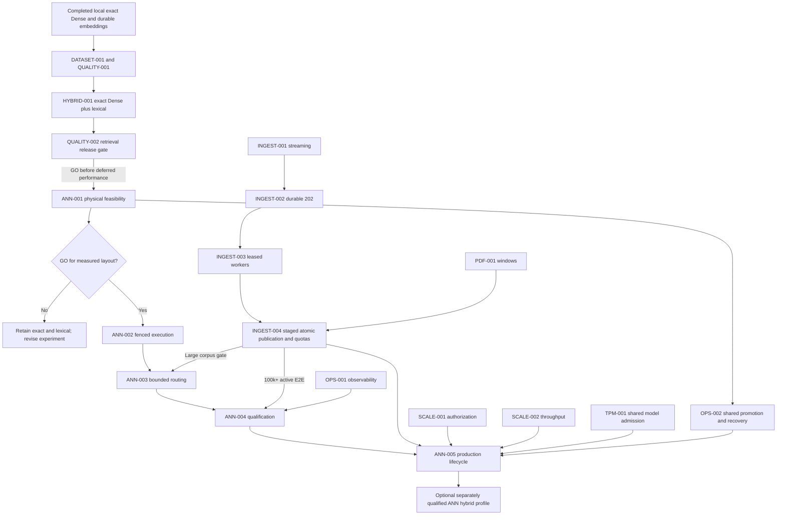

# RAG Index, Retrieval and Enterprise Roadmap — Implementation Plan

**Created:** 2026-11-23  
**Updated:** 2026-11-24  
**Status:** Architecture and ordered task specification; not proof of deployment  
**Scope:** Workbench backend retrieval, original evidence, search index lifecycle, scalable sources and enterprise readiness  
**Repository source snapshot:** 1aa9b2654df0f490781b2a09a5809e111c1f6651

## Executive decision

Keep **PostgreSQL + pgvector** as the authoritative data substrate, separate document/source version and raw original evidence from derived searchable representations, and build additional search execution modes **as explicit, versioned, provider-neutral capabilities**. Current PostgreSQL native FTS and exact vector primitive are not equivalent to real Qwen embeddings, BM25, ANN, hybrid retrieval or a production-tenant system. No silent in-memory corpus, unverified model vectors, generic file-to-Markdown loss, fake citations or cross-tenant access.

The roadmap prioritizes:
1. Persist workspace corpus/index revision at publication rather than hashing all active chunks per query.
2. Qualify the real local text embedding model and versioned profile, backfill vectors durably and expose truthful exact dense retrieval.
3. Add HNSW/halfvec ANN **only after** quality and tenant-filter benchmarks, then use RRF for explicit hybrid profiles.
4. Benchmark genuine PostgreSQL BM25 now, but **do not automatically replace FTS**; deployment follows a separate GO decision and license approval.
5. Keep original PDF/diagram/Mermaid evidence through existing CONTENT-001..005 and add a Live Workbench evidence viewer.
6. Expand through multiworkspace authorization, tenant quotas, queue-driven bulk ingestion, delta reuse, observability and index/asset disaster recovery.
7. Evaluate Microsoft MarkItDown as an optional **derived Markdown representation**, never as replacement for originals or universally superior to Docling.

## 1. Verified starting point

| Concern | Existing implementation | What is NOT yet delivered |
| --- | --- | --- |
| Data | [0001 initial schema](../apps/workbench/postgres/migrations/0001_initial.up.sql), [0002 jobs](../apps/workbench/postgres/migrations/0002_ingestion_jobs.up.sql), PostgresPersistence, source/version/Chunk, FORCE RLS; bounded synchronous TXT/Markdown/Python ingestion | Multiworkspace identity/roles, async source jobs, source evidence asset lifecycle |
| Lexical | [PostgresLexicalRetriever](../apps/workbench/retrieval/lexical.py) via Haystack, generated tsvector, GIN and ts_rank_cd; profile postgres-fts-baseline-r1 | Genuine BM25, tiered lexicon and large-corpus query optimization |
| Corpus revision | [_corpus_snapshot](../apps/workbench/postgres/postgres.py) hashes active chunk/doc metadata for each lexical snapshot | Persisted constant-cost generation and active profile index manifest |
| Vector | Chunk.embedding nullable, embedding_profiles table and [vector_search](../apps/workbench/postgres/postgres.py) exact cosine | Qualified Qwen inference in ingestion, full backfill, Live Dense profile, HNSW index |
| Workbench | Live keyword profile, Preview and constructor validator; [DocumentsView](../apps/workbench/web/src/views/DocumentsView.tsx) remains fixture-only in inspected source | Dense/Hybrid approved graphs, original evidence browser and live document-management UI |
| Document parsing | Parser registry, qualified TXT/MD/Python; Docling PDF source worker and table/page chunking code; PDF qualification evolves independently | OCR/vision, Mermaid graph, complete original asset evidence architecture |
| Local setup | PG17.10/pgvector0.8.2 pinned container; API local TEI/Qwen target contract | Multi-host deployment, workload SLOs, production RBAC and DR drills |

**Important implementation caution:** the source code continues evolving. Every task must redo Section C inspection before work. A Python class or migration existing is not proof that an endpoint, model or capability has passed runtime tests.

## 2. Target index model and data flows

```text
Untrusted source bytes / connector
  -> verified format + parser / OCR / visual / Mermaid adapters
  -> structured elements + original immutable assets (CONTENT-001)
  -> multiple typed representations and chunking profiles
  -> versioned Chunk metadata + ContentRepresentation and EvidenceReference
  -> lexical text index (PostgreSQL tsvector/GIN)
  -> embedding job and qualified Qwen embedding profile -> full vectors in pgvector
  -> optional qualified ANN physical index (HNSW / halfvec)
  -> immutable source/index generation with active profile pointer

Query -> FastAPI server-authorized workspace -> approved profile registry
   -> native FTS or true BM25 (if approved), exact Dense or ANN
   -> explicit RRF Hybrid if supported
   -> Evidence Resolver (CONTENT-005) -> original PDF/page/diagram/Mermaid
   -> Workbench results with actual source, generation, score and trace
```

**Version dimensions must not be conflated:** SourceVersion identifies immutable uploaded content; ProcessingProfile records parse/normalize/chunk rules; EmbeddingProfile pins model digest/tokenizer/dimensions/instruction; IndexGeneration is the committed searchable snapshot; RetrievalProfile pins search algorithm/index generation/candidate_k/top_k/rrf_k/score semantics. A model update creates a new semantic generation, not an in-place vector identity change.

**Snapshot performance fix:** current _corpus_snapshot() loads/hashes active metadata for each query. INDEX-001 moves this O(number_of_active_chunks) fingerprint to a transactional publication-time manifest, with search loading a constant-cost committed generation and consistent SQL snapshot. Make query-time page/range/source link query not re-hash every chunk. Preserve replay/idempotent unchanged semantics and fallback to explicit last-good profile if new generation is unready.

**Data tiering:** PostgreSQL stores source/version/element metadata, text chunks, provenance links, vector rows, search generations, jobs and RLS. AssetStorePort stores exact original PDF/Office/diagram files or crops and optional derived Markdown. Do not store base64 images inside Chunk.metadata or regard Markdown as canonical bytes.

## 3. Delivery sequence, gates and dependencies

**Priority override (2026-11-24):** immediate delivery is [Retrieval and answer quality — implementation order](quality/IMPLEMENTATION_ORDER.md), not ANN or large-document ingestion. Existing exact/lexical and small-file ingestion suffice for this phase. Begin [DATASET-001](quality/TASK-RAG-DATASET-001-independent-evidence-gold-set.md) and [QUALITY-001](quality/TASK-RAG-QUALITY-001-current-stack-evidence-retrieval-optimization.md), then exact+lexical RRF and measured optional BM25/semantic reranking, context/facet selection and answerability; [QUALITY-002](quality/TASK-RAG-QUALITY-002-retrieval-release-gate-and-regression.md) is the independent retrieval release gate. [GENERATION-001](quality/TASK-RAG-GENERATION-001-grounded-answer-generation.md) and [QUALITY-003](quality/TASK-RAG-QUALITY-003-grounded-answer-correctness-evaluation.md) follow its GO. The following ANN/ingestion sequence is retained as the **deferred performance and enterprise track**, not immediate work. No large-file ingestion, 100k corpus or ANN dependency for quality. Do not start deferred work until retrieval quality GO and explicit priority decision. Existing capacity/RLS guards remain.

**Delivery update (2026-11-24; source inspected `ce3b331e5869d563b9bfbabc034b2158148990b3`):** INDEX-001, PROFILE-001, EMBED-001, EMBED-002 and DENSE-001 are complete for their documented local scope. [DENSE-001 runtime evidence](evidence/dense-2026-11-24/report.md) proves exact retrieval on 102 active vectors, not 100k production scale. TPM-001 is IN PROGRESS: the measured single-owner prerequisite passed; broader capacity evidence remains pending. ANN is now five atomic specifications; the former omnibus task is replaced in place by ANN-001 feasibility. Every proposed task remains unimplemented until its own evidence is recorded.

| Order / track | Task | Gate / outcome |
| --- | --- | --- |
| 1 | [INDEX-001](completed/TASK-RAG-INDEX-001-persisted-revision-and-consistent-search-snapshots.md) | COMPLETE (local): persisted corpus generation instead of query-time O(N) digest |
| 2 | [PROFILE-001](completed/TASK-RAG-PROFILE-001-versioned-retrieval-and-processing-profile-registry.md) | COMPLETE (local): immutable retrieval/profile registry and governed rollout |
| 3 | [EMBED-001](completed/TASK-RAG-EMBED-001-qualify-local-qwen-embedding-provider.md) | COMPLETE (local): real TEI/Qwen model, 2560 dimensions, native tokenizer and budget |
| 3a | [TPM-001](TASK-RAG-TPM-001-adaptive-embedding-capacity-and-cross-project-reuse.md) | IN PROGRESS: shared desired 0.92 / rolling hard 0.95 admission; measured local prerequisite passed, broader concurrency/steady-window qualification remains |
| 4 | [EMBED-002](completed/TASK-RAG-EMBED-002-durable-embedding-ingestion-and-backfill.md) | COMPLETE (local): durable embedding backfill, coverage and immutable vector/mapping storage |
| 5 | [DENSE-001](completed/TASK-RAG-DENSE-001-live-dense-retrieval-and-exact-cosine-baseline.md) | COMPLETE (local): actual query embed + Haystack + exact cosine oracle and Live provenance |
| Deferred / 6a ANN feasibility | [ANN-001](TASK-RAG-ANN-001-hnsw-halfvec-index-and-tenant-recall-gates.md) | Independent float32 oracle, halfvec precision and HNSW cohort benchmarks; >=100k physical vectors, 1M optional; measured GO/NO-GO. Disposable SQL does not need production ingestion limits lifted. |
| Deferred / ingestion foundations | [INGEST-001](TASK-RAG-INGEST-001-streamed-asset-staging.md) → [INGEST-002](TASK-RAG-INGEST-002-atomic-http-202-job-admission.md) → [INGEST-003](TASK-RAG-INGEST-003-leased-workers-and-tenant-backpressure.md) | Streamed immutable assets, durable acceptance, leases/retry/fairness; reuse CONTENT-001, SCALE-001/002 and TPM-001 boundaries |
| Deferred / PDF scale | [PDF-001](TASK-RAG-PDF-001-bounded-page-window-processing.md) | Seekable bounded PDF windows/checkpointing; prerequisite for large-PDF publication path |
| Deferred / corpus capacity | [INGEST-004](TASK-RAG-INGEST-004-incremental-index-and-atomic-publication.md) | Bounded staging, atomic publication and measured unified workspace publication/retrieval quotas; actual 100k+ active chunks and no partial generations. Owns current 10k/50 MiB limit replacement, not ANN. |
| Deferred / ingestion consumers | [UI-004](TASK-UI-004-async-upload-and-job-tracking.md), [OPS-003](TASK-RAG-OPS-003-large-pdf-1000-page-qualification.md) | Durable upload/job tracking and independently measured large-PDF release gate; see [Large-document ingestion map](LARGE_DOCUMENT_ASYNC_INGESTION_PLAN_2026-11-23.md) |
| Deferred / 6b ANN execution | [ANN-002](TASK-RAG-ANN-002-generation-fenced-hnsw-retrieval-and-exact-reranking.md) | After ANN-001 GO: generation-fenced candidate retrieval on canonical vectors and full-precision chunk-level reranking; internal only |
| Deferred / 6c ANN resilience | [ANN-003](TASK-RAG-ANN-003-tenant-selective-routing-and-bounded-fallback.md) | After ANN-002: qualified tenant/corpus routing, shared admission, bounded exact fallback, truthful requested/executed policy; large serving cohort requires INGEST-004 |
| Deferred / 6d ANN qualification | [ANN-004](TASK-RAG-ANN-004-ann-qualification-shadow-evaluation-and-observability.md) | After ANN-003: held-out per-cohort quality, bounded shadow oracle, telemetry and existing rollout qualification; coordinate OPS-001; no production promotion |
| Deferred / 6e ANN operations | [ANN-005](TASK-RAG-ANN-005-index-lifecycle-and-production-qualification.md) | After ANN-004 and enterprise prerequisites: physical lifecycle, canary, rollback/restart/restore and production qualification; reuse OPS-002 shared lifecycle and recovery |
| Quality track / after baseline | [HYBRID-001](quality/TASK-RAG-HYBRID-001-dense-lexical-rrf-fusion-and-profile-execution.md) | Approved lexical + exact dense RRF can proceed from DENSE-001/PROFILE-001/INDEX-001 and applicable TPM admission; ANN-backed hybrid only after explicit ANN qualification/rollout, no raw-score mixing |
| Quality track / conditional decision | [BM25-001](quality/TASK-RAG-BM25-001-bm25-extension-feasibility-and-quality-gate.md) | Genuine BM25 A/B and license/deployment GO/NO-GO |
| Quality track / conditional | [BM25-002](quality/TASK-RAG-BM25-002-conditional-postgresql-bm25-search-profile.md) | Only after GO; additive BM25 profile, never hidden FTS replacement |
| Deferred decision | [CONVERT-001](TASK-RAG-CONVERT-001-microsoft-markitdown-evaluation-and-safe-conversion-adapter.md) | Per-format MarkItDown vs Docling/native GO/NO-GO |
| Evidence foundation | [CONTENT-001](TASK-RAG-CONTENT-001-structured-elements-representations-and-original-evidence.md) | Exact originals, structured elements, typed representations |
| Evidence producers | [CONTENT-002](TASK-RAG-CONTENT-002-scanned-pdf-ocr-and-layout.md), [CONTENT-003](TASK-RAG-CONTENT-003-visual-diagrams-charts-and-graph-extraction.md), [CONTENT-004](TASK-RAG-CONTENT-004-mermaid-typed-graph-ingestion.md) | Qualified OCR, diagram/chart and Mermaid evidence |
| Evidence consumer | [CONTENT-005](TASK-RAG-CONTENT-005-original-evidence-resolution-and-grounding.md) | Authorized original/page/crop/source-range resolution and trust state |
| UI consumer | [EVIDENCE-001](TASK-RAG-EVIDENCE-001-live-original-evidence-and-diagram-viewer.md) | Real PDF/image/Mermaid evidence pane, no invented sources |
| Enterprise security | [SCALE-001](TASK-RAG-SCALE-001-multiworkspace-identity-authorization-and-tenanted-retrieval.md) | Authenticated multiworkspace, RLS and quota/role isolation; mandatory before enterprise activation |
| Enterprise throughput | [SCALE-002](TASK-RAG-SCALE-002-durable-asynchronous-ingestion-and-tenant-backpressure.md) | Parent orchestration of queued uploads/workers/backpressure; deliver via existing atomic ingestion map, not a second implementation |
| Efficiency | [DELTA-001](TASK-RAG-DELTA-001-incremental-reindexing-and-embedding-vector-reuse.md) | Safe tenant-local compatible per-chunk vector reuse; evidence required for delta optimization claims |
| Operating model | [OPS-001](TASK-RAG-OPS-001-tracing-evaluation-and-search-quality-gates.md) | Shared redacted tracing, evaluation and quality/cost/latency monitoring; ANN-004 integrates ANN-specific evidence |
| Recovery | [OPS-002](TASK-RAG-OPS-002-index-promotion-backup-and-disaster-recovery.md) | Shared generation promotion and DB+asset recovery, after ANN-001 physical feasibility and in coordination with ANN-002..004; ANN-005 consumes this gate, not vice versa |

### 3.1. Dependency graph and capacity ownership



- **Capacity is owned by ingestion, not an arbitrary ANN constant:** the inspected publication code and ProfileDefinition each enforce 10,000 active chunks / 50 MiB. INGEST-004 already explicitly owns measured workspace quotas, retrieval profile limit changes, staged batches and atomic publication. Keep current guards until its evidence establishes the replacement; coordinate both publication and serving against one approved capacity policy. Distinguish total physical vector rows, unique compatible cached vectors, mapped eligible active chunks, content bytes and per-query selectivity. A physical index containing 100k vectors does not prove a 100k active-chunk workspace is supported.
- **Deferred performance work (after quality GO):** ANN-001 can use disposable SQL fixtures at 10k/100k/optional 1M without bypassing any Live limits. ANN-002 and bounded-routing unit/small-corpus integration can follow a GO before ingestion completion. Large-corpus application qualification (ANN-003/004) and ANN-005 enterprise rollout require INGEST-004 and its upstream staging/admission/worker prerequisites. OPS-003 and DELTA-001 are additionally required for their specific PDF/delta claims; no need to duplicate those implementations.
- **Quality and safety:** proposed release threshold is mean ANN recall@10 >=0.97 per qualified tenant cohort against independent full-precision chunk oracle; zero unauthorized/stale/wrong-profile results and unexpected underfill; predeclare lower-tail guard and require >25% p95 retrieval improvement on a qualified >=100k eligible corpus. These are gates, not measured outcomes. Failed or insufficient evidence leaves affected cohort disabled. Exact fallback requires remaining deadline and qualified cost/concurrency admission; no unconditional full scan, silent profile change or Preview substitution.
- **Operations and dependencies:** OPS-002 owns shared promotion and DB+asset restore; its ANN-001 prerequisite is feasibility, not completion of ANN-005. ANN-005 owns physical ANN index DDL/lifecycle and consumes shared recovery proof. OPS-001 owns common tracing; ANN-004 owns ANN-specific gate/shadow evidence. SCALE-001 and SCALE-002 remain enterprise rollout gates. TPM-001 remains sole model admission owner. Hybrid on exact dense, BM25 decisions and evidence content work do not depend on ANN production rollout. Original assets must exist before citation claims.

## 3a. Pinned related-project reuse: embedding capacity, source deltas, chunking

**Donor source pin:** `VibeInAMajor/enterprise-ai-development-pipeline` commit `955fd049949d3fc462d555be14774e4b255aa15c`; [source catalog](https://github.com/VibeInAMajor/enterprise-ai-development-pipeline/tree/955fd049949d3fc462d555be14774e4b255aa15c). This source is **not** already integrated into Workbench and has a separate [PolyForm Strict/Authorized Evaluation license](https://github.com/VibeInAMajor/enterprise-ai-development-pipeline/blob/955fd049949d3fc462d555be14774e4b255aa15c/LICENSE.md). Obtain/document rights for literal code copying, or independently implement compatible algorithms based on the behavior/test contracts. No Qdrant, Root/SQLite generation runtime or Azure SDK is to be copied into our PostgreSQL application.

| Donor implementation and exact file | Reuse owner / decision |
| --- | --- |
| [EmbeddingDispatchController](https://github.com/VibeInAMajor/enterprise-ai-development-pipeline/blob/955fd049949d3fc462d555be14774e4b255aa15c/src/enterprise_ai_pipeline/rag/embedding_dispatch.py) `reserve/finish/_wait_needed/_pacing_rates` | [TPM-001](TASK-RAG-TPM-001-adaptive-embedding-capacity-and-cross-project-reuse.md); preserve arrival reservations, cancellation, 429 cooldown; add independent hard 0.95 ceiling |
| [EmbeddingCapacityPolicy](https://github.com/VibeInAMajor/enterprise-ai-development-pipeline/blob/955fd049949d3fc462d555be14774e4b255aa15c/src/enterprise_ai_pipeline/rag/embedding_capacity.py) / [EmbeddingCapacityWindows](https://github.com/VibeInAMajor/enterprise-ai-development-pipeline/blob/955fd049949d3fc462d555be14774e4b255aa15c/src/enterprise_ai_pipeline/rag/embedding_capacity_windows.py) | [TPM-001](TASK-RAG-TPM-001-adaptive-embedding-capacity-and-cross-project-reuse.md) capacity policy and saturated/unknown completed-window metrics |
| [TEIEmbeddingProvider](https://github.com/VibeInAMajor/enterprise-ai-development-pipeline/blob/955fd049949d3fc462d555be14774e4b255aa15c/src/enterprise_ai_pipeline/providers/tei_embeddings.py) and [EmbeddingProvider protocol](https://github.com/VibeInAMajor/enterprise-ai-development-pipeline/blob/955fd049949d3fc462d555be14774e4b255aa15c/src/enterprise_ai_pipeline/rag/embeddings.py) | [EMBED-001](completed/TASK-RAG-EMBED-001-qualify-local-qwen-embedding-provider.md); adapt to actual local TEI endpoint, query/document instruction, model digest, finite vector and usage provenance |
| [EmbeddingPreparation](https://github.com/VibeInAMajor/enterprise-ai-development-pipeline/blob/955fd049949d3fc462d555be14774e4b255aa15c/src/enterprise_ai_pipeline/rag/semantic_embedding_preparation.py) and [bounded execution windows](https://github.com/VibeInAMajor/enterprise-ai-development-pipeline/blob/955fd049949d3fc462d555be14774e4b255aa15c/src/enterprise_ai_pipeline/rag/embedding_execution.py) | [EMBED-002](completed/TASK-RAG-EMBED-002-durable-embedding-ingestion-and-backfill.md) durable PostgreSQL-safe embedding batches and late paid-result recovery |
| [plan_chunk_delta](https://github.com/VibeInAMajor/enterprise-ai-development-pipeline/blob/955fd049949d3fc462d555be14774e4b255aa15c/src/enterprise_ai_pipeline/rag/chunk_delta.py) and [DocumentDeltaLookup](https://github.com/VibeInAMajor/enterprise-ai-development-pipeline/blob/955fd049949d3fc462d555be14774e4b255aa15c/src/rag_reference/cache/document_delta_lookup.py) | [DELTA-001](TASK-RAG-DELTA-001-incremental-reindexing-and-embedding-vector-reuse.md); multiset occurrence matching and direct source-version lookup, translated to Postgres/hashes |
| [StructuralChunker](https://github.com/VibeInAMajor/enterprise-ai-development-pipeline/blob/955fd049949d3fc462d555be14774e4b255aa15c/src/enterprise_ai_pipeline/rag/chunking.py) and [JSON structural splitting](https://github.com/VibeInAMajor/enterprise-ai-development-pipeline/blob/955fd049949d3fc462d555be14774e4b255aa15c/src/enterprise_ai_pipeline/rag/json_structural_chunking.py) | [CHUNK-004](TASK-RAG-CHUNK-004-policy-benchmark-and-tiered-enrichment.md); compare against existing completed [CHUNK-001](completed/TASK-RAG-CHUNK-001-strategy-routing-and-profile-contract.md) before adapting only improved boundaries |
| [Embedding TPM smoothing audit](https://github.com/VibeInAMajor/enterprise-ai-development-pipeline/blob/955fd049949d3fc462d555be14774e4b255aa15c/tasks/TASK-M39-030-embedding-TPM-smoothing-audit.md) and [test_rag_chunk_delta_runtime.py](https://github.com/VibeInAMajor/enterprise-ai-development-pipeline/blob/955fd049949d3fc462d555be14774e4b255aa15c/tests/pipeline/test_rag_chunk_delta_runtime.py) | Borrow quality/fault test scenarios but execute native Workbench Hatch/PostgreSQL tests for a real PASS |

**Exact TPM design:** first qualify **sustainable** local `Q_TPM`, not a fictional cloud quota. Desired admission pacing is `0.92 * Q_TPM`; the independent rolling-60-second **hard estimated/reserved arrival cap** is `0.95 * Q_TPM`; enforce RPM/bursts/max_in_flight separately. The donor default utilization is 0.85 (`EmbeddingCapacityPolicy`) / 0.9 (`TEIProfile`), and donor rolling reservation uses full safe tpm unless specifically changed. Simply changing the target ratio does **NOT** implement our hard 0.95 cap. The donor TEI provider commonly reports tokenizer-counted `usage_tokens`; this is not necessarily native provider-billed usage. Keep `provider_reported`, `tokenizer_counted_proxy` and `actual_usage_unknown` distinct. Quota ownership must be shared across query/ingestion and, before multi-worker mode, across processes. The target is a measurable **saturated backlog** performance setpoint, not an SLA without a benchmark.

**Delta integrity:** unchanged whole-source uploads are already supported; chunk-level vector reuse is separate and requires matching actual embedding input (including heading/context/instruction), tokenizer/model/profile digest, workspace ownership, and proof that the vector exists. Identical text occurrences retain distinct source/version/line/page/asset identity. Do not substitute donor Qdrant physical point identity into Postgres.

## 4. Microsoft Markdown converter: independent research decision

Microsoft [MarkItDown](https://github.com/microsoft/markitdown) is a lightweight Python conversion utility for LLM analysis of PDF, DOCX, PPTX, XLSX, HTML and more; output often preserves headings/lists and ordinary tables. Conversion convenience does **not** imply that Markdown is a better storage format for a RAG database. It is another text/string projection, whereas PostgreSQL already indexes chunk TEXT via tsvector and can hold vectors/metadata.

MarkItDown can be attractive for **simple Office-to-text pipelines** because it requires fewer format-specific extractors and emits uniform Markdown. But for high-fidelity PDF page citations, merged tables, diagrams, layout, numerical charts and original links, our Docling and CONTENT-001 structured-element paths are the stronger design candidates. Original bytes remain canonical; markdown should be a derived representation with converter hash/provenance and warnings.

**Privacy and cost caveat:** MarkItDown core supports offline format-specific conversion; plugins and Azure Document Intelligence/Content Understanding are distinct capabilities. The OCR plugin uses an LLM Vision client and may omit OCR silently when not configured, so a failed/absent vision adapter must not be advertised as an OCR success. MarkItDown README warns conversion uses the current process privileges, so run isolated and avoid optional network helpers by default. Azure layout Markdown may embed HTML tables and figure elements; text-only Markdown cannot be assumed to fully encode their geometry. Assess source retention, cloud egress, request pricing and licensing before any provider-specific deployment.

Comparison gate (CONVERT-001): >=12 representative files across formats, >=40 labeled evidence queries, table/cell/page fidelity, image/diagram loss, structured source maps, retrieval Recall/MRR, converter CPU/RAM/latency, bytes/index cost and safe no-network failures. **No blanket MarkItDown adoption before GO.**

Sources: https://github.com/microsoft/markitdown ; https://github.com/microsoft/markitdown/blob/main/packages/markitdown-ocr/README.md ; https://learn.microsoft.com/azure/ai-services/document-intelligence/prebuilt/layout ; https://docling-project.github.io/docling/concepts/chunking/

## 5. Real embedding, Dense, ANN and Hybrid decisions

The current target is a local Qwen3-Embedding-4B model through a qualified TEI embedding adapter; model card states **up to 2560 dimensions**, but the running endpoint must be probed for digest, dimensions, normalization, prefix/task kind, native tokenizer and max batch. Use a provider-neutral EmbeddingPort for both query and document inputs, and a bounded durable job for each source/version/processing/embedding profile.

Dense baseline should first use **exact cosine** against stored compatible vectors. Only after that reference is correct should HNSW be promoted. Standard pgvector HNSW on vector supports <=2000 dimensions; at 2560 use an approved halfvec(2560) expression index while retaining full-precision vectors for exact rerank or use a separately measured MRL dimension profile. Never silently truncate vectors. ANN RLS/tenant filtering and index post-filter behavior can reduce recall; benchmark with rare-workspace fixtures, hnsw.iterative_scan, ef_search and exact-oracle comparisons. See https://github.com/pgvector/pgvector#filtering and https://github.com/pgvector/pgvector#half-precision-indexing .

Hybrid uses explicitly selected **Reciprocal Rank Fusion** (e.g., RRF score = sum(1/(k+rank_i))) over unique chunk/source-version identities. PostgreSQL ts_rank_cd and cosine distance MUST NOT be linearly added; genuine BM25 is optional behind independent profile and licensing gate. RRF default k, candidate_k/top_k, selected source generation and ranking tie order are versioned.

## 6. BM25 decision: evaluate now, do not switch automatically

Native FTS with tsvector/GIN/ts_rank_cd is already running and its score_type is postgres_ts_rank_cd. Genuine BM25 can be attractive for long/broad keyword corpora, but a tiny eight-document synthetic test is not a business justification for a new extension. ParadeDB pg_search is a relevant PostgreSQL BM25 candidate and currently documents AGPL-3 packaging in PGXN; commercial compliance/deployment and Postgres 17 binary compatibility require explicit review. Benchmarks should measure precision, MRR, lexical exact/identifier quality, multilingual behavior, resource use, tenant filtering and storage overhead.

**Policy:** BM25-001 begins now as a comparative decision experiment; BM25-002 remains BLOCKED until demonstrable gain and legal/runtime approval. If negative, keep FTS; Dense and Hybrid continue independently. Do not use Haystack InMemoryBM25Retriever with PostgreSQL store or mislabel ts_rank_cd as bm25_raw. Source: https://pgxn.org/dist/pg_search/ .

## 7. Enterprise nonfunctional gates

**Performance:** saved source/index generations remove per-query O(number_of_chunks) hashes. For 100k/1M representative chunks measure p50/p95 query latency, SQL planned rows/index scans, index build time, ANN exact-vs-approx recall, worker throughput, model tokens/sec, database/index disk and asset store growth. No arbitrary SLO is claimed from a small seed.

**Security:** verify identity and membership before workspace/source/vector/asset access. RLS is essential but not a complete authorization system. Separate development loopback mode and audited remote mode. Test source/evidence ID guesses, vector ANN post-filter, cached embeddings, job ownership, and remote local-file reveal. Never log raw source text, OCR/VLM outputs, embedding vectors or model tokens.

**Fidelity:** exact originals are immutable; derived Markdown/visual descriptions are versioned and labeled as such. The Evidence Resolver must never turn model-inferred arrows/chart values into verified facts. Chunking/embedding/delta reindex must preserve original page/line/bbox anchors or explicitly fail.

**Reliability:** only committed generations are executable. Worker/API/DB/asset-store failures cannot create fake successful indexing, half-published source versions or silent fallback to Preview. Backup and disaster recovery must restore SQL+original assets together and verify byte hashes and generation identity.

**Observability:** safe trace IDs, job/source/version/profile/index generation, measured per-stage timing, embedding token counts, queue lag, coverage, retrieval/citation quality, ANN recall and capability state; no synthetic node timings or fake completion.

## 8. Completion policy

These Markdown documents are **blueprints**, not implemented code. A task becomes COMPLETE only with real unit, integration, Postgres, runtime/model and appropriate browser evidence captured in its A–O checklist. The implementation order and existing SOURCE/INDEX/PROFILE contracts must be revalidated against the live repository at implementation start; if the source has materially changed, revise task Section C/I/J first, preserving previous architecture decisions and rollback.

Only implement exactly what the approved task calls for; avoid parallel duplicate stores, accidental schema migrations, provider SDK imports into domain core, milestone-coded variable names and arbitrary graph execution.
