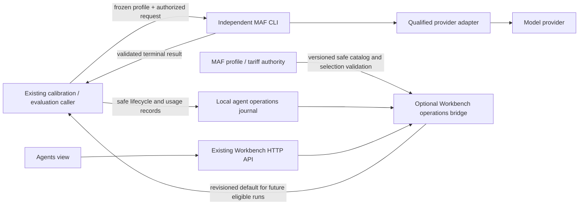

# TASK-UI-005 — Agent operations, model selection and live token/cost monitoring

**Created:** 2026-11-28  
**Updated:** 2026-11-28  
**Status:** PROPOSED — specification only; implementation and verification pending  
**Priority:** P0 for visibility during the upcoming full Semantic Review  
**Repository snapshot inspected:** `9dbc64ac90bc523873098e11b3d19e43de79f039`  
**Dependencies:** [MAF-001](maf/TASK-MAF-001-standalone-agent-runtime.md), [MAF-002](maf/TASK-MAF-002-semantic-judge-agent.md) for qualified model profiles, cache accounting and physical request evidence; existing Workbench API/UI and DATASET-002 caller.  
**Related:** [DATASET-002](quality/TASK-RAG-DATASET-002-source-grounded-ranking-judgments.md), [ANSWERABILITY-001](quality/TASK-RAG-ANSWERABILITY-001-insufficient-evidence-and-abstention.md), [OPS-001](TASK-RAG-OPS-001-tracing-evaluation-and-search-quality-gates.md).

## A. Title

Add an Agents menu to Workbench with a real-time operations dashboard, qualified model selection, model-specific pricing, execution history and sanitized agent activity logs.

## B. Context / Problem

The standalone Semantic Judge is being prepared for the full OPEN dataset audit. Operators need to see which model actually executes each request, how much of the input is cached, how much the run has cost so far, whether a request is waiting, running or failing, and how much work remains. Existing calibration JSONL and local evaluation reports are not a live operator interface. A selectable model without server-side qualification or model-specific tariff binding could misrepresent both quality and costs.

This is an operational UI for the independent agent subsystem, not another RAG evaluator or a change to semantic verdicts. Its first registered agent is Semantic Judge; the view must accommodate further registered agents without duplicating a separate page or pricing engine per agent.

## C. Current Repository State

Static source evidence at the inspected commit; no deployed service, local ignored journal, or new live API call was inspected.

- [App.tsx](../apps/workbench/web/src/App.tsx), [workbenchLocation.ts](../apps/workbench/web/src/domain/workbenchLocation.ts) and [AppNavigation.test.tsx](../apps/workbench/web/src/AppNavigation.test.tsx) currently implement Pipelines, Documents, Runs, Configuration and Settings. No Agents page is registered. Configuration follows Runs; preserve its existing navigation and unsaved-change behavior.
- [RunsView](../apps/workbench/web/src/views/RunsView.tsx) displays search/preview session history, cleared on refresh. Reuse its table/detail/status patterns, [ServerDuration](../apps/workbench/web/src/components/ServerDuration.tsx), existing styles and accessible controls; do not mix paid agent calls with preview pipeline fixtures or make transient React state the authoritative agent history.
- [Typed API client](../apps/workbench/web/src/api/client.ts), [contracts](../apps/workbench/web/src/api/contracts.ts) and [decoders](../apps/workbench/web/src/api/decode.ts) already centralize HTTP access, cancellation and validation. [ConfigurationView](../apps/workbench/web/src/views/ConfigurationView.tsx) demonstrates revision-checked server settings, errors and unsaved changes. [API composition](../apps/workbench/api/application.py), [RequestBoundary](../apps/workbench/api/boundary.py), [shared DTOs](../apps/workbench/contracts/schemas.py) and [safe events](../apps/workbench/observability/events.py) are the existing HTTP and observability owners.
- [MAF configuration](../apps/maf/src/agent_runtime/configuration.py) maps `semantic-review` to `gpt-6.1-sol` and `semantic-review-6.2` to `gpt-6.2-sol`. The former has candidate input admission 16,384 and output ceiling 32,000; the latter has 8,192 and 2,048 respectively. The 0.3.1/v8 PASS is historical; the capacity/cache candidate still requires qualification. The existing shared pricing constants are not proof of distinct verified tariffs for the two models.
- [Judge registration](../apps/maf/src/agent_runtime/agents/semantic_judge/agent.py) currently allows only `semantic-review` for all four modes. Merely exposing the existing alternate profile in a dropdown cannot enable it: the runtime will reject unsupported capability. [Calibration runner](../apps/maf/calibration/run.py) also pins the default profile in its preflight and request construction. Alternate profile selection requires a real profile-aware qualification path and immutable manifests; do not remove the allowlist or inherit the GPT-6.1 Sol PASS.
- [MAF contracts](../apps/maf/src/agent_runtime/contracts.py) already expose request/profile, runtime/model/prompt/schema identity, elapsed time, provider correlation, input/output/reasoning/cached-read usage, cost estimates and typed failures. [MAF-002](maf/TASK-MAF-002-semantic-judge-agent.md) owns cache writes, ordinary input accounting, tariff evidence, wire measurements and further qualification. Consume those contracts instead of duplicating calculations in UI.
- [CLI](../apps/maf/src/agent_runtime/cli.py) returns exactly one terminal JSON result on stdout. The current adapter uses non-streaming Responses requests; the runner writes manifest, completed case rows and final summary, but does not publish a UI-facing in-flight stream. Actual token counts normally arrive on provider completion. Real-time run status and per-completed-call accounting are achievable without token streaming; exact incremental token counts inside an unfinished request are not currently available.
- [MAF architecture](maf/MAF_ARCHITECTURE.md) and DATASET-002 keep the local evaluator under `.local/evaluation-holdout/quality-check/` as owner of source preparation, approved payloads, scoring and resume. It uses the versioned CLI, not shared SDK imports. Raw artifacts are ignored locally and were not inspected. No production API/UI was previously required for this evaluation. This explicitly authorized task adds an optional local operations projection only, not a new evaluator or production dependency.
- [Full-input pilot](evidence/dataset-semantic-pilot-full-2026-11-28/report.md) records 46 real requests, 89,152 input tokens and 27,873 output tokens including 7,971 reasoning tokens, estimated USD 0.551771 for the final v8 replay. It does not expose a live timeline or cache-write totals. Do not seed a live dashboard with those figures as if they were current activity.

Reinspect current files, scoped instructions and the actual caller before implementation. If MAF-002 changes its interfaces, adapt to the final versioned contract, not assumptions from this snapshot.

## D. Goal

Provide a usable Agents screen in the existing Workbench that:

- shows registered agents, availability and selected/qualified model profiles;
- displays model-specific rates in USD per million tokens and their provenance;
- observes the existing Semantic Judge execution path with live status and cumulative observed usage/cost, including cached reads and writes;
- presents a chronological, sanitized activity log and historical runs after page reload;
- permits explicit model selection for future eligible runs while preserving immutable model/pricing identity for in-flight and historical runs.

Measure end-to-end freshness, arithmetic correctness, failure handling and profile selection using the acceptance criteria in M. Neither the page nor selecting a model starts a billable request.

## E. Scope

Two incremental slices within this task:

1. **Operations visibility:** optional capability discovery, Agents navigation/page, backend-owned profile and tariff read model, safe run/call events, live polling, run history and details, usage and cost projection, error/offline states. Instrument the existing calibration and DATASET-002 execution paths through a neutral event sink; do not create a second runner.
2. **Model selection:** explicit revision-checked selection of an eligible model profile for future ordinary Semantic Judge runs, model-specific tariff display, independent GPT-6.2 Sol qualification and caller integration. Show an unavailable/unqualified alternate with the reason and disabled activation until its gates pass.

Initial UI is monitor/configuration only; the existing caller remains the authority for starting an external evaluation, source scope, opt-in, budgets and cancellation. Do not make this task a prerequisite for unrelated RAG operation.

## F. Non-Goals

No chat/playground, browser-to-OpenAI connection, arbitrary prompt execution, API key editor, agent builder, new Semantic Judge modes, model switching during a run, automatic fallback or calibration threshold relaxation. No new retrieval, generation, reindexing or golden-set mutation. No independent provider pricing calculator in TypeScript, hidden paid requests, synthetic Live counters, invented tokens/second, ETA or billed cost.

No new SaaS telemetry service, Redis, Qdrant, mandatory Langfuse, second evaluation engine or MAF dependency in Workbench/Haystack. Provider-native token streaming within one call, live reasoning text, raw prompt/response viewer, enterprise remote administration and multi-tenant SaaS rollout are out of scope; a separately justified streaming capability can be specified later.

## G. Architecture / Boundaries

Arrows represent versioned data exchange, not cross-application imports. The caller is authoritative for the run and physical call lifecycle; MAF supplies validated usage and provider identity. The optional bridge owns safe HTTP projection, journal access and revision-checked selection, not source data or provider execution. MAF owns agent capabilities, provider mappings and canonical model-specific tariff accounting. OPS-001 owns shared observability conventions; reuse them without requiring the full OPS rollout.

| Layer | Impact and owner |
| --- | --- |
| Domain/core | Provider-neutral agent/profile/run/call/usage and price snapshot DTO semantics; reuse existing contracts |
| Application/orchestration | Existing caller emits lifecycle and binds selected defaults at run admission; no new runner |
| Port/interface/contract | Versioned safe operations read/selection interface, typed HTTP and CLI exchange |
| Provider adapter | Existing MAF-002 adapter accounting; no vendor SDK in UI/Workbench |
| Persistence | Bounded durable local operations journal and revisioned selection; reuse existing caller journal/checkpoint storage where possible; no vector-store change |
| Retrieval/RAG | N/A — ordinary search, ingestion and generation unchanged |
| Agent runtime | Existing registry, profile capabilities, one-shot CLI and separate qualification |
| Security/governance | Server-authorized scope, immutable execution identity, explicit egress and budget policies |
| Observability/evidence | Sanitized event projection, deterministic totals and correlation; no duplicate physical calls |
| Infrastructure/CI/CD | Optional feature discovery and local wiring; no mandatory new service or credential for CI |
| Documentation | Workbench usage, model eligibility, prices, freshness, retention and rollback |

The simplest baseline is a bounded append-only local metadata journal written by the existing caller plus a same-origin read projection. Inspect whether the caller already has safe durable records before introducing storage. Use an optional versioned MAF CLI catalog/qualification exchange (or an existing equivalent) rather than importing MAF Python modules into the API. Do not expose arbitrary paths, start subprocesses from read endpoints, tail raw evaluation payloads, or let the browser invoke the provider. If materially different persistence/transport is required, amend this specification first.

## H. Contracts / Interfaces / Data Model

Finalize field names against current conventions and publish the actual OpenAPI schema and matching strict TypeScript decoders. The following are proposed semantic contracts, not existing endpoints.

| Resource | Minimum fields and invariants |
| --- | --- |
| Agent descriptor | Opaque agent ID, display name, supported modes, availability/reason, runtime revision, current default profile and selection revision |
| Model profile | Profile ID, model/provider display identity, capabilities, reasoning effort, input admission units, max output, cache mode/TTL, qualified/unqualified/blocked/stale state, qualification fingerprint/time, eligibility reason |
| Tariff snapshot | Provider/model/service tier/currency, per-million ordinary input, cached read, cache write and output rates; nullable unsupported rates, TTL/rate band, price source URL, effective/verified date, version/digest, any regional allowance; stale/unknown status. Do not assume model tariffs match. |
| Agent run | Opaque run ID, authorized scope, agent ID/mode or batch kind, origin (calibration/evaluation), frozen profile/model/runtime/prompt/schema/cache policy/tariff identity, queued/start/end timestamps, state, total planned and terminal cases if known, physical requests, cache/checkpoint reuse counts, aggregate observed usage/cost coverage, budget/reserve, last event sequence |
| Physical call | Stable call/attempt ID, run ID, safe case/mode ID, requested and returned model, provider request ID if safe, status, elapsed time, error code/stage, observed usage, frozen tariff identity, estimated cost and reserve, terminal event identity |
| Usage | Total input, ordinary input, cached read, cache write, output, reasoning (subset of output), nullable counts, accounting quality/coverage. Never add cached reads/writes to total input or reasoning to total output. |
| Activity event | Schema revision, scope, run/call IDs, monotonic run sequence, UTC timestamp, allowlisted event/stage/severity/status, bounded reason code, optional numeric metrics. No raw evidence or free-form exception dump. |
| Selection update | Agent/scope, requested allowed profile ID, expected selection revision; server returns authoritative selection and new revision or typed conflict/ineligibility. No arbitrary model/provider URL, tariff, secret, cap or prompt fields. |

Use existing versioned API conventions, e.g. a capability flag plus bounded agent catalog, scoped run list/detail/event cursor reads, and a single selection update. Define read access and ownership on the server; application-level synthetic calibration runs belong to the local operator scope, not to an arbitrary workspace. No cross-scope aggregation without explicit authority.

Lifecycle must distinguish queued, admitted, provider running, output/evidence validation, completed, failed, cancelled, interrupted/unknown and blocked. A terminal event is immutable; duplicates are idempotent and conflicting duplicates quarantined. No inferred provider cancellation on network loss. A physical provider error with usage is accounted for even if the verdict is rejected; a pre-egress failure must not increment physical requests. Reused verdicts are visible separately, never counted as fresh provider calls or new spend.

## I. Repository Files / Components Impacted

- UI: `apps/workbench/web/src/App.tsx`, `domain/workbenchLocation.ts`, existing `AppNavigation.test.tsx`, shared `api/client.ts`, `api/contracts.ts`, `api/decode.ts`; add a feature-owned Agents view/hook and focused tests under existing naming/style conventions. Reuse `views/views.css`, design tokens, table/status, confirmation and duration components; no new chart framework unless justified.
- API: `apps/workbench/api/application.py`, `boundary.py`, shared `contracts/schemas.py`, `api/openapi.json`, capability and configuration owners, and focused route/contract tests. Add a minimal optional operations feature module only for distinct ownership; reuse current cursor/error/transport protections and safe log emitter.
- MAF: reuse `configuration.py`, agent registry and runtime metadata from MAF-002. Extend the existing versioned CLI catalog exchange and profile qualification runner only where necessary for this task. Coordinate with MAF-002 before editing shared files; do not duplicate its cache/pricing work or modify frozen control expectations.
- Existing local DATASET-002 caller and calibration runner: safe lifecycle emission, immutable selected-profile/tariff binding and resume-compatible operations records. Keep raw local evidence untouched and publish only sanitized acceptance artifacts.
- Documentation: Workbench and MAF README, project map, applicable architecture/contract docs and release metadata per existing project conventions.

MUST NOT modify retrieval scoring, search/ingestion profiles, source documents, historical reports, golden labels, holdout partitions, provider secrets or existing default egress behavior. No task identifiers in code, CSS, telemetry or API names.

## J. Implementation Requirements

1. **Navigation and layout.** Add Agents to main navigation after Configuration and before Settings (preserves Runs → Configuration). Use existing location persistence (`?page=agents`), icon library, active/keyboard state, dirty-navigation protection and responsive layout. Provide registry cards/list, selected agent details, model/pricing panel, live run summary, run history table and activity timeline. Use existing UI tokens; support loading, empty, unavailable, stale, error and reconnect states. Do not invent an independent design system.
2. **Profile discovery and selection.** Default Semantic Judge remains `semantic-review` / GPT-6.1 Sol. Display GPT-6.2 Sol using the existing `semantic-review-6.2` profile with actual capabilities and caps. Show separate requested and returned model names and default vs frozen active-run model. Qualify the alternate using the same frozen controls, independent profile/model/cache/price fingerprint and actual compatible full-input admission before enabling selection for full audit. If the current 2,048 output or 8,192 input caps cannot admit required data, show blocked/incompatible; amend MAF-002 through its owner before raising them. Never silently bypass qualification or default to a different model. Add explicit profile choice to the existing calibration runner where needed; calibration remains explicitly pinned, unaffected by changing UI defaults. A selection persists across reload, uses expected revision, and takes effect only for the next eligible run. Resume retains original identity. Existing explicit CLI profile requests remain explicit; ordinary caller default must actually consume the stored selection or surface why it cannot. A display-only dropdown is not accepted.
3. **Price catalog.** On profile choice, render four rates (ordinary input, cached input read, cache creation/write, output) in USD per million tokens, plus tariff version, source, freshness, cache TTL, reasoning effort and limits. Use the provider/model/profile-specific trusted backend pricing owner from MAF-002, verified against the official provider pricing/model sources at implementation and when changing tariff revisions. Price unknown/stale/unsupported must be shown as such, not zero. Do not fetch prices from the provider on every UI render, use unverified model aliases, or hardcode current price values in React. Price updates affect only newly admitted runs; freeze the tariff snapshot before sending. The per-call reserve and aggregate run budget must reflect the real selected profile; cache hits are not guaranteed.
4. **Live event production.** Reuse the existing caller and MAF terminal results. Emit run planned/started, per-call queued/admitted/started, terminal success/failure and run finished events, with observed validation stages where actually instrumented. Publish a start before a physical call; report provider-running while awaiting response; emit final usage only when received/validated. If the CLI caller cannot observe physical dispatch, use truthful invocation-start state rather than labeling it provider-started; add a minimal versioned metadata-only side channel if required, preserving the single terminal stdout JSON contract. No extra provider calls for monitoring.
5. **Near-real-time updates.** Use one bounded cancellable polling hook against the existing API (target 1 second interval while a visible run is active, back off on idle/error, stop on unmount, resume by cursor). A progress/usage update committed by the caller must become visible within 2 seconds p95 on a healthy local connection in the acceptance scenario; report observed event-to-render latency. Deduplicate by stable IDs/sequence, handle reconnect/gaps with a fresh snapshot, no overlapping unbounded polls or stale responses after scope change. Show last updated time and stale/disconnected badge. Preserve active run and history when navigating/reloading; no browser timers invent token counters.
6. **Usage and cost summary.** Display actual observed input, output, total, cached read, cache write, ordinary input and optional reasoning counts; cache read share, request hit rate when eligible telemetry exists, physical requests, completed/planned cases, failed/blocked cases and elapsed duration. Clearly label reported subset counts and missing coverage. Display current accumulated estimated cost in USD with suitable sub-cent precision, per-call breakdown, optional cost-by-category, budget ceiling, pending reserved headroom and estimated savings where valid. All arithmetic uses backend Decimal/accounting owner. Do not multiply all input by one rate, double-count reasoning/cache, apply current tariff to old results, or treat unknown cost as free.
7. **Truthful in-flight behavior.** During each non-streaming request, show running status/elapsed time, last observed totals and current pending reserve separately. Mark exact usage/cost pending until provider telemetry arrives; no incremental estimates labeled actual. Update cumulative totals immediately after each terminal physical request. Optional provider-reported progress may be projected if already supported and qualified; do not enable streaming or change semantic qualification simply to animate the dashboard. For a batch, show progress as terminal cases / planned cases only when planned count is authoritative, otherwise indeterminate.
8. **Run history and logs.** Provide bounded paginated history, filters by agent/status/model, selected run detail and chronological safe activity log with time, mode, opaque case/call IDs, status, latency, usage, cost and error reason. Display requested/served model mismatch and operational failures separately from semantic UNKNOWN/no-answer. Reuse immutable run manifests and append-only safe metadata; no raw JSONL payload viewer, chain-of-thought, raw prompts, source text or untrusted exception strings. Retain a bounded local policy (initial proposed 30 days or 100 recent runs, whichever removes data first; never delete active runs; user-visible retention and storage cap required, adjust with explicit evidence). Do not delete protected calibration/evaluation evidence when pruning UI projection. Restart recovery must classify unfinished state from actual caller evidence, never fabricate completed work.
9. **Optional availability and isolation.** Agents works as actual operations view in either Workbench mode, marked explicitly as agent operations rather than Preview data. Preview fixtures may be used only in tests, not shown as real spend. With no MAF installation, disabled bridge, offline API or no authorized telemetry, show explicit unavailable state; ordinary Workbench features continue unchanged. No implicit external provider calls on mount, navigation, polling, selection, or pricing refresh.
10. **Delivery order.** Implement UI/typed projection and synthetic lifecycle tests while MAF-002 finalizes cache accounting. Integrate actual MAF/caller events after compatible contracts are available; run an explicitly authorized small public/synthetic pilot before the full OPEN audit where practical. Do not block ANSWERABILITY-001 Phase A. The model switch cannot bypass MAF-002 qualifications. DATASET-002 remains owner of actual full evaluation and release evidence. No full paid audit is required solely to demonstrate this UI.

## K. Security / Governance / Observability

Keep current loopback/same-origin transport, server-generated request/trace identities and request-intent protections. Enforce server-side local operator or WorkspaceContext authorization for catalog mutations and every run/event read; do not infer permissions from a browser-selected scope or accept untrusted file paths. Explicitly bind journal scope at caller admission, reject cross-scope cursor or ID reuse, symlinks/path traversal, stale revisions and duplicate conflicting events. Remote exposure requires separate authorization design and is not enabled by this task.

No API keys, provider credentials, raw payloads, source excerpts, personal/private identifiers or hidden reasoning content in UI, journal, URLs, browser storage or logs. Reasoning token count is allowed, reasoning text is not. Prices and model metadata must originate from trusted configuration, not document content. Escape activity messages and render only allowlisted event codes, not arbitrary HTML or exception bodies. Use safe opaque correlation IDs, bounded fields and restricted local storage; disclose retention. Audit selection changes with old/new profile, revision, scope and safe operator context. Explicit external opt-in and source classification remain required for each authorized run. Monitoring failure must not fabricate spend or verdicts; report missing telemetry coverage and preserve the existing run budget/validation behavior.

## L. Testing / Evaluation / Runtime Verification

- Before running project code, verify `hatch --version`; use scoped configured Hatch checks. For MAF: `hatch run check`, `hatch run types`, `hatch run test`, applicable offline calibration preflight and wheel build. For Workbench API use existing `workbench-api:check/test/types`, HTTP schema parity and focused integration tests. UI: `npm ci` when needed, `npm run typecheck`, `npm run format:check`, `npm test`, `npm run build`.
- Table-driven accounting fixtures: ordinary/read/write/output rates, sub-cent Decimal costs, reasoning subset, missing/invalid usage and prices, known partial sum, failed charged call, pre-egress rejection, reused checkpoint, duplicate events, mixed historical tariff revisions and model mismatch. Compare with hand-calculated server fixtures; UI must display backend totals without recalculating price.
- Profile tests: default GPT-6.1 Sol, alternate visible but blocked until independently qualified, reject unknown model, stale selection revision, invalid/expired tariff and insufficient full-input admission, verify selected model in actual caller request and frozen run identity, ensure active run/resume and explicit calibration are unchanged by selection.
- Lifecycle/contract tests: start before terminal, pending non-stream usage, incremental completed-call totals, reconnect/reload/history, out-of-order/duplicate events, stale scope, API offline, absent MAF, cancellation/timeout/429/invalid verdict, interrupted caller and partial journal record. Test bounded pagination, retention, one active poll, cursor scope and cleanup. No read/mutation request initiates billable execution.
- Security tests: unauthorized scope, malicious path/cursor/symlink, injected log content, key/source/hidden reasoning leakage, arbitrary profile/URL/tariff writes, origin/intent and revision conflict. Assert existing retrieval and Preview work without the agent integration.
- Real browser smoke via existing Workbench Playwright approach: menu, two model choices and rates, active run events, cumulative costs, log, reload/reconnect and offline state; record screenshots, exact timestamps and measured p95 freshness on at least 30 emitted events across a deterministic local test run. Mark synthetic/mock evidence explicitly.
- Perform a small separately authorized real MAF run or observe the already approved qualification/pilot with actual provider usage and safe events. Verify display against terminal CLI metadata and journal, not a fixture or estimate. No new paid workload merely for UI if the existing qualified pilot can supply evidence. Alternate model qualification is separate and must use approved bounded calls; if no credentials/qualification available, report blocked and keep its selection disabled. Preserve historical v8 and all existing semantic gates. Record commands, counts, exit codes, artifact paths and limitations; no claimed live success from mocks.

## M. Acceptance Criteria

- [ ] Agents menu and URL remount work using the existing visual/navigation system; Configuration adjacency, dirty guard and other views pass regression tests.
- [ ] The real backend catalog shows Semantic Judge, default GPT-6.1 Sol and alternate GPT-6.2 Sol, actual profile limits, eligibility and selected/served identity, with verified model-specific rates or explicit unknown/unavailable state.
- [ ] A qualified alternate can be persisted and used by the next eligible caller run; unqualified or incompatible models are rejected server-side. Historical/in-flight/resumed and explicitly pinned qualification identities remain unchanged.
- [ ] Each displayed rate has currency, per-million unit, source, tariff version and applicable cache TTL; price snapshots and actual usage are tied to runs, not the current UI selection.
- [ ] Usage/cost projection matches independently calculated fixtures and actual observed provider records, including cache read/write, reasoning subset, charged failures and unknowns, with zero double-counting on replay.
- [ ] During active work, show truthful stage, pending reserve and latest observed totals; completed-call updates arrive within 2 seconds p95 on the documented healthy-local test (at least 30 events), with no fabricated intra-call token/cost updates.
- [ ] Scoped run history and safe chronological logs survive reload, handle reconnect/interruption and support bounded pagination and retention. No unauthorized cross-scope access, raw payload, credential or reasoning-text exposure.
- [ ] With MAF/bridge unavailable, Workbench search, ingestion, Preview and configuration continue unchanged; no monitoring or selection action sends provider traffic.
- [ ] Existing MAF cache/qualification and Answerability/DATASET-002 ownership preserved; relevant offline, integration, browser and authorized live evidence linked. If a required live gate is blocked, the task is not COMPLETE.

## N. Documentation / Migration / Compatibility / Rollback

Document how to open Agents, how model selection affects future runs, qualification badges, pricing units/source/freshness, cache read/write metrics, cost versus reserve, per-call update cadence, local authorization, journal retention and unavailable states. Update Workbench and MAF README and project map, plus actual API schema and operator configuration instructions. Keep all documents in Markdown; schema/config/release metadata follow existing code-owned formats.

Use a versioned additive operations interface and bounded metadata store. Preserve existing terminal CLI JSON and calibration reports; if MAF-002 changes strict envelope fields, explicitly migrate compatible consumers before adoption. No source corpus/index migration. Avoid storing selection in browser localStorage as the sole authority. For rollout, enable the optional bridge only after its safe catalog/records are available; allow read-only model discovery if a profile is not qualified. Roll back via disabling the optional feature or reverting the UI/API projection, retaining authorized immutable audit evidence; keep the existing CLI and caller usable and previous qualified profile explicitly selectable. Never silently switch an active run or recompute old costs using a new tariff. Defer provider token streaming and remote/enterprise dashboard deployment.

## O. Mandatory Completion Checklist

- [ ] Reinspect actual repository, scoped guidance, local caller and final MAF-002 contracts; record reused owners and any amended scope before implementation.
- [ ] Implement registry/navigation, optional bridge, durable sanitized event projection, history and live usage/cost dashboard without cross-package SDK imports.
- [ ] Verify model-specific tariffs and qualification-aware selection, including real caller propagation and immutable run binding.
- [ ] Verify all applicable offline, security, integration, browser and approved live tests; document missing/unrun gates.
- [ ] Publish sanitized verification evidence and measured latency/usage parity; preserve historical artifacts and no-answer semantics.
- [ ] Update documentation, compatibility and rollback instructions; list changed paths and implementation commit.
- [ ] Mark COMPLETE only after applicable criteria pass with actual evidence; do not treat the specification or a synthetic UI as implementation.
