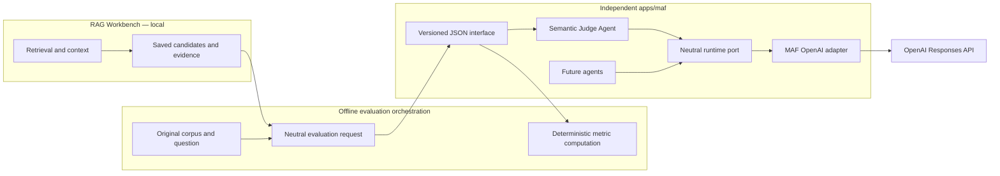

# MAF Agent Runtime — independent module architecture

**Created:** 2026-11-27  
**Updated:** 2026-11-27  
**Status:** Proposed architecture; not an implemented capability  
**Repository snapshot inspected:** `d31eb5ca283523f90584a61c80ca6a90d6fccfe9`

## Decision

The Microsoft Agent Framework module is an independent Python application in the same repository, not a submodule of RAG Workbench. Its first agent is the semantic judge. Future agents can use its execution boundary without adopting RAG, PostgreSQL, Haystack or embedding infrastructure.



Arrows between modules are data exchange, not Python imports. The evaluation runner owns RAG-specific mapping, reading authorized originals/captures, exact evidence validation, metric calculation and report publication. MAF receives explicit text and opaque identifiers; it never queries the index, accesses the RAG database, loads a Workbench object, reads the source repository through tools or changes the gold dataset. Workbench must run normally when MAF is absent/offline.

## Independent layout (proposed)

```text
apps/
  workbench/                  # existing RAG application
  maf/
    pyproject.toml            # own package/dependencies/Hatch
    README.md
    AGENTS.md
    .env.example             # names and harmless defaults only
    src/maf_runtime/
      contracts.py
      configuration.py
      runtime.py
      cli.py
      __main__.py
      adapters/
        maf_openai.py        # all provider SDK coupling here
      agents/
        semantic_judge/
          contracts.py
          instructions.py
          agent.py
    tests/
```

No empty placeholder agents or speculative workflow engine. Future agents get their own typed input/output and instruction revision inside `agents/`; they reuse runtime, configuration and lifecycle. No root Haystack distribution dependency on MAF and no Workbench dependency on MAF. Initial integration: local CLI with versioned JSON request/result envelope, caller-owned file exchange or stdin/stdout. A local HTTP service is optional future work and not a requirement for the judge. Use the existing evaluation UI as the caller, not a second UI platform.

## Provider boundary

- Neutral model profile requests structured output, adequate context and optionally reasoning controls.
- Composition maps the profile to the MAF Responses adapter. Initial proposed OpenAI model: `gpt-6.2-sol` (GPT-6.2 Sol), configurable and subject to actual API access and qualification. No hard-coded model inside judge policy.
- Direct OpenAI API, not Azure OpenAI or ChatGPT/Codex plan. Official MAF [provider](https://learn.microsoft.com/en-us/agent-framework/integrations/by-component/model-providers/openai), [structured outputs](https://learn.microsoft.com/en-us/agent-framework/agents/structured-outputs), [model catalog](https://developers.openai.com/api/docs/models), [Sol](https://developers.openai.com/api/docs/models/gpt-6.2-sol). Check released package API when implementing.
- Fresh stateless context for each decision, no tools/web search/RAG access, no automatic fallback. Local strict schema validation and deterministic quote/locator checks. No exposing internal reasoning; only concise evidence-based rationale.
- Live calls explicitly enabled with approved non-sensitive data and a per-run spending cap; offline default. No credentials in prompts or artifacts, no raw payload telemetry. Verify `store=false`; provider retention may still apply (see [data controls](https://developers.openai.com/api/docs/guides/your-data)).

## Evaluation roles and order

1. Source-first pass: the judge sees the question and authorized original material, not retrieval results, old labels or scores. Derive answerability within supplied scope, expected facts, qualifiers and exact original evidence. Incomplete source coverage cannot prove absence.
2. Reference audit: separate stateless comparison of source-derived findings against old reference facts. The runner validates quotes/locators and proposes versioned corrections.
3. Candidate judgments: fresh contexts with the question, approved reference facts and one candidate (or explicit evidence set); no rank, arm, prior labels or similarity. Grade direct/partial/support vs topic-only/wrong-scope/contradiction/unknown. Each positive grade must have a quote and claim/constraint mapping.
4. Context assessment: judge actual selected pack for sufficiency, missing facts, irrelevant spans, contradictions and constraint matches. Generation assessment is later and only on actual generated responses.
5. Runner recomputes metrics deterministically, records unresolved cases and compares against previous revision. The judge is neither the retriever nor the reranker and does not compute final scores, write gold or promote a profile.

A separate model call alone does not establish a valid benchmark. Source-derived labels, small explicit regression cases, semantic agreement checks, uncertainty, immutable revisions and deterministic validation are required. The manually reported three cases are mandatory diagnostic controls; do not silently hard-code outcomes into the general prompt. No human-review workflow prerequisite.

## Delivery

- [MAF-001](TASK-MAF-001-independent-agent-runtime.md): standalone runtime and live smoke.
- [MAF-002](TASK-MAF-002-semantic-judge-agent.md): reusable judge with typed evaluations and controlled qualification.
- [DATASET-002](../quality/TASK-RAG-DATASET-002-source-grounded-ranking-judgments.md): re-audit saved OPEN source references and candidates via MAF, publish corrected version and metrics. Do not repeat full retrieval solely for relabeling.
- [QUALITY-002](../quality/TASK-RAG-QUALITY-002-retrieval-release-gate-and-regression.md): require validated labels and useful-context measures for release qualification. Later [QUALITY-003](../quality/TASK-RAG-QUALITY-003-grounded-answer-correctness-evaluation.md) consumes answer-mode judgments.

No MAF implementation or API requests were performed by this architecture document.
