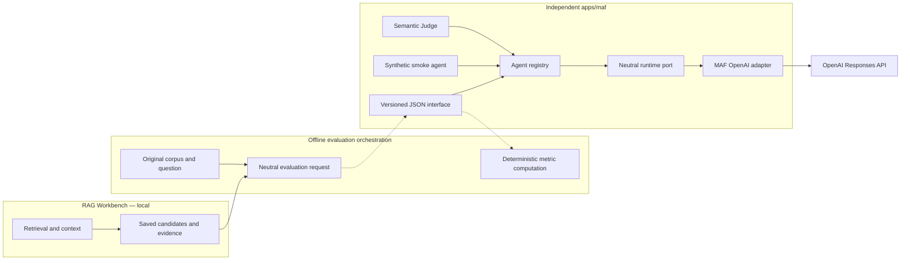

# MAF Agent Runtime — independent module architecture

**Created:** 2026-11-27  
**Updated:** 2026-11-28

**Status:** Runtime 0.3.3 gives both Sol profiles the same application limits and Semantic Judge modes. GPT-6.1 Sol has historical v8 live evidence from runtime 0.3.1. [Shared policy and evidence](TASK-MAF-002-semantic-judge-agent.md#shared-sol-limits-only--operator-decision)

**Repository base inspected:** `482c8d980db6a06ef88532f60bf97cae002cdb0e` plus the scoped MAF implementation. Live qualification is tracked in [MAF-001](TASK-MAF-001-standalone-agent-runtime.md).

## Decision

**Current implementation policy (2026-11-28):** [MAF-002](TASK-MAF-002-semantic-judge-agent.md) reopens cache/accounting/diagnostic and configured-model admission. Both configured Sol models share the existing limits and are selectable without separate or joint paid qualification. Historical v8 calibration is evidence only; not a new model entitlement. Use offline contract/SDK-wire tests, then actual source-grounded evaluation in [DATASET-002](../quality/TASK-RAG-DATASET-002-source-grounded-ranking-judgments.md). Caller owns incremental evidence/checkpoints, aggregate budgets and RPM/TPM pacing. [UI-005](../TASK-UI-005-agent-operations-model-selection-and-live-usage.md) consumes safe journal records; [OPS-001](../TASK-RAG-OPS-001-tracing-evaluation-and-search-quality-gates.md) provides an optional trace mirror. No MAF/RAG SDK coupling.

The Microsoft Agent Framework module is an independent Python application. It ships a synthetic smoke agent and a Semantic Judge with four stateless modes. Both use the versioned CLI, agent registry and runtime. The local evaluation runner exchanges requests and results through the CLI.



Arrows between modules are data exchange, not Python imports. The evaluation runner owns RAG-specific mapping, reading authorized originals/captures, exact evidence validation, metric calculation and report publication. MAF receives explicit text and opaque identifiers; it never queries the index, accesses the RAG database, loads a Workbench object, reads the source repository through tools or changes the gold dataset. Workbench must run normally when MAF is absent/offline.

**Shared Sol policy (2026-11-28).** Both profiles load the same application input, output, transport and deadline limits. The current delivery is the standalone runtime configuration and its offline checks. [UI-005](../TASK-UI-005-agent-operations-model-selection-and-live-usage.md) owns operator selection and use of eligibility evidence.

## Independent layout

```text
apps/
  workbench/                  # existing RAG application
  maf/
    pyproject.toml            # own package/dependencies/Hatch
    README.md
    .env.example             # names and harmless defaults only
    src/agent_runtime/
      contracts.py
      configuration.py
      runtime.py
      cli.py
      __main__.py
      adapters/
        maf_openai.py        # all provider SDK coupling here
      agents/
        structured_smoke.py  # synthetic fixture and typed input/output
        semantic_judge/      # mode registration, schemas, prompts, evidence validation
    calibration/            # frozen controls, bounded runner and agreement metrics
    tests/
```

The runtime ships its own Hatch project and a local CLI with a versioned JSON request/result envelope on stdin/stdout. Future agents get their own typed input, output and instruction revision. The evaluation caller owns the exchange and can use the existing evaluation UI. See the [standalone runbook](../../apps/maf/README.md).

Runtime 0.3.3 imposes a 16 KiB CLI envelope, 16,384 estimated input units, 32,000 generated tokens, a 128 KiB response-body ceiling and a 45-second deadline on both Sol profiles. The configured rates give each a USD 0.397056 worst-case reserve. `judge_context` accepts up to 12 excerpts while the other judge modes hold up to eight excerpts per list. The runner preserves the full saved fragment text, order, offsets and hashes. The v8 pilot measured 37 saved passages and nine complete packs under runtime 0.3.1 with GPT-6.1 Sol. [Runtime limits](../../apps/maf/README.md#execution-limits-and-estimated-spend) · [Recorded v8 pilot](../evidence/dataset-semantic-pilot-full-2026-11-28/report.md)

## Provider boundary

- Neutral model profile requests structured output, adequate context and optionally reasoning controls.
- Configuration maps `semantic-review` to `gpt-6.1-sol` and `semantic-review-6.2` to `gpt-6.2-sol`. Both use the same MAF Responses adapter and Semantic Judge definitions. The default profile remains `semantic-review` and model selection is explicit through the request profile ID.
- Direct OpenAI API, not Azure OpenAI or ChatGPT/Codex plan. Official MAF [provider](https://learn.microsoft.com/en-us/agent-framework/integrations/by-component/model-providers/openai), [structured outputs](https://learn.microsoft.com/en-us/agent-framework/agents/structured-outputs), [model catalog](https://developers.openai.com/api/docs/models), [GPT-6.1 Sol](https://developers.openai.com/api/docs/models/gpt-6.1-sol), [GPT-6.2 Sol](https://developers.openai.com/api/docs/models/gpt-6.2-sol). Check released package API when implementing.
- The runtime starts fresh for each invocation and validates the structured output locally. Its CLI exposes no tools, web search, RAG access, or automatic provider fallback. The planned judge owns deterministic quote and locator validation and returns concise evidence-based rationale.
- Live calls explicitly enabled with approved non-sensitive data and a per-run spending cap; offline default. No credentials in prompts or artifacts, no raw payload telemetry. Verify `store=false`; provider retention may still apply (see [data controls](https://developers.openai.com/api/docs/guides/your-data)).

## Evaluation roles and order

1. Source-first pass (`derive_reference`): the judge sees the question and authorized original material, not retrieval results, old labels or scores. Derive answerability within supplied scope, expected facts, qualifiers and exact original evidence. Incomplete source coverage cannot prove absence.
2. Reference audit: the caller compares the frozen `derive_reference` output with old reference facts, validates quotes/locators and proposes versioned corrections. Keep this outside the judge's source-first prompt. No fifth mode is required.
3. Candidate judgments (`judge_evidence`): fresh contexts with the question, approved reference facts and one candidate (or explicit evidence set); no rank, arm, prior labels or similarity. Grade direct/partial/support vs topic-only/wrong-scope/contradiction/unknown. Each positive grade must have a quote and claim/constraint mapping.
4. Context assessment (`judge_context`): judge actual selected pack for sufficiency, missing facts, irrelevant spans, contradictions and constraint matches. Generation assessment (`judge_answer`) is later and only on actual generated responses.
5. Runner recomputes metrics deterministically, records unresolved cases and compares against previous revision. The judge is neither the retriever nor the reranker and does not compute final scores, write gold or promote a profile.

A separate model call alone does not establish a valid benchmark. Source-derived labels, small explicit regression cases, semantic agreement checks, uncertainty, immutable revisions and deterministic validation are required. The manually reported three cases are mandatory diagnostic controls; do not silently hard-code outcomes into the general prompt. No human-review workflow prerequisite.

## Delivery

- [MAF-001](TASK-MAF-001-standalone-agent-runtime.md): standalone runtime and live smoke.
- [MAF-002](TASK-MAF-002-semantic-judge-agent.md): implemented reusable judge, typed evaluation contract and measured qualification result.
- [DATASET-002](../quality/TASK-RAG-DATASET-002-source-grounded-ranking-judgments.md): re-audit saved OPEN source references and candidates via MAF, publish corrected version and metrics. Do not repeat full retrieval solely for relabeling.
- [QUALITY-002](../quality/TASK-RAG-QUALITY-002-retrieval-release-gate-and-regression.md): require validated labels and useful-context measures for release qualification. Later [QUALITY-003](../quality/TASK-RAG-QUALITY-003-grounded-answer-correctness-evaluation.md) consumes answer-mode judgments.
