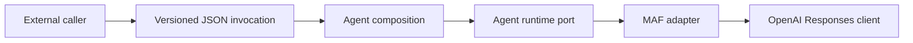

# TASK-MAF-001 — Establish an independently runnable Microsoft Agent Framework application

**Created:** 2026-11-27  
**Updated:** 2026-11-27  
**Status:** Complete. Offline checks and the `semantic-review` live smoke passed.

**Priority:** P0  
**Repository snapshot inspected:** `d31eb5ca283523f90584a61c80ca6a90d6fccfe9`  
**Consumer:** [MAF-002](TASK-MAF-002-semantic-judge-agent.md)  
**Architecture:** [MAF module boundary](MAF_ARCHITECTURE.md)

## A. Title

Create a self-contained agent runtime application using Microsoft Agent Framework (MAF), with an OpenAI Responses API adapter and a portable typed invocation boundary.

## B. Context / Problem

The user requires an agent subsystem that can grow independently of the RAG application. The first consumer is a semantic judge for evaluating questions, original evidence and retrieved passages. Neither RAG implementation nor Haystack should be responsible for executing MAF agents, handling external model credentials, or carrying MAF/provider dependencies. Future agents must be addable without changing retrieval, embedding or PostgreSQL internals.

## C. Current Repository State

- Recursive repository inspection at the recorded commit contains only `apps/workbench` under `apps/`; no MAF application or semantic judge runtime is present.
- [Root pyproject.toml](../../pyproject.toml) has a detached `workbench-api` Hatch environment, including the repository Haystack library and local ingestion/retrieval dependencies; the root wheel targets only `haystack`. Reuse the isolation principle, not its dependency set.
- [AGENTS.md](../../AGENTS.md), [engineering conventions](../../docs-website/ENGINEERING.md) and [project map](../../docs-website/PROJECT_MAP.md) require ownership-based module placement, semantic names and Hatch-managed execution.
- [DATASET-002](../quality/TASK-RAG-DATASET-002-source-grounded-ranking-judgments.md) and [full OPEN report](../evidence/dataset-ranking-full-open-2026-11-26/report.md) show existing local review/scoring artifacts; there is no external judge invocation contract. Existing local review tooling and deterministic scorer remain RAG evaluation owners.
- The user explicitly requests the Microsoft Agent Framework and OpenAI API for this new module. The [official MAF OpenAI provider guide](https://learn.microsoft.com/en-us/agent-framework/agents/providers/openai/), [Python breaking-change guide](https://learn.microsoft.com/en-us/agent-framework/support/upgrade/python-2026-significant-changes) and [provider package](https://pypi.org/project/agent-framework-openai/) document the current `agent-framework-openai` package and `OpenAIChatClient` for Responses. Older examples naming `OpenAIResponsesClient` or using `model_id` are not the current Python contract. Reverify the actual installed version and signatures at implementation time.
- [OpenAI model documentation](https://developers.openai.com/api/docs/models/gpt-6.1-sol) confirms `gpt-6.1-sol` supports Responses and structured outputs. Account-specific access, exact runtime compatibility and usage are NOT_TESTED.

## D. Goal

Run a real, typed MAF agent request through the configured direct OpenAI adapter from an isolated application environment, without importing or installing Haystack, Workbench, PostgreSQL, Docling, TEI or reranker components. Demonstrate that the runtime can be relocated or executed alone with its own configuration and tests.

## E. Scope

Independent Python project, dependency isolation, minimal provider-neutral invocation interface and agent registry/composition, MAF adapter, direct OpenAI client configuration, structured output validation, CLI transport, bounded execution and usage/error reporting. One real structured-output smoke and credential-free offline tests. No evaluation-specific semantics in this task.

## F. Non-Goals

No new RAG pipeline, external database, UI, web service, network port, hosted agent, Azure subscription, Microsoft Foundry, distributed queue, MCP server, multi-agent graph, agent memory, tool execution or automatic startup. No changes to the local retrieval/generation model, existing provider implementations or the root Haystack package. No generic framework reimplementation or speculative managers/factories. The semantic judge is MAF-002.

## G. Architecture / Boundaries

- [x] Domain / core — application-owned invocation and model-profile DTOs, independent of vendor SDKs.
- [x] Application / orchestration — resolve a registered agent and a compatible configured profile.
- [x] Port / interface / contract — one narrow typed agent-runtime invocation port and versioned JSON transport.
- [x] Provider adapter — MAF adapter with OpenAI Responses client construction.
- [ ] Persistence / vector store — N/A; no persistent service store.
- [ ] Retrieval / RAG — N/A; neither module imports the other.
- [x] Agent runtime — use MAF's Agent/run API, not a custom loop.
- [x] Security / governance — explicit external-call enablement, bounded egress and secrets.
- [x] Observability / evidence — safe request IDs, usage, duration, error codes.
- [x] Infrastructure / CI/CD — independent Hatch project and offline checks only; no mandatory cloud CI.
- [x] Documentation — standalone README and versioned contract documentation.



Use `apps/maf/` beside `apps/workbench/`. The new application has its own `pyproject.toml`, Hatch environments, package source and tests. Prefer a small standalone package under `apps/maf/src/agent_runtime/`. Application policies and agent instructions depend on typed local contracts; only the adapter/composition imports `agent_framework` and provider SDKs. Do not install the root project as a dependency of this package. The existing evaluator may invoke the standalone CLI through its own boundary adapter; neither core app needs the other's Python package.

## H. Contracts / Interfaces / Data Model

Define a small, versioned, provider-neutral request/result envelope with opaque `request_id`, `schema_version`, registered `agent_id`, `profile_id`, typed input, outcome and typed output. No arbitrary SDK options, user-supplied system instructions or executable import paths. Invocation metadata includes actual returned model identity (if available), provider/profile, package/prompt/schema revisions, elapsed time, provider-reported input/output/reasoning/cached tokens where reported, and safe correlation ID. Missing usage remains null/unknown. Operational failures (invalid input, unsupported capability, missing credentials, blocked egress, timeout, rate limit, provider failure, refusal, incomplete output, invalid schema, budget exceeded, cancellation) are distinct from valid agent results.

A profile declares required capabilities, context/output caps and execution policy. Adapter configuration maps it to the selected provider/model and secret reference. First configured mapping: profile `semantic-review`, direct OpenAI Responses, model `gpt-6.1-sol`, configurable supported reasoning effort (initial medium); do not hard-code this model in agent logic or silently fall back to another model. Validate capability and account access by a bounded real smoke. Current MAF docs support `OpenAIChatClient(model=...)` and `Agent.run(..., options={"response_format": ...})`; use the pinned release's actual supported API and validate output independently. No forced temperature/seed arguments unsupported by reasoning models.

Local transport: an explicitly invoked CLI, one versioned JSON request/result on stdin/stdout, or a bounded JSONL batch composed of independent requests using the same contract. Stdout contains machine-readable responses only; diagnostic logs go to stderr. No provider SDK objects or file paths from untrusted payloads cross the boundary. No network listener required. Future HTTP or agent-to-agent transport can use the same DTOs in a separate task.

## I. Repository Files / Components Impacted

Expected new files under `apps/maf/`: `pyproject.toml`, README, safe configuration example, package entry point, typed contracts, composition/configuration, runtime adapter with direct OpenAI client, minimal offline smoke fixture and tests. Exact filenames follow ownership and existing engineering conventions. Add scoped ignore rules only if needed. The app's own Hatch scripts should expose `run`, `test`, `check`, `types` and explicit `smoke`. Update project map and local module documentation to reflect actual behavior after implementation.

MUST NOT modify `haystack/`, `apps/workbench/`, Workbench dependency versions, root start.ps1, retrieval profiles, shared embedding capacity ledger, Docker services, DB schema or existing evaluation artifacts. Do not add MAF to root/library or Workbench dependencies. No new global environment-variable side effects.

## J. Implementation Requirements

1. Inspect current package ownership and official installed MAF interfaces. Resolve/pin mutually compatible MAF core/provider and SDK dependency versions in this independent project, recording versions and licenses. Use Hatch and its configured installer, not direct pip/python. No unpinned main checkout or old preview snippets as production API contract.
2. Implement the minimal neutral DTOs and runtime port, explicit agent registry/composition and a real async MAF invocation. Create client only on explicit execution; no credentials, outbound requests or SDK client construction on import, test discovery, app startup or unrelated Workbench execution. Unknown agent/profile/capability fail before provider execution. Use a fake port for deterministic tests.
3. Bind the direct OpenAI adapter to an environment-resolved secret (OPENAI_API_KEY); no Azure/Foundry routing or provider fallback unless explicitly configured in future. Use a fixed trusted endpoint, not request-controlled base URLs. Map model and reasoning settings at the adapter boundary; pin resolved configuration for runs.
4. Use MAF structured outputs with strict validated schema, required fields, bounded text/list sizes and no extra fields. Reject malformed, refusal, truncated or incomplete responses. Do not turn transport errors into semantic results. The framework must actually construct and execute an agent; direct SDK-only calls are not MAF implementation.
5. No tools, retrieval access, web/file search, code execution, persistent sessions, conversation carry-over or hosted memory in the initial agent profile. Each invocation is stateless. Treat supplied text as untrusted data. Set and verify `store=false` on Responses requests if supported; fail closed for external evaluation if required privacy settings cannot be applied. Do not describe this as zero provider retention.
6. Enforce explicit external-call opt-in, request/response size, token/output, timeout, total requests and concurrency bounds; account for retries and estimated cost, with a finite run budget. No indefinite retry, background server or hidden automatic execution. Report actual usage where available and estimated spend with pricing version, not invented cost. Keep secrets out of child process arguments and logs.
7. Execute the standalone CLI from its own project, with Workbench and local GPU services stopped or absent in the test environment. Prove real OpenAI structured response and actual model/usage metadata using a non-sensitive synthetic smoke input. If key/access/network unavailable, record BLOCKED_REAL_API, do not simulate success. No user-provided private document needed for smoke.

### Runtime boundary clarification — 2026-11-27

The [MAF architecture](MAF_ARCHITECTURE.md) is the shared module layout and ownership reference. The existing profile `semantic-review` initially maps to `gpt-6.1-sol` as requested; the [newer GPT-6.2 Sol](https://developers.openai.com/api/docs/models/gpt-6.2-sol) is an optional separately qualified profile, not an automatic replacement. Verify actual account entitlement by a live smoke. Keep explicit package entry point and versioned JSON transport independent of the repository working directory. No Workbench imports in MAF, no MAF imports in Workbench, no RAG startup hook. Limit per-run estimated maximum spend before submission; report actual usage, uncertainty and retry consumption. Reuse complete identical case outputs only through caller-owned checkpoint hashes; no persistent shared conversational state.

## K. Security / Governance / Observability

The user has requested an external provider for evaluation, not unrestricted data upload. Default external invocation disabled; use explicit run opt-in and approved payload classification. Never send customer/workspace private files, secrets, internal configuration, full repository dumps or local paths. The external adapter resolves credentials at invocation only; keys do not enter DTOs, prompts, logs, fixtures or committed files. No provider data retention guarantee: consult [OpenAI API data controls](https://developers.openai.com/api/docs/guides/your-data), including abuse-monitoring retention. Keep logs metadata-only by default; no prompt/response text, reasoning traces or secret-bearing errors in shared logs. The local CLI does not grant filesystem, retrieval, tenant or write privileges. Use bounded errors, trace IDs and local-only sanitized evidence. No new account hierarchy, manual reviewer or secret vault required.

## L. Testing / Evaluation / Runtime Verification

From `apps/maf/`, verify `hatch --version`, then run the new configured Hatch check/test/types targets. Test invalid schema, unknown agent/profile, no SDK imports in neutral package, missing key, disabled egress, unsupported model capability, timeout, 429, cancellation, refusal, incomplete output, bad JSON, budget and input limits, secret redaction, usage-null behavior and CLI stdout contract. Use fake runtime and transport tests (capture actual request settings such as no tools, storage and output format). Verify forbidden imports and clean independent environment without Workbench/Haystack/DB dependencies. Prove startup/import/test does not call provider. Run one opt-in real non-sensitive OpenAI smoke via MAF and record actual response envelope, provider model, elapsed time and usage safely. A mocked smoke is not a live pass. Keep original Workbench behavior unchanged; run relevant static boundary/regression checks if shared documentation/config is touched.

### Verification record — 2026-11-27

Implementation was checked against repository base `482c8d9`. The [standalone README](../../apps/maf/README.md#setup-and-offline-checks) lists installed SDK versions and licenses. The adapter uses the released MAF `Agent.run()` and `OpenAIChatClient` APIs. The package follows the detached Workbench Hatch environment pattern with its own manifest and wheel. [Microsoft OpenAI provider documentation](https://learn.microsoft.com/en-us/agent-framework/integrations/by-component/model-providers/openai)

| Verification | Observed result |
| --- | --- |
| `hatch --version` and `hatch env create` | Hatch 1.18.2 installed the independent environment on Windows with Python 3.12.1. |
| `hatch run check` and `hatch run types` | Ruff lint and format checks passed. Strict mypy checked 10 source files. |
| `hatch run test` | 56 passed. 19 adapter cases use the installed MAF and OpenAI SDKs with a mocked HTTP transport. Other cases use the neutral runtime port or installed CLI. |
| `hatch build --target wheel` | Built `rag_maf_agent_runtime-0.1.0-py3-none-any.whl` and inspected its package and console entry point. |
| Installed CLI from an unrelated directory | Import and CLI subprocess tests passed. The isolation test denies provider imports and socket/DNS access on the neutral import path. |
| Independent Linux container at `/opt/maf` with `--network none` | Hatch 1.18.2 on Python 3.12.15 passed lint, format, strict typing and all 56 tests. Only the MAF source and test directories were mounted. The opted-in CLI smoke returned `MISSING_CREDENTIALS` with zero requests. |
| `hatch run run` with the README request and no opt-in | Exit 1, `EGRESS_DISABLED`, one JSON result and zero provider requests. |
| `hatch run smoke --allow-external` before credentials were supplied | Exit 1, `MISSING_CREDENTIALS`, zero provider requests. |
| `hatch run smoke --allow-external` with a session-scoped key | The operator ran the command from `apps/maf/` in Windows PowerShell. One live OpenAI request returned `cobalt` with model `gpt-6.1-sol` in 6,433 ms. |

The operator supplied the successful CLI result. The recorded envelope redacts the provider correlation ID.

```json
{
  "schema_version": 1,
  "request_id": "synthetic-marker-smoke",
  "agent_id": "structured-smoke",
  "profile_id": "semantic-review",
  "outcome": "ok",
  "output": {"marker": "cobalt"},
  "error": null,
  "metadata": {
    "runtime_revision": "0.1.0",
    "elapsed_ms": 6433,
    "provider": "openai",
    "configured_model": "gpt-6.1-sol",
    "model": "gpt-6.1-sol",
    "prompt_revision": "1",
    "output_schema_revision": "1",
    "correlation_id": "[redacted]",
    "usage": {
      "input_tokens": 101,
      "output_tokens": 26,
      "reasoning_tokens": 10,
      "cached_input_tokens": 0
    },
    "requests": 1,
    "retries": 0,
    "pricing_version": "openai-standard-2026-11-27",
    "estimated_max_cost_usd": "0.045056",
    "estimated_cost_usd": "0.00056375"
  }
}
```

This run confirms the account's access and structured output for `semantic-review` with the synthetic fixture. The optional `semantic-review-6.2` profile requires its own live qualification. The estimate uses published Standard rates with a regional allowance. Parallel runs in separate processes require a caller-owned aggregate budget. [Runtime contract and limits](../../apps/maf/README.md)

Changed paths are `apps/maf/` for the standalone package, CLI, tests and runbook, `AGENTS.md` and `docs-website/PROJECT_MAP.md` for routing, `tasks/maf/` for architecture and verification, `tasks/quality/IMPLEMENTATION_ORDER.md` for delivery status, and one release note under `releasenotes/notes/`.

## M. Acceptance Criteria

- [x] Independent package installs and runs in its own Hatch environment.
- [x] Provider-neutral request/result and runtime contract are validated. Explicit profiles preserve model selection at the adapter boundary.
- [x] The opted-in MAF invocation returned the expected structured marker, actual model and token usage from direct OpenAI.
- [x] Offline tests cover errors, refusal, budget, cancellation, egress, secret redaction and import isolation.
- [x] The standalone CLI works independently of Workbench and uses stdin/stdout.
- [x] Resolved direct dependencies, checks, configured model and live limits are recorded.

## N. Documentation / Migration / Compatibility / Rollback

Document separate setup, supported package versions, environment and profile settings, JSON contract, opt-in live smoke, data handling and error semantics in the new application README. No database migration or change to existing RAG contracts. Remove/disable the standalone app or its opt-in invocation to roll back; RAG remains functional. Future agents register in this module; future transport/orchestration requires a separate bounded task.

## O. Mandatory Completion Checklist

- [x] Reinspect repository, official APIs and compatible dependencies.
- [x] Implement and verify independently runnable package, actual MAF adapter and neutral boundary.
- [x] Run scoped offline checks and the explicit live smoke. Record the initial credential failure and subsequent live success.
- [x] Verify isolation, default egress denial and redaction. Check the diff for RAG code or configuration changes.
- [x] Update module docs and the project map. Record changed paths, offline evidence and the live smoke in Git.
