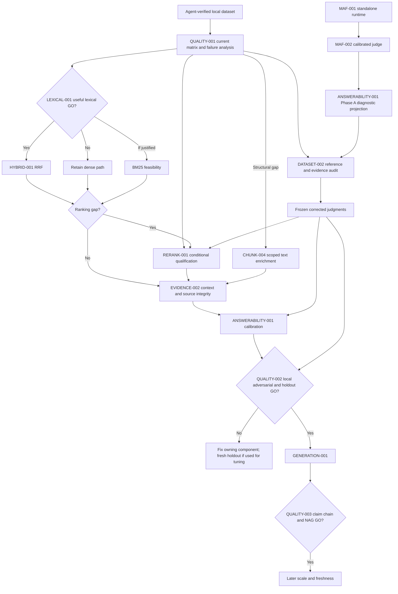

# Retrieval and answer quality — implementation order

**Created:** 2026-11-24  
**Updated:** 2026-11-28

**Status:** Active local quality roadmap. The current-stack diagnostic measured `NO_GO`. The calibrated MAF 0.3.1 judge completed the DATASET-002 full-input pilot. The full OPEN audit remains pending. [Pilot report](../evidence/dataset-semantic-pilot-full-2026-11-28/report.md)
**Source inspected:** d6cba6580e308fbb37266b779dce5b6880309a44

## Decision

The immediate project goal is finding correct, sufficient, authorized evidence on small representative documents, not accelerating inaccurate retrieval or supporting large files. [DENSE-001](../../tasks/completed/TASK-RAG-DENSE-001-live-dense-retrieval-and-exact-cosine-baseline.md) is complete for the local exact baseline. [actual Dense evidence](../../tasks/evidence/dense-2026-11-24/report.md): 102 active vectors, 52 queries (46 answerable and six no-answer), two relevant labels per answerable case; primary@1 31/46 (0.673913), primary@5 44/46 (0.956522), Recall@5 86/92 (0.934783), MRR@10 0.942029, nDCG@5 0.845519 (preserved embedding evidence); all six no-answer cases return neighbors. Exact SQL/HTTP agreement is demonstrated, independent production relevance is not. No independently reviewed relevance gate has passed. Current stack uses local TEI/Qwen3-Embedding-4B (2560 dims), PostgreSQL/pgvector exact and native FTS. No change to current 10k/50 MiB limits, large upload path, production tenant scope or model provider.

**External-domain evaluation added (2026-11-24):** [External dataset V1](dataset/README.md) contains 31 actual source Markdown documents, 306 multilingual query/answer rows (102 correlated families) and [execution protocol](dataset/EXTERNAL_EVALUATION_PROTOCOL_V1.md). DATASET-001 must review/admit this alongside the internal seed; QUALITY-001, QUALITY-002 and later QUALITY-003 execute and report it separately. The original open labels are visible; the later agent-verified local delivery includes separate R2 and ANSWER groups, not an independently blinded benchmark. No large-file ingestion, ANN or unsupported parser prerequisites; no quality claim from static corpus collection.

## Robustness and content understanding amendment — 2026-11-26

The [quality, robustness and content-understanding plan](RAG_QUALITY_AND_CONTENT_UNDERSTANDING_PLAN_2026-11-26.md) defines seven additional stage-specific metrics, their local experiment contracts, and reuse decisions from the Azure Content Understanding samples. The [actual DATASET-001 report](../evidence/dataset-2026-11-24/report.md) records the completed local delivery and OPEN V2 retrieval baseline. It reports zero natural-query FTS hits on 306 queries, while literal native controls passed 10/10. The QUALITY-001 matrix, failure analysis and matched Markdown UI experiment are complete with INSUFFICIENT_WITH_CURRENT_STACK. The bounded source-fidelity assessment is complete; preserve its 18/219 semantic-facet scope and do not restart the matrix. Qualify a useful lexical query policy before claiming hybrid benefit; a dense-only reranker remains valid if lexical is NO-GO. If structural problems are demonstrated, run the narrow text-only CHUNK-004 experiment without making multimodal storage or vision a prerequisite.

Keep local evaluation autonomous: no enterprise reviewers, separate accounts, vault, cloud model or mandatory telemetry platform. Preserve source integrity, local split isolation, existing immutable profiles and runtime budgets. The proposed new stress thresholds are project choices, frozen before their evaluation, not measurements or standards.

## Corrective execution after the diagnostic — 2026-11-26

The [actual report](../evidence/quality-2026-11-25/report.md) shows eight historical arms and a separate matched cleaned Markdown pair. Use the latter generic 500/50 canonical-LF originals-only corpus as the next comparison baseline: any-complete-fact@1 194/261 (74.33%), @5 255/261 (97.70%), all-facts@5 237/261 (90.80%), all-facts@10 246/261 (94.25%), all-context at 2048 source-content tokens 240/261 (91.95%). The selected code-query on the old source-window corpus is not this baseline. Do not claim a combined policy was evaluated. The later DATASET-002 full OPEN pool reported provisional Primary Evidence Hit and pooled ranking metrics; exhaustive recall/nDCG remain NOT_EVALUABLE. Semantic validity of the prior reference/occurrence judgments is now under audit; preserve the prior scores as historical, not qualified gold.

The corrective retrieval experiments LEXICAL-001 and dense-only RERANK-001 can capture candidate rankings in parallel with the independent judge work, without waiting for hybrid (serialize GPU-intensive runs under shared admission). Do not finalize semantic qualification or tune against unverified reference grades. Native FTS diagnosis is already complete, not another prerequisite experiment. Narrow CHUNK-004 is activated by observed structural gaps, but remeasure remaining losses on cleaned source before changing chunk policy. Use existing local UI/Workbench for new functional checks. Compare one factor at a time, then evaluate the combined winning policies on the same OPEN corpus, with fixed candidate/context budgets and cohort/negative regressions. Do not promote until QUALITY-002 frozen R2 GO. No new evaluation service or enterprise governance.

## Independent semantic assessment — 2026-11-27

User-observed failures on EXT-LIT-001, EXT-NA-003 and EXT-ART-003 require revalidation of question constraints, reference completeness and actual evidence support. The [historical full OPEN report](../evidence/dataset-ranking-full-open-2026-11-26/report.md) records 102 families, 306 translated questions, 1241 pooled judgments and 409 checks. Those checks establish structural and arithmetic consistency, not semantic correctness; the previous metrics are provisional. [DATASET-002](TASK-RAG-DATASET-002-source-grounded-ranking-judgments.md) is reopened. Preserve old revisions and saved predictions; no new full retrieval matrix just to audit grades.

The standalone `apps/maf/` application owns the provider-neutral invocation contract, model profiles and direct OpenAI Responses adapter. Its synthetic smoke passed with `gpt-6.1-sol`. MAF-002 owns Semantic Judge implementation and calibration. The local DATASET-002 pilot used the versioned CLI with approved public source excerpts and received structured judgments. The evaluator owns source selection, deterministic scoring, labels and release decisions. [MAF architecture](../maf/MAF_ARCHITECTURE.md) · [MAF-001 verification](../maf/TASK-MAF-001-standalone-agent-runtime.md) · [MAF-002](../maf/TASK-MAF-002-semantic-judge-agent.md)

Execution order for semantic review: preserve completed MAF smoke, historical control/pilot evidence and ANSWERABILITY-001 Phase A → finish MAF-002 engineering reuse and UI-005 diagnostics/selection → DATASET-002 offline exact-input/budget/checkpoint preflight → useful full OPEN audit → freeze corrected reference/qrel revision and rescore saved ranks → evaluate retrieval corrections. No repeated paid model qualification, dual-model calibration or identical pilot replay. Existing semantic and RAG release evidence requirements remain; keep actual model/runtime explicit and external calls bounded/opt-in.

## Immediate prerequisite amendment — 2026-11-28

[ANSWERABILITY-001 Phase A](TASK-RAG-ANSWERABILITY-001-insufficient-evidence-and-abstention.md) passed on the nine preserved pilot packs. Six support a verified answer and three represent expected no-answer in verified scope. The diagnostic projection is ready for DATASET-002 full OPEN reporting. The historical v8 PASS applies to its recorded runtime. Phase B of ANSWERABILITY-001 remains after corrected labels and EVIDENCE-002 and before QUALITY-002. Candidate capture can continue independently where already authorized. [Phase A report](../evidence/answerability-phase-a-2026-11-28/report.md)

The [current MAF-002 scope](../maf/TASK-MAF-002-semantic-judge-agent.md) reopens deferred Enterprise cache, accounting, measurement and physical-call diagnostics; both configured Sol profiles share limits and are selectable without a historical/joint PASS gate. [UI-005](../TASK-UI-005-agent-operations-model-selection-and-live-usage.md) consumes the configured catalog and repairs Activity Log. [OPS-001](../TASK-RAG-OPS-001-tracing-evaluation-and-search-quality-gates.md) implements an optional agent trace mirror in parallel, not a full-audit prerequisite.

## Reranker diagnostic and pre-audit decision — 2026-11-28

[RERANK-001 report](../evidence/reranker-2026-11-28/report.md): Dense diagnostic NO-GO at K10/K20/K50; retain Exact Dense, RERANK-002 blocked. No further reranker run before DATASET-002. Freeze exact top-10 ranks; retain 2,048 historical context and separately preflight the 4,096 top-10 replay (246/261 vs 240/261 known-fact coverage; top 20 gave no complete-context gain at the same budget). Before paid full audit, follow DATASET-002 zero-egress manifest/admission checks and explicit model/runtime/budget decision; 4,096 source tokens do not guarantee MAF transport admission. [UI-005](../TASK-UI-005-agent-operations-model-selection-and-live-usage.md) Activity diagnostic correction can run in parallel with offline preflight; verify coherent safe run telemetry before a long paid batch. Complete the reopened MAF-002 cache/accounting engineering scope; measure actual efficiency on useful audit calls rather than separate paid model tests. Reassess saved rerank arms on corrected labels later, with an additive judgment pool where needed.

## Immediate execution queue — current operator decision (2026-11-28)

| Order | Existing task | Required result |
| --- | --- | --- |
| 1 (P0) | [MAF-002](../maf/TASK-MAF-002-semantic-judge-agent.md) | Implement explicit caching, stable prefix/key, read/write/ordinary accounting, request composition, safe physical call/diagnostic/quota metadata and configured model admission; offline engineering tests. |
| 2 (P0; parallel UI work) | [UI-005](../TASK-UI-005-agent-operations-model-selection-and-live-usage.md) | Meaningful Activity Log, both configured model choices, actual cache/cost/progress/diagnostic data, bounded history; functional HTTP/browser tests. Coordinate shared contracts with MAF-002. |
| 3 (P0; offline preparation can start now) | [DATASET-002](TASK-RAG-DATASET-002-source-grounded-ranking-judgments.md) | Implement caller incremental verdict reuse/attestation, aggregate reservations and RPM/TPM pacing, preflight actual complete inputs and freeze budget. Run useful OPEN batches after MAF/UI functional handoff; measure cache efficiency there. Produce source-grounded labels, deterministic metrics and evidence-based failure localization. |
| Parallel (P1) | [OPS-001 agent slice](../TASK-RAG-OPS-001-tracing-evaluation-and-search-quality-gates.md) | Optional Langfuse-compatible journal mirror; no mandatory collector or blocking dependency for DATASET-002. |
| After corrected labels | [RERANK-001](TASK-RAG-RERANK-001-local-semantic-reranker-qualification.md), [EVIDENCE-002](TASK-RAG-EVIDENCE-002-bounded-context-and-required-facet-coverage.md) | Rescore retained reranked ranks if useful with explicit pool extension; retain NO-GO until evidence supports promotion. Improve context selection/retrieval only where the audit identifies causes. |

ANSWERABILITY-001 Phase A is done. Phase B, QUALITY-002, generation and QUALITY-003 remain downstream. Do not create new tasks or rerun completed historical experiments for their own sake. No paid calls are authorized by this roadmap; use the existing explicit authorization and aggregate budget.

## Delivery order and ownership

| Order | Task | Output / decision |
| --- | --- | --- |
| 0 | [DENSE-001](../../tasks/completed/TASK-RAG-DENSE-001-live-dense-retrieval-and-exact-cosine-baseline.md) | COMPLETE local exact SQL/HTTP reference |
| 1 | [DATASET-001](TASK-RAG-DATASET-001-independent-evidence-gold-set.md) | [Actual source-pinned seed](dataset/RETRIEVAL_EVALUATION_SEED_V1.md); agent-verified tuning + local holdout and original-source facets required |
| 2 | [QUALITY-001](TASK-RAG-QUALITY-001-current-stack-evidence-retrieval-optimization.md) | COMPLETE_DIAGNOSTIC / INSUFFICIENT_WITH_CURRENT_STACK; preserve bounded source-fidelity and historical captures |
| 2a.1 (P0) | [MAF-001](../maf/TASK-MAF-001-standalone-agent-runtime.md) | COMPLETE: standalone runtime and opted-in OpenAI smoke passed |
| 2a.2 (P0) | [MAF-002](../maf/TASK-MAF-002-semantic-judge-agent.md) | Shared Sol limits implemented; finish cache/accounting/diagnostics and configured model selection. No repeated paid qualification. |
| 2a.2a (P0) | [ANSWERABILITY-001 Phase A](TASK-RAG-ANSWERABILITY-001-insufficient-evidence-and-abstention.md#two-phase-execution-and-diagnostic-classification--2026-11-28) | COMPLETE for Phase A. Deterministic diagnostic projection and saved-pilot replay passed. |
| 2a.3 (P0) | [DATASET-002](TASK-RAG-DATASET-002-source-grounded-ranking-judgments.md) | REOPENED: source-first reference and full pooled-judgment audit, same saved predictions, new metric revision; no holdout tuning |
| 2b | [LEXICAL-001](TASK-RAG-LEXICAL-001-natural-language-query-policy.md) | Qualify useful lexical natural-query policy on OPEN; preserve literal FTS baseline; GO/NO-GO |
| 3 (conditional on useful lexical GO) | [HYBRID-001](TASK-RAG-HYBRID-001-dense-lexical-rrf-fusion-and-profile-execution.md) | Compare genuine lexical + exact dense RRF; explicit profile, no ANN dependency |
| 4 (conditional) | [BM25-001](TASK-RAG-BM25-001-bm25-extension-feasibility-and-quality-gate.md) | Benchmark real BM25 only if lexical errors warrant; decision/licensing |
| 4a (conditional) | [BM25-002](TASK-RAG-BM25-002-conditional-postgresql-bm25-search-profile.md) | Implement only on BM25 GO; FTS/RRF baseline stays independent |
| 2c (dense-only now; hybrid comparison later) | [RERANK-001](TASK-RAG-RERANK-001-local-semantic-reranker-qualification.md) | Qualify local semantic reranker if ranking gap remains; GO/NO-GO |
| 5a (conditional) | [RERANK-002](TASK-RAG-RERANK-002-qualified-reranking-integration.md) | Only after GO; approved reranking path |
| 5b (narrow, evidence-backed) | [CHUNK-004](../TASK-RAG-CHUNK-004-policy-benchmark-and-tiered-enrichment.md) | Residual structural diagnosis and bounded context variants |
| 6 | [EVIDENCE-002](TASK-RAG-EVIDENCE-002-bounded-context-and-required-facet-coverage.md) | Bounded selected context, provenance, required-facet coverage |
| 7 | [ANSWERABILITY-001](TASK-RAG-ANSWERABILITY-001-insufficient-evidence-and-abstention.md) | Phase B: measured local evidence-support and abstention policy; Phase A already precedes full audit |
| 8 | [QUALITY-002](TASK-RAG-QUALITY-002-retrieval-release-gate-and-regression.md) | Freeze candidate; local holdout, paired adversarial stress, source-chain integrity and OOD sufficiency GO/NO-GO |
| 9 | [GENERATION-001](TASK-RAG-GENERATION-001-grounded-answer-generation.md) | Only after retrieval GO: grounded answer composition, local model qualification |
| 10 | [QUALITY-003](TASK-RAG-QUALITY-003-grounded-answer-correctness-evaluation.md) | Local held-out answer correctness, Faithfulness-Plus, claim chains, noise robustness and optional answer calibration |

CHUNK-004 stays in the ingestion/chunking ownership area and is activated only when failure analysis shows structural/hierarchy gaps; start with deterministic text context and bounded enrichment. CONTENT-001/003/005 and EVIDENCE-001 remain a separately qualified visual/representation track. DELTA-001 and OPS-001 later cover local concept drift and time-to-correct replay. OPS-001 stays the common tracing owner, implement only required evaluation telemetry now; TPM-001 retains shared model admission (fresh current calibration required, broader production scope not a local gate). CONTENT-005 richer original evidence is not needed for verified text span/page retrieval; unsupported modalities are NOT_EVALUABLE. Existing completed tasks and evidence stay in place. No duplicate task IDs or competing evaluation runners.

## Evaluation design and release gates

Use identical original source scope, query labels, candidate and final context budgets (report both), fixed model/parser/chunk/profile revisions and paired runs. Compare FTS, exact, RRF, exact+reranker, RRF+reranker; optional BM25 only if GO. Always include original synthetic regression, but do not treat it as independent gold. No-answer, conflicting, wrong-version and foreign-scope cases separate from answerable recall. Required facets are original evidence facts, not chunk IDs after rechunking. Track candidate ceiling and final-context coverage separately. User-facing answer completeness and claim grounding belong to QUALITY-003.

Proposed retrieval targets: Primary Evidence Hit@1 >=0.95, Primary Evidence Hit@5 >=0.98, relevant evidence Recall@5 >=0.95, graded nDCG@5 >=0.95, All Required Facets@5 >=0.95; critical adequately sized cohorts Primary@5 >=0.95. Predeclared p95 <=1.20x identical baseline load unless an explicitly approved cost/latency trade-off is recorded. Zero observed unauthorized/stale/wrong-profile/source-hash/citation integrity violations. These are proposed point targets, not achieved results. False acceptance and false abstention each <=5% with actual reviewed denominators. Final local held-out quality gate requires source-first verification, calibrated independent MAF judge, deterministic scoring, per-cohort uncertainty and no tuning leakage. Proposed additional selected-context useful-chunk precision >=0.90 and irrelevant chunk rate <=0.10; freeze denominators/unknown treatment before evaluation. No reduction of existing gates. Enterprise certification is out of scope; no human reviewers, additional identities or special custody infrastructure are required. If thresholds fail, task may document a NO-GO but quality phase does not pass. Never infer quality from top-k size, cosine score or ANN agreement alone.

## Deferred scope

ANN-001–005 remain valid specifications in tasks/ and are deferred until retrieval GO; large-file INGEST-001–004, PDF-001, OPS-003, SCALE-001/002, broad DELTA-001/OPS-002, OCR/vision and CONVERT-001 are deferred. Existing small ingestion and RLS must remain enforced. After retrieval qualification, ANN can proceed as a separate performance track; 100k+ real corpus qualification remains dependent on INGEST-004. Neither is a dependency for the quality track. No task is silently marked complete or deleted by prioritization.

## Status

DATASET-001 has a completed local handoff per its report. QUALITY-001 completed its diagnostic matrix, UI continuation and bounded source-fidelity assessment with NO-GO. MAF-001 passed live runtime verification and MAF-002 historical v8 evidence is preserved; remaining engineering reuse is reopened. The DATASET-002 pilot completed 37/37 whole passages and 9/9 full contexts on the saved baseline. Full OPEN review and the new metric revision are pending. [Pilot report](../evidence/dataset-semantic-pilot-full-2026-11-28/report.md)
