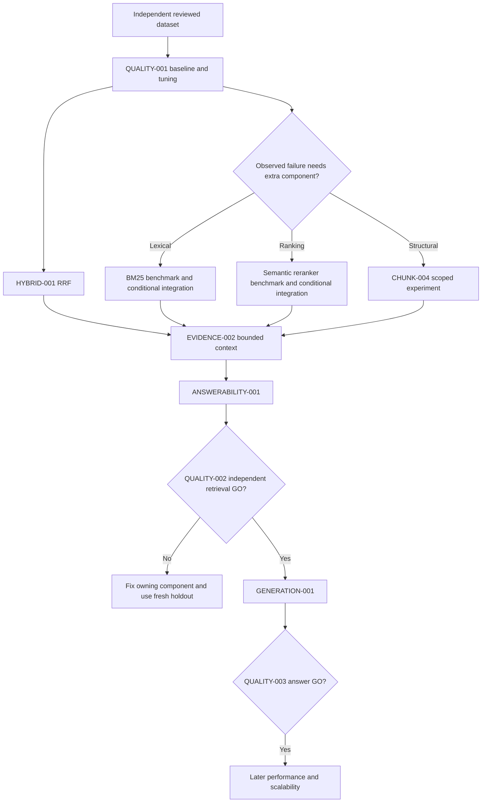

# Retrieval and answer quality — implementation order

**Created:** 2026-11-24  
**Updated:** 2026-11-24  
**Status:** PROPOSED — quality-first delivery plan, not runtime qualification  
**Source inspected:** d6cba6580e308fbb37266b779dce5b6880309a44

## Decision

The immediate project goal is finding correct, sufficient, authorized evidence on small representative documents, not accelerating inaccurate retrieval or supporting large files. [DENSE-001](../../tasks/completed/TASK-RAG-DENSE-001-live-dense-retrieval-and-exact-cosine-baseline.md) is complete for the local exact baseline. [actual Dense evidence](../../tasks/evidence/dense-2026-11-24/report.md): 102 active vectors, 52 queries (46 answerable and six no-answer), two relevant labels per answerable case; primary@1 31/46 (0.673913), primary@5 44/46 (0.956522), Recall@5 86/92 (0.934783), MRR@10 0.942029, nDCG@5 0.845519 (preserved embedding evidence); all six no-answer cases return neighbors. Exact SQL/HTTP agreement is demonstrated, independent production relevance is not. No independently reviewed relevance gate has passed. Current stack uses local TEI/Qwen3-Embedding-4B (2560 dims), PostgreSQL/pgvector exact and native FTS. No change to current 10k/50 MiB limits, large upload path, production tenant scope or model provider.

**External-domain evaluation added (2026-11-24):** [External dataset V1](dataset/README.md) contains 31 actual source Markdown documents, 306 multilingual query/answer rows (102 correlated families) and [execution protocol](dataset/EXTERNAL_EVALUATION_PROTOCOL_V1.md). DATASET-001 must review/admit this alongside the internal seed; QUALITY-001, QUALITY-002 and later QUALITY-003 execute and report it separately. The visible candidate labels are not independently human-reviewed or sealed. No large-file ingestion, ANN or unsupported parser prerequisites; no quality claim from static corpus collection.

## Delivery order and ownership

| Order | Task | Output / decision |
| --- | --- | --- |
| 0 | [DENSE-001](../../tasks/completed/TASK-RAG-DENSE-001-live-dense-retrieval-and-exact-cosine-baseline.md) | COMPLETE local exact SQL/HTTP reference |
| 1 | [DATASET-001](TASK-RAG-DATASET-001-independent-evidence-gold-set.md) | [Actual source-pinned seed](dataset/RETRIEVAL_EVALUATION_SEED_V1.md); independent human-reviewed tuning + sealed holdout and original-source facets required |
| 2 | [QUALITY-001](TASK-RAG-QUALITY-001-current-stack-evidence-retrieval-optimization.md) | Reproduce baseline and tune existing exact/FTS, chunk/input policies; no holdout tuning |
| 3 | [HYBRID-001](TASK-RAG-HYBRID-001-dense-lexical-rrf-fusion-and-profile-execution.md) | Compare genuine lexical + exact dense RRF; explicit profile, no ANN dependency |
| 4 (conditional) | [BM25-001](TASK-RAG-BM25-001-bm25-extension-feasibility-and-quality-gate.md) | Benchmark real BM25 only if lexical errors warrant; decision/licensing |
| 4a (conditional) | [BM25-002](TASK-RAG-BM25-002-conditional-postgresql-bm25-search-profile.md) | Implement only on BM25 GO; FTS/RRF baseline stays independent |
| 5 (conditional) | [RERANK-001](TASK-RAG-RERANK-001-local-semantic-reranker-qualification.md) | Qualify local semantic reranker if ranking gap remains; GO/NO-GO |
| 5a (conditional) | [RERANK-002](TASK-RAG-RERANK-002-qualified-reranking-integration.md) | Only after GO; approved reranking path |
| 6 | [EVIDENCE-002](TASK-RAG-EVIDENCE-002-bounded-context-and-required-facet-coverage.md) | Bounded selected context, provenance, required-facet coverage |
| 7 | [ANSWERABILITY-001](TASK-RAG-ANSWERABILITY-001-insufficient-evidence-and-abstention.md) | Measured insufficient-evidence / no-answer decision |
| 8 | [QUALITY-002](TASK-RAG-QUALITY-002-retrieval-release-gate-and-regression.md) | Freeze candidate and independent final retrieval GO/NO-GO; regression suite |
| 9 | [GENERATION-001](TASK-RAG-GENERATION-001-grounded-answer-generation.md) | Only after retrieval GO: grounded answer composition, local model qualification |
| 10 | [QUALITY-003](TASK-RAG-QUALITY-003-grounded-answer-correctness-evaluation.md) | Independent answer correctness/completeness/citation release gate |

CHUNK-004 stays in the ingestion/chunking ownership area and is activated only when failure analysis shows structural/hierarchy gaps. OPS-001 stays the common tracing owner, implement only required evaluation telemetry now; TPM-001 retains shared model admission (fresh current calibration required, broader production scope not a local gate). CONTENT-005 richer original evidence is not needed for verified text span/page retrieval; unsupported modalities are NOT_EVALUABLE. Existing completed tasks and evidence stay in place. No duplicate task IDs or competing evaluation runners.

## Evaluation design and release gates

Use identical original source scope, query labels, candidate and final context budgets (report both), fixed model/parser/chunk/profile revisions and paired runs. Compare FTS, exact, RRF, exact+reranker, RRF+reranker; optional BM25 only if GO. Always include original synthetic regression, but do not treat it as independent gold. No-answer, conflicting, wrong-version and foreign-scope cases separate from answerable recall. Required facets are original evidence facts, not chunk IDs after rechunking. Track candidate ceiling and final-context coverage separately. User-facing answer completeness and claim grounding belong to QUALITY-003.

Proposed retrieval targets: Primary Evidence Hit@1 >=0.95, Primary Evidence Hit@5 >=0.98, relevant evidence Recall@5 >=0.95, graded nDCG@5 >=0.95, All Required Facets@5 >=0.95; critical adequately sized cohorts Primary@5 >=0.95. Predeclared p95 <=1.20x identical baseline load unless an explicitly approved cost/latency trade-off is recorded. Zero observed unauthorized/stale/wrong-profile/source-hash/citation integrity violations. These are proposed point targets, not achieved results. False acceptance and false abstention each <=5% with actual reviewed denominators. Final held-out quality gate must have independent review, per-cohort uncertainty and no tuning leakage. High-risk enterprise claim requires predeclared stronger confidence gate or explicit reviewed risk acceptance. If thresholds fail, task may document a NO-GO but quality phase does not pass. Never infer quality from top-k size, cosine score or ANN agreement alone.

## Deferred scope

ANN-001–005 remain valid specifications in tasks/ and are deferred until retrieval GO; large-file INGEST-001–004, PDF-001, OPS-003, SCALE-001/002, broad DELTA-001/OPS-002, OCR/vision and CONVERT-001 are deferred. Existing small ingestion and RLS must remain enforced. After retrieval qualification, ANN can proceed as a separate performance track; 100k+ real corpus qualification remains dependent on INGEST-004. Neither is a dependency for the quality track. No task is silently marked complete or deleted by prioritization.

## Status

All new tasks are PROPOSED or conditional BLOCKED. DATASET-001 has an actual unreviewed 48-query starter, not independent gold. No model inference, PostgreSQL test, human review or quality target has been executed by this documentation change.
