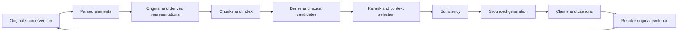

# RAG quality, robustness and content-understanding implementation plan

**Created:** 2026-11-26  
**Updated:** 2026-11-26  
**Status:** Design and execution roadmap — no new runtime results  
**Scope:** Local development, existing Haystack + Docling + PostgreSQL/pgvector + qualified TEI/Qwen embedding stack; optional qualified local generation/vision models.  
**Repository snapshot inspected:** `458349c280bc2409ecbe2b573d8e973b52e0c64c`  
**Related roadmap:** [Implementation order](IMPLEMENTATION_ORDER.md)

## 1. Sources and interpretation

- Pierre Kasparian, [7 Advanced Metrics to Evaluate Your RAG in Production](https://pierrekasparian.com/en/blog/guide/rag-evaluation-metrics-production), 28 May 2026. The direct page fetch failed; the search index returned the English article and the French counterpart with all seven metric descriptions. Its examples are illustrative, not results for this project or validated universal release thresholds.
- [Azure AI Search with Content Understanding samples](https://github.com/Azure-Samples/azure-ai-search-with-content-understanding-python/tree/82ade360894b5b7959ef546cbfe96f0ff9e1cc81), inspected notebook/template source; MIT code license, subject to notice preservation and separate source-data rights. These demonstrations use the older 2024-12-01-preview Content Understanding API. No Azure sample was executed.
- [Current project evaluation report](../evidence/dataset-2026-11-24/report.md), [aggregate data](../evidence/dataset-2026-11-24/metrics.json), [QUALITY-001](TASK-RAG-QUALITY-001-current-stack-evidence-retrieval-optimization.md), [chunking architecture](../../docs-website/docs/architecture/content-aware-chunking-strategy.md).

The article motivates seven additional measurements; the formulas, controlled experiments, task ownership and proposed local thresholds below are our implementation decisions. Retain classical ranking metrics. Do not substitute a single composite RAG score for stage-level evidence. No external service, human reviewer, enterprise approval, monitoring platform or new database is required for the local quality track.

## 2. Observed baseline and gaps

| Actual OPEN V2 result (DATASET-001, not completed QUALITY-001 matrix) | Measurement |
| --- | --- |
| Corpus | 31 originals, 144 indexed representations, 1080 embedded chunks |
| Queries | 306, including 261 answerable and 45 no-answer; 102 correlated families |
| Dense any complete known fact @1 / @5 / @10 | 176/261 (67.43%) / 246/261 (94.25%) / 252/261 (96.55%) |
| All required facts @1 / @5 / @10 | 136/261 (52.11%) / 222/261 (85.06%) / 232/261 (88.89%) |
| Art any fact @1; all facts @5 | 13/24; 17/24 |
| Literature any fact @1; all facts @5 | 32/60; 51/60 |
| Kubernetes any fact @1; all facts @5 | 37/57; 45/57 |
| FTS natural queries | 0/306 nonempty; literal native controls 10/10 |
| Dense no-answer neighbors | 45/45; not false acceptance |
| Dense HTTP/SQL parity | 306/306 |
| Sparse qrels | Full relevance recall and graded nDCG not evaluable without adequate judgments |
| Generation/answerability | Not evaluated |

The local delivery contains 103 originals and 1,563 localized records across OPEN, Retrieval-R2 and ANSWER. Do not read the reserved R2/ANSWER labels during tuning. The eight-arm uniform QUALITY-001 run was still IN PROGRESS in the inspected specification. Finish it and localize failures before changing its settings. Five Markdown 413 refusals and source-only TXT views must be investigated as representation effects, not assumed parser corruption.

## 3. Evaluation model and common rules

Freeze query families, original locators, valid alternative evidence sets, source version, parser/chunk/embedding/profile revisions, run seed, candidate limits, actual final context token budget and evaluation rubric. Distinguish original source occurrence from chunk identity. Use paired same-query comparisons and family-clustered uncertainty; report numerator, denominator, unknown, error, excluded and not-evaluable counts. Never treat unjudged chunks as negatives. Report Art, Literature, Kubernetes, Azure, C#, Math, EN/RU/UK, exact identifiers, multi-facet and no-answer separately; do not route production by gold domain labels. Use supported formats only; a planned modality is NOT_EVALUABLE, not a failed answer. Existing 10k active chunks / 50 MiB corpus and per-file caps remain.

The baseline metrics are Primary Hit@1/5/10, any-complete-fact Hit@K (distinct), first-primary MRR, Recall@K/nDCG@K only with sufficient qrels, judged precision with judgment coverage, required-facet recall and all-facets rate, raw candidate ceiling vs final selected pack. Preserve existing local quality targets; use NOT_EVALUABLE instead of claiming a target passed on sparse labels. Answer relevance, correctness, completeness, claim support, citation precision/coverage and abstention remain separate. No average may hide a source/version/authorization error.

## 4. Seven additional metric contracts

### 4.1 Contextual Recall@K with adversarial negatives — P0, before final retrieval GO

Run paired clean and perturbed corpus snapshots with the same queries and gold originals. Add a deterministic set of plausible distractor documents (initial count about 5% of clean originals, round up and disclose actual ratio). Use same-topic wrong number/unit, version, attribution, actor, negation, exact keyword and contradictory clauses. Mark expected active conflict separately from stale/foreign records, which must never be returned. Add targeted per-family difficult decoys where the small 5% corpus would be uninformative; report this as a separate stress arm.

Compute exhaustive Recall@K when possible, otherwise explicitly named known-facet recall and all-facets rate; delta = clean minus perturbed in percentage points. Report primary@1, explicit hard-negative@1/@K, contradictory-evidence admission and false-positive retrieval separately. Compare at K=1/5/10 and diagnostic 20/50 where supported. Starting proposed stress tolerance: <=5 pp drop in known-facet recall@5 and all-facets@5, zero forbidden version/scope results; ratify on OPEN before freeze, never tune on holdout. A real conflict that changes gold answerability requires a separate labeled scenario, not an artificially unchanged oracle. Ownership: DATASET-001 (fixtures), QUALITY-002 (paired gate), HYBRID/RERANK (remedies).

### 4.2 Faithfulness-Plus / source fidelity — P0 for extraction now, full metric after generation

Keep two independent axes: source integrity = verified original-supported evidence units / assessed units; answer faithfulness = material claims supported by the exact supplied context / assessed material claims. Separately report both denominators, unverified fraction, full source-fact coverage and context omissions. Exact byte/character/line mappings, page/bbox, row/cell, units, negative qualifiers and correct active version are checked before semantic judgments. For derived fields validate claim against original source, not just the generated description. Check the same claim at each link; a true quote stripped of a negation or condition can still be misleading. No scalar threshold can identify root cause alone. If both axes fail, report both. Missing evidence is not fabricated as an integrity error; absent assessment is not a pass. Proposed local gate: zero observed invalid source identity/locator or falsely verified unsupported facts; >=95% assessed semantic source-fact support for experimental enrichment with uncertainty and coverage disclosed. QUALITY-001 adds offline extraction diagnosis on existing artifacts; CHUNK-004/CONTENT-003 measure new producers; QUALITY-003 completes answer-stage metric. Use deterministic checks first, bounded local model/agent verification for semantic cases only; no new mandatory cloud judge.

### 4.3 Noise-Augmented Generation Accuracy (NAG Acc) — after generation

Run the same frozen generator/prompt on a verified clean context, noisy context and actual retrieved context. First use an oracle clean pack containing all facts to isolate generation; then repeat on real packs. Inject 0/10/20/30% irrelevant content by serialized source-content tokens, same total budget and order policy; in the evidence-preserving arm remove only surplus nonessential tokens, if impossible mark pair not feasible. Run a separate displacement arm that permits loss of required facts and score its context coverage separately. Include near-topic misleading and contradictory passages as distinct stress sets. Measure fully correct/complete answers, supported claims, false acceptance, citations, exact values, token/latency cost and noise sensitivity. Report accuracy drop in pp and relative percentage when baseline >0; proposed evidence-preserving 20% noise gate <=10 pp drop, no fabricated provenance, unchanged zero scope violations. Do not equate this chosen local tolerance with the article's illustrative percentage. QUALITY-003 owns; EVIDENCE-002 provides pack snapshots and noise/coverage accounting.

### 4.4 Latent Concept Drift Score — local version-change replay, broader monitoring later

Select a bounded initial set (e.g. 20–50 tracked entities if available, otherwise disclose count). Use source-grounded stable entity IDs, versioned definition passages and a pinned embedding profile. Compare compatible normalized embeddings of canonical entity descriptions across revisions: drift = 1 - cosine(old,new), aggregate median/p95 and per-entity changes. Use unchanged controls, paraphrase-only edits and genuinely changed meanings; inspect lexical/semantic evidence and paired retrieval errors. Do not compare incompatible model revisions or treat drift alone as stale data or incorrect answers. Model/profile changes get a separate experiment. Use drift as a diagnostic trigger for checking changed elements and delta publication, never as a substitute for exact input hashes or automatic broad reindex. DELTA-001 owns bounded replay; OPS-001 later owns optional local alerting. No streaming enterprise monitor is needed now.

### 4.5 Chain-of-Evidence Consistency — P0 source chain; end-to-end after generation

For every evaluated material claim, require a complete valid chain: claim -> cited evidence ID -> context member -> retrieved chunk/representation -> element/locator -> correct original source/version. Measure valid-and-supporting chains / assessed claims, broken links by stage, contradiction rate and citation coverage. A syntactically valid citation or intact image hash is not proof of factual support. For multi-document or multi-facet facts, verify all required links, scope, version and logical compatibility; disclose unresolved conflicts. Proposed local answer gate >=95% supported complete claim chains, >=98% valid supporting citations (existing target), zero fabricated or unauthorized locators. For retrieval-only run chain integrity from selected context to original; answer link NOT_EVALUATED. EVIDENCE-002 and CONTENT-005 own respective link validation; GENERATION-001 consumes typed evidence IDs, QUALITY-003 scores claims; EVIDENCE-001 displays verified source.

### 4.6 Confidence calibration under distribution shift — P0 with answerability

Gold answerability and actual context sufficiency are different labels. Evaluate accepted insufficient, partial, conflicting, unanswerable, answerable and operational-error outcomes; report False Acceptance and False Abstention separately, <=5% proposed existing local targets. Test held-back tuning families, cross-language paraphrases, unfamiliar domains, wrong premises and shifted source/query distributions; final R2 remains untouched until gate. Use probability of sufficient context only if calibrated from actual binary outcomes (not raw cosine/reranker score or model self-report). On a frozen calibration split compute Brier = mean((p-y)^2), ECE using predeclared reliability bins and sample counts, PR/ROC and risk-coverage curves; report ID vs OOD, small samples, uncertainty and missing probabilities as NOT_EVALUABLE. No fake percentages in UI. Tune thresholds on OPEN calibration data only; use final holdout once. ANSWERABILITY-001 owns sufficiency calibration; QUALITY-003 separately evaluates answer-correctness calibration if probabilities exist.

### 4.7 Time-to-Correct Window — local update scenario, production SLA later

Record monotonic/UTC source-update acceptance, staged parse/chunk/embedding completion, active generation publication, first correct retrieval and, later, first correct grounded answer. Probe a fixed query family at a declared interval until correct results remain stable over a declared consecutive count; report polling resolution, stale-result count/rate, p50/p95/max windows and incomplete/censored runs. Measure time from update availability in the local connector/import flow, and separately from server acceptance when known. Never count pre-update active versions as unauthorized merely because an update is pending; after publication, stale active-version returns are an integrity failure. Keep old valid generation on failed update; do not claim correction. DELTA-001 owns version replay and vector reuse; OPS-001 consumes timing evidence. No production user count or SLA may be fabricated from local polling.

## 5. Microsoft reuse map and design choices

| Pinned sample / observed behavior | Adopt or adapt | Existing owner |
| --- | --- | --- |
| [Document layout notebook](https://github.com/Azure-Samples/azure-ai-search-with-content-understanding-python/blob/82ade360894b5b7959ef546cbfe96f0ff9e1cc81/notebooks/search_with_document_layout.ipynb): layout to Markdown, heading splits, metadata returned with answers | Reuse existing Docling/Haystack structure, explicit source metadata in context; no LangChain dependency | CHUNK-004, EVIDENCE-002 |
| [Visual document notebook](https://github.com/Azure-Samples/azure-ai-search-with-content-understanding-python/blob/82ade360894b5b7959ef546cbfe96f0ff9e1cc81/notebooks/search_with_visual_document.ipynb): page figure crops, field formatter, inserts derived content into Markdown | Adapt crop/typed field projection. Validate coordinate frame, page rotation and multi-region behavior. Keep original immutable; do NOT use inserted text offsets as original offsets (notebook explicitly warns about this). | CONTENT-001/003/005 |
| [Chart analyzer schema](https://github.com/Azure-Samples/azure-ai-search-with-content-understanding-python/blob/82ade360894b5b7959ef546cbfe96f0ff9e1cc81/analyzer_templates/image_chart_diagram_understanding.json): titles, categories, axes, descriptions, tabular values, notes | Versioned provider-neutral schema, null unknowns, exact units/numbers, evidence locators per field, separate observed and inferred outputs | CONTENT-001/003 |
| [Multimodal notebook](https://github.com/Azure-Samples/azure-ai-search-with-content-understanding-python/blob/82ade360894b5b7959ef546cbfe96f0ff9e1cc81/notebooks/search_with_multimodal_RAG.ipynb): text representations from media, vector and hybrid demo | Same text embedding/index for typed search projections; do not serialize arbitrary provider JSON as evidence. Optional heading split is not used by main indexing cell; Q&A uses similarity, not hybrid. | CHUNK-004, CONTENT-001 |
| [Video notebook](https://github.com/Azure-Samples/azure-ai-search-with-content-understanding-python/blob/82ade360894b5b7959ef546cbfe96f0ff9e1cc81/notebooks/search_with_video.ipynb) and [video webapp](https://github.com/Azure-Samples/azure-ai-search-with-content-understanding-python/blob/82ade360894b5b7959ef546cbfe96f0ff9e1cc81/nodejs/video-search-app/app/page.tsx): time segments and direct source navigation | Future transcript/timestamp locators and UI navigation. Do not copy generated SAS URL parsing, global conversation state, in-memory jobs or public port assumptions. | PARSE-005, EVIDENCE-001 (deferred) |

Existing PDF models and child metadata already carry page/bbox, table cells, original excerpts and visual completeness status. Existing parser/chunker handles source spans and headings. Extend those seams, not a second parser or splitter. The sample's visual splitter uses character lengths, not model tokens. Keep native model admission. No source-based proof that Azure ranking is better; no comparable benchmark was demonstrated. Retain provider neutrality and MIT notices if code is copied.

## 6. Local enrichment experiment (conditional on QUALITY-001 structural findings)

Reuse CHUNK-004. Test baseline, deterministic document title/heading/parent context, bounded neighboring paragraph/section expansion, then schema-driven entity/event/technical metadata using a qualified local model only if deterministic variants leave a measured gap. For Art: creator/work/technique/date/attribution; Literature: character/event/relationship/chapter; technical: identifiers, parameters, preconditions. These text profiles are project proposals inspired by schema extraction, not features demonstrated by Azure for those domains.

Never enrich with gold answers or query-specific hints. Keep original text unchanged; store derived projection, schema/model/prompt revision, hash and source refs in local experimental artifacts. Compare fixed candidate/context budgets, grouped quality, source fidelity, unsupported-field rate, duplicate-token cost, indexing tokens/time and VRAM. Promote only a measured benefit without source corruption; no domain-only production routing. Local experiment may use existing metadata/projection seams without waiting for the full CONTENT storage architecture; durable multi-representation publication remains in CONTENT-001. Visual understanding requires separate qualified VLM capability, not Qwen text embedding.

## 7. Task changes and delivery order

| Phase | Task | Concrete deliverable |
| --- | --- | --- |
| 0 | QUALITY-001 | Finish original matrix, source-fidelity diagnostic, failure taxonomy; no restart merely for this plan |
| 1 | [LEXICAL-001](TASK-RAG-LEXICAL-001-natural-language-query-policy.md) (new) | Nonempty useful lexical arm; isolated query-policy comparison, preserve original FTS baseline |
| 2 | HYBRID-001, RERANK-001/002 | Real lexical/dense fusion only after useful lexical GO; dense-only rerank permitted; clean and hard-negative diagnostics |
| 2 conditional | CHUNK-004 | Source-grounded context/enrichment benchmark if structural causes confirmed |
| 3 | EVIDENCE-002, ANSWERABILITY-001 | Context integrity, noise accounting, calibration and abstention |
| 4 | QUALITY-002 | Local retrieval holdout and paired adversarial stress report; no generation metrics claimed |
| 5 | GENERATION-001, QUALITY-003 | Grounded response, full Faithfulness-Plus, claim chain, NAG and optional answer-confidence calibration |
| 6 conditional | CONTENT-001/003/005, EVIDENCE-001 | Typed visual projections and exact original evidence, separately measured |
| 7 later | DELTA-001, OPS-001 | Local drift and correction-window replay, optional broader monitoring |
| Deferred | CONTENT-002, PARSE-005, audio/video | Only after existing format/quality needs justify additional producers; no cloud or media platform prerequisite |

DATASET-001 retains completed local delivery; additive fixtures are separately versioned for subsequent stress experiments, not a reason to reopen completed ingestion. Reuse existing evaluation runners and scorer. No additional generic metric framework or duplicate task needed. All proposed thresholds are starting local engineering decisions; freeze exact acceptance values and experiment budgets before running, report failure honestly, do not lower after opening holdout.

## 8. Minimum artifact contract

Each run records dataset digest, perturbation manifest, source/profile/model/tokenizer/prompt revisions, paired query IDs/families, context hashes, ranks, original locators, judgment coverage, metric version/denominators, clean and stress values, error and NOT_EVALUATED counts, elapsed/resource data, root cause and next owner. Detailed records stay in existing local evaluation directory; sanitized Markdown summary and aggregate metrics in existing tasks/evidence/. No production changes or runtime checks performed by this design update.
